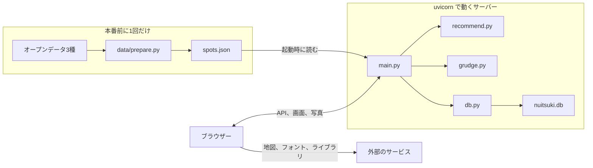
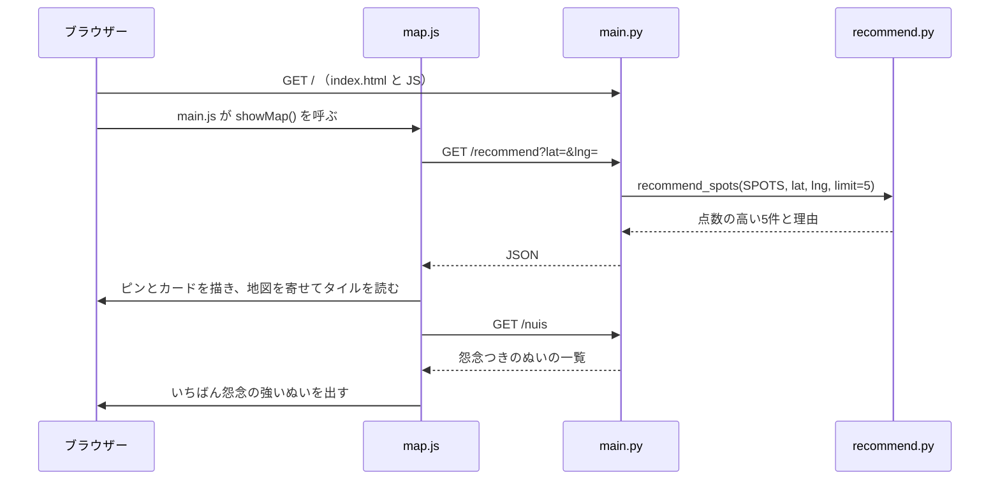

# コードの読み方

バイブコーディングで作った「ぬい憑き」の中身を、書いた本人が読んで理解するための説明書です。すべてのファイルについて、役割、仕組み、重要なコードをまとめています。

機能や発表の説明は [overview.md](overview.md)、API の項目は [api.md](api.md)、データの出典は [data/README.md](../data/README.md) にあります。この文書では、それらがコードでどう実現されているかを説明します。

内容は2026年11月6日時点のブランチ `tkg28/ar-from-nuis`（PR #29）に合わせています。コードを変えたら、この文書も直してください。

## 目次

1. [最初に読む順番](#1-最初に読む順番)
2. [全ファイルの一覧](#2-全ファイルの一覧)
3. [動くときの流れ](#3-動くときの流れ)
4. [バックエンド](#4-バックエンド)
5. [データの前処理](#5-データの前処理)
6. [画面](#6-画面)
7. [AR](#7-ar)
8. [テスト](#8-テスト)
9. [よくある変更の手順](#9-よくある変更の手順)
10. [動かないときの調べ方](#10-動かないときの調べ方)
11. [知っておきたい制限と残っているコード](#11-知っておきたい制限と残っているコード)
12. [用語集](#12-用語集)

## 1. 最初に読む順番

全体をつかむなら、次の順に読むと分かりやすいです。短いファイルから、データの流れに沿って進みます。

1. [backend/app/grudge.py](../backend/app/grudge.py)：このアプリの中心である怨念の計算。39行です。
2. [backend/app/main.py](../backend/app/main.py)：API の入口。5つの API と画面の配信を受け持ちます。
3. [backend/app/recommend.py](../backend/app/recommend.py)：技術の見どころである推薦の点数と理由。
4. [frontend/js/main.js](../frontend/js/main.js)：画面の切り替え。
5. [frontend/js/map.js](../frontend/js/map.js) と [frontend/js/visit.js](../frontend/js/visit.js)：地図から記録までの流れ。
6. [frontend/ar/main.js](../frontend/ar/main.js) と [frontend/ar/puppet.js](../frontend/ar/puppet.js)：AR の起動と、ぬいを動かす仕組み。

## 2. 全ファイルの一覧

行数は目安です。

### リポジトリの直下

| ファイル | 役割 |
|---|---|
| `README.md` | プロジェクトの入口。概要、動かし方、資料へのリンク |
| `AGENTS.md` | AI に実装を頼むときの決まり |
| `CLAUDE.md` | `AGENTS.md` を読み込むだけのファイル |
| `.gitignore` | git に入れないもの（元データ、写真、データベースなど） |

### backend/：API のサーバー

| ファイル | 行数 | 役割 |
|---|---:|---|
| `backend/app/__init__.py` | 1 | `app` をパッケージにするためのファイル |
| `backend/app/main.py` | 266 | API の入口。写真と画面も配る |
| `backend/app/db.py` | 162 | SQLite の読み書き |
| `backend/app/grudge.py` | 39 | 怨念の計算 |
| `backend/app/recommend.py` | 203 | 推薦の点数と理由 |
| `backend/data/spots.json` | - | 推薦地点483件。`data/prepare.py` が作る |
| `backend/scripts/seed.py` | 97 | デモ用のデータを入れる |
| `backend/scripts/demo_photos/` | - | デモ用の画像。ふわまるは写真（`nui_fuwamaru.jpg`）で、ほかは仮のイラスト。ぬい3枚（`nui_fuwamaru.jpg`、`nui_konpeito.svg`、`nui_mochimochi.svg`）と訪問3枚（`visit_cafe.svg`、`visit_fujimi.svg`、`visit_muza.svg`） |
| `backend/tests/test_recommend.py` | 204 | 前処理、推薦、`GET /recommend` のテスト16件 |
| `backend/tests/test_frontend_files.py` | 16 | 画面のファイルの配信のテスト1件 |
| `backend/requirements.txt` | 3 | サーバーに必要なもの（FastAPI、uvicorn、python-multipart） |
| `backend/requirements-dev.txt` | 4 | テストに追加で必要なもの（pytest、httpx、pandas） |

`backend/nuitsuki.db`（データベース）と `backend/uploads/`（写真）は動かすと作られ、git には入りません。

### data/：前処理

| ファイル | 行数 | 役割 |
|---|---:|---|
| `data/prepare.py` | 433 | オープンデータから `spots.json` を作る |
| `data/README.md` | 200 | データの出典、作り方、推薦のルール |
| `data/requirements.txt` | 2 | 前処理に必要なもの（pandas、NumPy） |

### frontend/：画面

| ファイル | 行数 | 役割 |
|---|---:|---|
| `frontend/index.html` | 169 | 1ページの骨組み。画面ごとの `<section>` がある |
| `frontend/css/style.css` | 1184 | 画面全体の見た目 |
| `frontend/js/main.js` | 109 | URL の `#` で画面を切り替える |
| `frontend/js/api.js` | 117 | API の呼び出しをまとめる |
| `frontend/js/ui.js` | 165 | 共通の部品（顔、ゲージ、朱印など）と怨念の段階 |
| `frontend/js/map.js` | 366 | 地図と推薦カード |
| `frontend/js/spot-detail.js` | 187 | 地点の詳細のシート |
| `frontend/js/visit.js` | 340 | 訪問の記録と結果の演出 |
| `frontend/js/nuis.js` | 339 | ぬいの一覧と思い出 |
| `frontend/js/register.js` | 145 | ぬいの登録 |
| `frontend/mock/` | - | API の代わりの JSON（`nuis.json`、`recommend.json`、`visits.json`） |

### frontend/ar/：AR のページ

| ファイル | 行数 | 役割 |
|---|---:|---|
| `frontend/ar/index.html` | 61 | AR のページ。ライブラリの読み込み先を決める |
| `frontend/ar/main.js` | 209 | カメラと MindAR を起動し、全体を動かす |
| `frontend/ar/config.js` | 38 | ぬいと名札の寸法 |
| `frontend/ar/effects.js` | 185 | オーラ、人魂、吹き出し |
| `frontend/ar/puppet.js` | 229 | カメラ映像のぬいを切り取って動かす |
| `frontend/ar/marker.js` | 123 | 名札の模様を描く、照合データを作る |
| `frontend/ar/marker.html` | 64 | 名札の印刷ページ |
| `frontend/ar/marker.mind` | - | 名札の照合データ（バイナリ） |
| `frontend/ar/style.css` | 150 | AR のページの見た目 |
| `frontend/ar/README.md` | 57 | AR の動かし方と注意 |

### docs/：文書

| ファイル | 役割 |
|---|---|
| `docs/design.md` | 全体設計、優先順位、怨念の計算 |
| `docs/api.md` | API の項目と `spots.json` の形 |
| `docs/overview.md` | 発表と質疑のための機能のまとめ |
| `docs/code-guide.md` | この文書 |
| `docs/tasks/backend-data.md` | バックエンドAの作業の指示書 |
| `docs/tasks/backend-api.md` | バックエンドBの作業の指示書 |
| `docs/tasks/frontend-main.md` | フロントAの作業の指示書 |
| `docs/tasks/frontend-nui.md` | フロントBの作業の指示書 |

## 3. 動くときの流れ

### 全体の形

本番で動くプログラムは Python のサーバー1つです。サーバーは API に答えるだけでなく、画面の HTML、CSS、JavaScript と写真も配ります。そのため CORS の設定もビルドも要りません。



### 地図を開いたとき



### 訪問を記録したとき

1. `map.js` の `selectPlace()` が `nuituki:place-selected` というイベントを出し、URL を `#visit` に変えます。
2. `visit.js` がイベントで場所を受け取り、`showVisit()` で画面を作ります。
3. 「記録する」で `submit()` が `FormData` を作り、`POST /visits` を呼びます。
4. `main.py` の `create_visit()` が記録の前の怨念を計算し、写真を保存し、データベースに入れ、記録のあとの怨念を計算して返します。
5. `visit.js` の `renderResult()` が朱印を出し、`settle()` が数字とゲージを下げます。

### AR を開いたとき

1. 一覧か結果画面の `arLink()` が作ったリンクで、`ar/?nui=2&name=ふわまる&grudge=100` を開きます。AR はアプリとは別のページです。
2. `ar/main.js` が URL の値を読み、怨念の段階を決めます。
3. 「はじめる」で MindAR がカメラを起動し、名札を探します。
4. 名札が見つかると `onTargetFound` が呼ばれ、演出とぬいの動きが出ます。
5. 毎フレーム、`renderer.setAnimationLoop()` の中で演出を更新して描きます。

## 4. バックエンド

Python と FastAPI で書いています。`backend` フォルダで `uvicorn app.main:app --port 8000` と打つと起動します。`app.main:app` は「`app/main.py` の中の変数 `app`」という意味です。

### backend/app/main.py：API の入口

#### 起動時の処理

FastAPI の `lifespan` はサーバーの起動時と終了時に動く処理を書く場所です。`yield` より前が起動時です。

```python
@asynccontextmanager
async def lifespan(app: FastAPI):
    global SPOTS, SPOTS_BY_ID
    db.init_db()
    SPOTS = load_spots()
    SPOTS_BY_ID = {
        spot["id"]: spot for spot in SPOTS if isinstance(spot, dict) and "id" in spot
    }
    yield
```

ここで表を作り、`spots.json` をメモリに読みます。`SPOTS` は推薦に使う一覧で、`SPOTS_BY_ID` は `spot_id` から地点を素早く引くための辞書です。`spots.json` を作り直したらサーバーの再起動が必要なのは、起動時にしか読まないためです。

#### 5つの API

| 関数 | パス | 内容 |
|---|---|---|
| `get_nuis` | `GET /nuis` | ぬいの一覧を登録した順に返す |
| `create_nui` | `POST /nuis` | ぬいを登録する（状態コード 201） |
| `get_recommend` | `GET /recommend` | 推薦地点を5件返す |
| `create_visit` | `POST /visits` | 訪問を記録し、前後の怨念を返す（状態コード 201） |
| `get_nui_visits` | `GET /nuis/{nui_id}/visits` | そのぬいの訪問を新しい順に返す |

関数の引数の書き方で、FastAPI が値の受け取りと確かめを自動で行います。

```python
@app.post("/nuis", status_code=201)
def create_nui(
    name: str = Form(...),
    last_outing_date: date = Form(...),
    photo: UploadFile | None = File(None),
):
```

- `Form(...)` は、フォームの必須の項目です。`...` が必須の印です。
- `last_outing_date: date` と書くと、`2026-11-06` のような文字列を日付に変換します。変換できなければ、FastAPI が 422 を返します。
- `File(None)` は任意のファイルです。
- `get_recommend(lat: float, lng: float)` のように `Form` がない引数は、URL の `?lat=&lng=` から受け取ります。

#### 訪問の記録

`create_visit()` がこのアプリで一番大事な API です。流れは次のとおりです。

```python
    grudge_before = _grudge_of(nui)
    photo_url = _save_photo(photo, "visit")
    visit = db.create_visit(
        nui_id=nui_id,
        spot_id=spot_id,
        spot_name=spot_name,
        lat=lat,
        lng=lng,
        photo_url=photo_url,
        recommended=recommended,
    )
    grudge_after = _grudge_of(nui)
```

推薦地点かどうかは画面から送られた `spot_id` で決まります。

- `spot_id` がある：`SPOTS_BY_ID` にあれば推薦地点での記録です。地点の名前は `spots.json` から取るので、画面から送る必要はありません。なければ 404 を返します。
- `spot_id` がない：`spot_name` が必須です。なければ 422 を返します。

#### 補助の関数

| 関数 | 内容 |
|---|---|
| `load_spots` | `spots.json` を読む。なければ空の一覧を返し、起動は止めない |
| `_save_photo` | 写真を `backend/uploads/` に保存し、URL を返す。名前は `uuid4` で重ならないようにする |
| `_grudge_of` | 1体の怨念を計算する |
| `_nui_to_dict` | データベースの行を、API の Nui の形にする。怨念と訪問の数はここで計算する |
| `_visit_to_dict` | データベースの行を、API の Visit の形にする。`recommended` の 0 と 1 を真偽値に直す |

#### 画面と写真の配信

```python
class FrontendFiles(StaticFiles):
    async def get_response(self, path: str, scope):
        response = await super().get_response(path, scope)
        response.headers["Cache-Control"] = "no-cache"
        return response
```

上のコードは説明のために docstring を省いています。`Cache-Control: no-cache` がないと、ブラウザーが古い JS を使い回すことがあります。古い JS と新しい JS が混ざると import のエラーでページ全体が止まるので、使う前に毎回サーバーに確かめさせています。変わっていなければ 304 が返り、本体は送り直しません。

`app.mount("/", ...)` はファイルの最後に置きます。`/` はすべてのパスに当てはまるので、先に置くと API に届かなくなるためです。`html=True` により、`/ar/` を開くと `frontend/ar/index.html` が返ります。

### backend/app/db.py：データベース

SQLite の読み書きをまとめたファイルです。SQL はここにしか書きません。

表は2つです。

```sql
CREATE TABLE IF NOT EXISTS nuis (
    id               INTEGER PRIMARY KEY AUTOINCREMENT,
    name             TEXT NOT NULL,
    photo_url        TEXT,
    last_outing_date TEXT NOT NULL
);
```

`visits` は `nui_id`、`spot_id`、`spot_name`、`lat`、`lng`、`photo_url`、`recommended`、`created_at` を持ちます。

`grudge` と `visit_count` の列はありません。怨念は今日の日付で変わる値なので、保存すると古くなるためです。API が返すたびに計算します。

接続の開き方がこのファイルの要です。

```python
@contextmanager
def connect() -> Iterator[sqlite3.Connection]:
    """1回の処理ごとに接続を開き、終わったら閉じる。"""
    conn = sqlite3.connect(DB_PATH)
    conn.row_factory = sqlite3.Row
    conn.execute("PRAGMA foreign_keys = ON")
    try:
        yield conn
        conn.commit()
    except Exception:
        conn.rollback()
        raise
    finally:
        conn.close()
```

- `with connect() as conn:` の形で使います。成功すれば保存し、エラーなら取り消し、どちらでも接続を閉じます。
- `sqlite3.Row` にすると、`nui["name"]` のように列の名前で値を取れます。
- FastAPI は `def` で書いた API を別々のスレッドで動かします。SQLite の接続はスレッドをまたいで使えないので、処理ごとに開き直しています。

SQL の値は `?` で渡します。文字列をつなげて SQL を作らないので、SQL インジェクションを防げます。

| 関数 | 内容 |
|---|---|
| `init_db` | 表と `uploads/` を用意する。`CREATE TABLE IF NOT EXISTS` なので何度呼んでもよい |
| `reset_db` | データを空にして番号を1に戻す。`seed.py` が使う |
| `list_nuis`、`get_nui`、`create_nui` | ぬいの読み書き |
| `list_visits` | 訪問を新しい順に返す |
| `list_visits_for_grudge` | 怨念の計算用に訪問を返す。並び順は問わない |
| `create_visit` | 訪問を入れる。`created_at` を渡さなければ今の時刻にする |

### backend/app/grudge.py：怨念の計算

全文でも短いファイルです。

```python
GRUDGE_PER_DAY = 2
CALM_RECOMMENDED = 30
CALM_OTHER = 10
```

```python
def calc_grudge(last_outing_date: date, visits: list[dict], today: date) -> int:
    days = max(0, (today - last_outing_date).days)
    grudge = min(100, days * GRUDGE_PER_DAY)

    for visit in visits:
        if _is_recommended(visit):
            grudge -= CALM_RECOMMENDED
        else:
            grudge -= CALM_OTHER

    return max(0, grudge)
```

（docstring は省いています）

順番に意味があります。

1. 放置日数から点を出し、先に100で頭打ちにします。
2. そこから訪問の数だけ引きます。
3. 最後に0より下がらないようにします。

訪問しても「最後に連れ出した日」は変わりません。つまり、怨念を下げるのは訪問の記録だけで、日が経てば放置の点は増えます。放置の点の上限は100なので、鎮めた点が100以上になると、そのぬいはずっと0です。

`today` を引数で受け取るのは、テストで日付を自由に変えられるようにするためです。

### backend/app/recommend.py：推薦

外から呼ばれる関数は `recommend()` です。点数を付ける、同じ建物を除く、カテゴリの偏りを抑える、理由を書く、の順に進みます。

#### 点数の計算

```python
WEIGHT_NEAR = 0.45  # 現在地からの近さ
WEIGHT_SIZE = 0.35  # 地点の大きさ（施設は種類）
WEIGHT_STATION = 0.2  # 駅からの近さ
```

```python
def score_parts(spot: dict, lat: float, lng: float) -> dict | None:
    """点数の内訳（重みを掛けた値）と、現在地からの距離。MAX_DISTANCE_M より遠い地点は None。"""
    distance = distance_m(lat, lng, spot["lat"], spot["lng"])
    near = 1 - distance / MAX_DISTANCE_M
    if near <= 0:
        return None
```

各要素は0〜1にそろえてから重みを掛けます。

| 要素 | 計算 | 例 |
|---|---|---|
| 近さ | `1 - 距離 / 3000m` | 300m なら 0.9 |
| 大きさ（公園） | `(log10(面積) - 3) / 3` | 1,000㎡ で 0、100万㎡ で 1 |
| 大きさ（施設） | `FACILITY_SCORES` の値 | 博物館・美術館は 0.9 |
| 駅の近さ | `1 - 駅までの距離 / 2000m` | 400m なら 0.8 |

面積に対数を使うのは、広さの差が大きすぎるためです。そのまま割り算すると、数十万㎡の公園以外はほぼ0点になります。

`distance_m()` は緯度と経度から2点の距離を求める式（ハーバサイン公式）です。地球を球として計算します。

`score_spot()` は内訳の合計を重みの合計で割ります。`EXTRA_RULES` でデータを足して重みの合計が1を超えても、点数は0〜1のままです。

#### 地点の選び方

`recommend()` の処理を順に見ます。

```python
    scored.sort(key=lambda item: (-item[0], item[1]["id"]))
```

点数の高い順に並べます。点数が同じならIDの順にするので、同じ入力なら必ず同じ結果になります。乱数は使っていません。

```python
        if all(distance_m(spot["lat"], spot["lng"], s["lat"], s["lng"]) >= SAME_PLACE_M for _, s in distinct):
            distinct.append(item)
```

すでに選んだ地点から50m未満の地点は、同じ建物とみなして飛ばします。アートガーデンかわさきと川崎図書館が同じビルにあるためです。`limit * 4` 件（20件）集まったら打ち切ります。

```python
    picked, counts = [], {}
    for item in distinct:
        category = item[1]["category"]
        if counts.get(category, 0) < MAX_PER_CATEGORY:
            picked.append(item)
            counts[category] = counts.get(category, 0) + 1
    picked += [item for item in distinct if item not in picked]
    picked = sorted(picked[:limit], key=lambda item: (-item[0], item[1]["id"]))
```

1つのカテゴリからは3件までとし、公園と施設が両方出るようにします。`picked +=` の行で、選ばなかった地点を後ろにつなげています。ほかのカテゴリが足りず5件に届かないときは、この分で埋めます。最後に点数の順に並べ直します。

#### 推薦理由の文

`make_reason()` は、近さ、大きさ、駅の3つの文を作り、点数への寄与が大きい順に並べます。

```python
    order = sorted(phrases, key=lambda key: -parts.get(key, 0.0))
    return "。".join(phrases[key] for key in order)
```

そのため、広さが決め手の公園は広さから、近さが決め手の施設は近さから理由が始まります。画面は「。」で区切って1行ずつ表示し、最初の行を濃くします。「半径3km以内の公園で一番広い」は `park_ranks()` が求めた順位から作ります。

#### 新しいデータの受け皿

`EXTRA_RULES` に項目を足すと、点数と理由に自動で加わります。

```python
EXTRA_RULES: dict[str, dict] = {}
```

`check_extra_rules()` はファイルを読み込むときに動き、`full` が0などの書き間違いがあれば、サーバーの起動時にエラーで知らせます。手順は [9章](#9-よくある変更の手順) にあります。

### backend/scripts/seed.py：デモ用のデータ

`python scripts/seed.py` で、データベースを空にしてから、ぬい3体と訪問3件を入れます。

| 番号 | ぬい | 放置日数 | 訪問 | 怨念 |
|---:|---|---:|---|---:|
| 1 | もちもち | 45日 | 推薦地点1件、それ以外1件 | 50 |
| 2 | ふわまる | 60日 | なし | 100 |
| 3 | こんぺいとう | 20日 | 推薦地点1件 | 10 |

日付は「今日から何日前」で作るので、いつ実行しても同じ怨念になります。**手元のデータはすべて消えます。** `db.reset_db()` はデータベースだけを空にするので、`backend/uploads/` の写真は残り続けます。

## 5. データの前処理

### data/prepare.py：spots.json を作る

本番前に1回だけ、リポジトリの直下で `python data/prepare.py` と実行します。結果は git に入っているので、ふだんは実行しません。`main()` がそのまま処理の流れです。

```python
def main() -> None:
    spots = pd.concat([load_parks(), load_facilities()], ignore_index=True)
    spots = attach_nearest_station(spots, load_stations())
    for source in EXTRA_SOURCES:
        shapes = load_shapes(
            EXTRA_DIR / source["file"], source.get("lat_col", "緯度"), source.get("lng_col", "経度")
        )
        spots = attach_extra(spots, source, shapes)
```

| 関数 | 内容 |
|---|---|
| `raw_path` | 元のデータの場所を返す。なければダウンロードする |
| `load_parks` | PLATEAU の公園を読み、1,000㎡未満と霊園を外す |
| `load_facilities` | 公共施設一覧を読み、6種類の施設だけを残す。「移転」とある施設を外す |
| `load_stations` | 駅の位置と乗降客数を読み、駅名でまとめる |
| `attach_nearest_station` | 各地点に一番近い駅を結びつける。全部の駅との距離を比べる |
| `to_spot` | 1行を `docs/api.md` の形の辞書にする |
| `_text`、`_year`、`_hours`、`_amenities`、`_plain` | 値を整える小さな関数 |

重要な点を挙げます。

- 公園のIDは絞り込む前のファイルの並び順で付けます（`park_0798` など）。元のデータに ID がないためです。元のデータの順が変わるとIDも変わります。
- 公共施設一覧は Shift_JIS なので `encoding="cp932"` で読みます。
- 駅は路線ごとに線のデータがあるので、線の点の平均を位置とし、駅名でまとめて乗降客数を合計します。
- `attrs` は推薦の点数に使う値、`details` は画面に出すだけの値です。

### あとから足すデータの計算

`EXTRA_SOURCES` に足したデータは、`load_shapes()` が線分の配列に変換します。点は長さ0の線分、面は外周の線分として扱うので、以降の計算を1つにまとめられます。

`distances_to_shapes()` は NumPy で全線分の距離を一度に計算します。

```python
    t = np.clip(t, 0.0, 1.0)
    d = np.hypot(ax + t * dx, ay + t * dy)
    result = np.full(shapes["count"], np.inf)
    np.minimum.at(result, shapes["feature"], d)
```

地点を原点とした平面に直し、原点から各線分までの最短距離を求めて、地物ごとに最小値を取ります。`t` は線分の上で一番近い点の位置で、0〜1に収めることで線分の外に出ないようにしています。

面の中にあるかは、原点から右へ伸ばした線が面の縁と奇数回交わるかで調べます。中にあれば距離を0にします。

`attach_extra()` は `mode` に合わせて、`count`（半径内の数）か `nearest`（一番近い距離）を列に足します。

## 6. 画面

ビルドなしの HTML、CSS、JavaScript です。ファイルを保存して再読み込みするだけで反映されます。

### frontend/index.html：骨組み

1ページの中に、画面ごとの `<section>` がすべて入っています。表示中の1つにだけ `is-active` クラスが付きます。

```css
.screen { display: none; }
.screen.is-active { display: block; }
.hidden { display: none !important; }
```

| `<section>` の id | URL | 描くファイル |
|---|---|---|
| `map` | `#map` | `map.js` |
| `visit` | `#visit` | `visit.js` |
| `nuis` | `#nuis` | `nuis.js` |
| `nui` | `#nui/1` | `nuis.js` |
| `register` | `#register` | `register.js` |

ほかに知っておきたい点です。

- `<link rel="modulepreload">` は、地図の画面に要る JS を先にまとめて読む指定です。地図が出るまでの時間を縮めています。
- Leaflet は `<script>` で読むので、JS から `L` という名前で使えます。
- 地点の詳細と写真の拡大は `<dialog>` で、JS が必要になってから作ります。
- `data-pending` の文は分担して作っていたときの名残です。画面の JS の読み込みに失敗すると、「ここはフロントB の担当です」と出ます。

### frontend/js/main.js：画面の切り替え

URL の `#` を見て画面を切り替えます。ページの再読み込みはありません。

```js
async function render() {
  const { name, param } = parseHash(location.hash);
  showSection(name);

  // 地図のない画面から開いたときは、待たずにフォントを読む
  if (name !== 'map') loadFonts();

  if (name === 'map') showMap();
  else if (name === 'visit') showVisit();
  else await callLazyScreen(name, param);
}

window.addEventListener('hashchange', render);
```

- `parseHash()` は `#nui/1` を `{ name: 'nui', param: 1 }` に分けます。知らない名前は `map` にします。
- `showSection()` は `is-active` を付け替え、下のメニューの選択を変え、`document.body.dataset.route` に画面の名前を入れます。CSS はこの値を見て、記録の画面でメニューを隠します。
- `nuis.js` と `register.js` は `import()` で必要になってから読みます。読み込みに失敗しても画面全体が止まりません。

フォントは約680KBあり、地図のタイルと回線を取り合います。そこで `loadFonts()` は地図のタイルを読み終えた合図（`nuituki:map-ready`）か、5秒経ったときに動きます。

### frontend/js/api.js：API の呼び出し

ほかの JS は `fetch` を直接書かず、ここの関数を使います。

| 関数 | API |
|---|---|
| `getNuis` | `GET /nuis` |
| `createNui` | `POST /nuis` |
| `getRecommend` | `GET /recommend` |
| `createVisit` | `POST /visits` |
| `getVisits` | `GET /nuis/{id}/visits` |

失敗すると `errorMessage()` が FastAPI の `{ "detail": "..." }` を読み、その文で `Error` を投げます。各画面はこれを `catch` して表示します。

`USE_MOCK` を `true` にすると、API の代わりに `frontend/mock/` の JSON を読みます。API がない段階で画面を作るための仕組みです。今は `false` です。

写真を送る API は `FormData` を渡します。`fetch` の `body` に `FormData` を渡すと、ブラウザーが `multipart/form-data` の形にしてくれます。

### frontend/js/ui.js：共通の部品

複数の画面と AR で使う部品です。怨念の段階はここで決めます。

```js
export function grudgeStage(grudge) {
  if (grudge <= 0) return { label: '鎮まった', key: 'calm', line: 'また連れてってね' }; // 0
  if (grudge <= 39) return { label: '弱い', key: 'weak', line: '…まあ、許してあげてもいい' }; // 1〜39
  if (grudge <= 69) return { label: '中くらい', key: 'medium', line: '最近ずっと置いていくよね' }; // 40〜69
  return { label: '強い', key: 'strong', line: 'ゆるさない…' }; // 70〜100
}
```

`key` は CSS のクラスになります（`is-calm`、`is-weak`、`is-medium`、`is-strong`）。CSS がクラスごとに色を決めるので、段階の色を変えるときは CSS だけ直せば済みます。`line`（セリフ）は今のところ AR のページでしか使っていません。

| 関数 | 作るもの |
|---|---|
| `clampGrudge` | 怨念を0〜200の整数にそろえる |
| `arLink` | AR のページへのリンク。怨念が0なら「鎮まった様子を見る」 |
| `nuiFace` | 写真がないときの顔の SVG。段階で表情が変わる |
| `nuiAvatar` | 丸い写真。写真がなければ `nuiFace` を使う |
| `stageChip` | 「強い」などの小さな札 |
| `reasonList` | 推薦理由を「。」で分けて箇条書きにする |
| `grudgeGauge` | 怨念のゲージ。`before` を渡すと鎮まった分を斜線で残す |
| `seal` | 朱印。推薦地点は朱色の「鎮」、それ以外は墨色の「記」 |
| `openPhoto` | 写真を画面いっぱいに出す |

### frontend/js/map.js：地図と推薦カード

一番大きな画面です。地図のライブラリは Leaflet です。

#### 初期化

```js
export function showMap() {
  if (!map) initMap();
  // 隠れている間に地図を作ると大きさがずれるので、表示のたびに直す
  map.invalidateSize();
  // 記録のあとで怨念が変わるので、表示のたびに取り直す
  renderBuddy();
}
```

`map` が `null` のときだけ `initMap()` を呼ぶので、地図は1回しか作りません。

#### 地図のタイルを読む順番

タイルは地図の絵の画像です。読み込みの無駄を減らすため、次の順に進みます。

1. `initMap()` でタイルを作りますが、まだ地図に足しません。
2. 推薦地点が届いたら、`fitBounds()` で地図を寄せます。
3. `showTiles()` でタイルを足します。寄せる前のズームのタイルを読まずに済みます。
4. API が遅いときのために、3秒経ったら `setTimeout(showTiles, TILE_WAIT_MS)` でタイルを出します。

```js
    detectRetina: window.devicePixelRatio >= SHARP_TILE_MIN_RATIO && !WIDE.matches,
```

`detectRetina` は高解像度の画面で1段細かいタイルを半分の大きさで出す指定です。地図がくっきりしますが、タイルの数が増えて読み込みは遅くなります（[overview.md](overview.md) に測定があります）。そのため、スマホの幅だけで有効にしています。

#### 現在地と推薦

`setCurrent()` が現在地を変え、`loadRecommend()` を呼びます。地図を押したときも、位置情報のボタンを押したときも、ここを通ります。

```js
  map.on('click', (e) => {
    setCurrent(e.latlng.lat, e.latlng.lng, '押した場所を現在地にしました');
  });
```

位置情報は自動で取りません。会場が川崎市の外だと推薦地点が出ないためです。

#### ピンとカードの連動

`drawSpots()` がピンとカードを同じ順に作ります。`setActive(index)` がその番号のピンとカードに `is-active` を付けます。

- ピンを押す：`setActive(i, { scrollCard: true })` でカードを送ります。
- カードを横に送る：`onListScroll()` が真ん中のカードを探して選びます。
- PC の幅：カードは縦に並ぶので、スクロールでは選びません。

`ignoreScrollUntil` は、ピンを押してカードが動いている間に、スクロールで選び直さないための時刻です。

`mapPadding()` は、シートに隠れる分を引いて地図を寄せるための余白を計算します。

#### ほかの画面との連絡

`getCurrentLocation()` を `visit.js` に公開しています。場所の選択はイベントで伝えます。

```js
function selectPlace(spot, lat, lng) {
  document.dispatchEvent(new CustomEvent('nuituki:place-selected', {
    detail: { spot, lat, lng },
  }));
  location.hash = '#visit';
}
```

`spot` が `null` なら、推薦地点ではない場所での記録です。

`renderBuddy()` は、いちばん怨念の強いぬいを地図の上に出します。

### frontend/js/spot-detail.js：地点の詳細

`openSpotDetail(spot, onRecord)` が `<dialog>` を作って開きます。`GET /recommend` が `details` と `attrs` を返しているので、詳細を開くときに API は呼びません。

値がある項目だけを `infoRow()` で並べます。公園には住所がなく、施設には広さがないためです。

「経路を見る」は Google マップの URL を開くだけで、経路の計算はしていません。

```js
    `https://www.google.com/maps/dir/?api=1&destination=${spot.lat},${spot.lng}`,
```

`dialog.showModal()` を使うと、Esc キーで閉じる動きと、背景の操作を止める動きをブラウザーが受け持ちます。

### frontend/js/visit.js：訪問の記録

状態は `place`（記録する場所）と `nuisById`（選べるぬい）で持ちます。

| 関数 | 内容 |
|---|---|
| `showVisit` | `#visit` を開くたびにフォームを初期化する |
| `renderPlace` | 推薦地点なら名前と理由、それ以外なら名前の入力欄を出す |
| `renderNuiOptions` | ぬいを怨念の強い順に並べ、一番強いぬいを選んでおく |
| `showPreview` | 選んだ写真を送る前に表示する |
| `submit` | 入力を確かめ、`FormData` を作って送る |
| `renderResult` | 朱印、数字、ゲージ、次のボタンを出す |
| `settle` | 数字とゲージを下げるアニメーション |

`showPreview()` は `URL.createObjectURL()` で写真の仮の URL を作ります。使い終わった URL を `URL.revokeObjectURL()` で消して、メモリを解放しています。

結果の演出は CSS と JS の組み合わせです。朱印は CSS のアニメーション（`.seal.is-stamped`）で押され、JS は押し終わるころ（550ms後）に数字を下げ始めます。

```js
      const value = before - (before - after) * (1 - (1 - t) ** 3);
```

`t` は0から1へ進む時間です。`1 - (1 - t) ** 3` で、最初は速く、最後はゆっくり止まる動きになります。

`renderResult()` の最後で `place = null` にして、同じ場所で続けて記録しないようにしています。`prefers-reduced-motion` の設定がある端末では、アニメーションせずにすぐ結果を出します。

### frontend/js/nuis.js：一覧と思い出

| 関数 | 内容 |
|---|---|
| `showNuis` | `#nuis` を描く。一番怨念の強いぬいのカードと、全員のタイル |
| `createHero` | 一番上のカード。「連れ出す場所を探す」と「憑依を見る」がある |
| `createNuiTile` | ぬい1体のタイル |
| `createAddTile` | 登録の画面へのタイル |
| `showNuiDetail` | `#nui/1` を描く |
| `createProfile` | そのぬいの写真、怨念、思い出の数、朱印の数、最後に連れ出した日 |
| `createMemory` | 訪問1件のカード。写真を押すと拡大する |
| `getContainer`、`hidePending`、`createError`、`createEmpty`、`formatDate` | 小さな補助 |

ぬいの詳細を返す API はないので、`showNuiDetail()` は一覧と訪問を一緒に取り、一覧からそのぬいを探します。

```js
    const [nuis, visits] = await Promise.all([getNuis(), getVisits(nuiId)]);
```

### frontend/js/register.js：登録

`showRegister()` がフォームを1回だけ作ります。`submitForm()` が入力を確かめ、`createNui()` を呼び、成功したら `location.hash = '#nuis'` で一覧に移ります。

- 写真を選ばないと空のファイルが `FormData` に入るので、`formData.delete('photo')` で除きます。
- `form.last_outing_date.max` に今日を入れて、未来の日を選べないようにしています。
- ボタンを `disabled` にして、二重に送らないようにしています。

### frontend/css/style.css：見た目

コメントで章に分かれています。

| 章 | 内容 |
|---|---|
| `:root` | 色、影、文字などの変数。色を変えるときはまずここ |
| 画面の枠 | ページの余白、上の帯 |
| ボタン | 押すと沈むボタン。`.is-primary`（紫）、`.is-shu`（朱） |
| ぬいの顔、写真、怨念 | 顔、札、ゲージ、朱印。段階ごとの色 |
| 地図 | ピン、現在地の印、下のシート、推薦カード、詳細のシート |
| 訪問の記録 | ぬいの選択、写真の枠、結果の演出 |
| ぬいの一覧、思い出、登録 | 各画面 |
| 下のメニュー | `.navbar` |
| 広い画面 | `@media (min-width: 900px)` でシートを左のパネルにする |

`900px` という幅は `map.js` の `WIDE` と同じ値にする必要があります。CSS と JS の両方で画面の形を判断しているためです。`ar/main.js` の `WIDE_SCREEN` も同じ幅を使います。

## 7. AR

AR は3つの処理の組み合わせです。

| 処理 | 担当 | 内容 |
|---|---|---|
| 名札の追跡 | MindAR | カメラ映像の中の名札の位置と向きを計算する |
| 憑依の演出 | `effects.js` | オーラ、人魂、吹き出しを 3D で重ねる |
| ぬいの動き | `puppet.js` | カメラ映像からぬいを切り取って変形させる |

### frontend/ar/index.html：ライブラリの読み込み

npm がないので、`importmap` で「`three` と書いたらこの URL」と決めています。

```html
          "three": "https://cdn.jsdelivr.net/npm/three@0.160.0/build/three.module.js",
```

そのためインターネットが必要です。AR のページを開いたときにだけ読むので、地図の画面は遅くなりません。

### frontend/ar/config.js：寸法

座標の単位は名札の幅です。名札の幅が1で、原点は名札の中心です。

```js
export const NUI_HEIGHT = NUI_CM / MARKER_CM;
// ぬいの体の中心（マーカーの中心から見た高さ）
export const NUI_CENTER_Y = (0.5 - TAG_HEIGHT_RATIO) * NUI_HEIGHT;
```

全長14cmのぬいに4cmの名札なら、`NUI_HEIGHT` は3.5です。名札がぬいの下から36%の高さにあるので、体の中心は名札の中心より `0.14 * 3.5 = 0.49` だけ上です。

`PARTS` は、ぬいの輪郭の楕円と、首や腕の位置です。ぬいの高さを1とした値で決めています。別のぬいで合わないときは、ここを直します。

URL の値（`?markerCm=3&nuiCm=14&tagRatio=0.36&tilt=10&hideTag=0`）で、コードを直さずに試せます。

### frontend/ar/main.js：全体の起動

ページを開くと、URL から `grudge`、`name`、`nui` を読みます。`grudge` がなければ100です。

カメラの解像度は MindAR を起動する前に `getUserMedia` を包んで指定しています。

```js
  media.getUserMedia = (constraints) => getUserMedia({ ...constraints, video: { ...constraints.video, ...CAMERA } });
```

MindAR は解像度を指定しないので、何もしないと 640×480 になることが多く、名札が小さく映って認識しにくくなるためです。

`start()` の流れは次のとおりです。

1. 自分の画像を選んでいれば照合データを作り、なければ `marker.mind` を使います。
2. `MindARThree` を作り、`mindar.addAnchor(0)` で名札に付いた 3D の入れ物を受け取ります。
3. `nuiBody` を作って `TAG_TILT_DEG` の分だけ傾け、演出をその中に入れます。
4. `mindar.start()` でカメラを起動します。
5. カメラ映像が要るので、起動のあとに `createPuppet()` で動くぬいを作ります。
6. `renderer.setAnimationLoop()` で毎フレームの更新を始めます。

```js
    renderer.setAnimationLoop(() => {
      const delta = clock.getDelta();
      // 見失っているあいだは位置が古いので、映像を切り取って動かす処理だけ止める
      puppet.setTracking(mindar.controller.trackingStates[0]?.isTracking ?? true);
      parts.forEach((p) => p.update(clock.elapsedTime, delta, camera));
      renderer.render(scene, camera);
    });
```

認識の設定は `TRACKING` にあります。`warmupTolerance: 1` はすぐ出す設定、`missTolerance: 30` は30フレーム見失ってから消す設定です。動かすと一瞬見失うことが多いので、演出が途切れないようにしています。

`?debug=1` を付けると、`showDebugInfo()` がカメラの解像度と処理の回数を画面に出します。

### frontend/ar/effects.js：憑依の演出

見せ方は段階ごとの表 `LOOKS` にまとまっています。

```js
const LOOKS = {
  strong: { aura: 'rgba(225, 40, 70, 1)', wisp: 'rgba(255, 130, 90, 1)', wisps: 3, shake: 1, deform: 1 },
  medium: { aura: 'rgba(160, 60, 255, 1)', wisp: 'rgba(110, 200, 255, 1)', wisps: 3, shake: 0.6, deform: 0.75 },
  weak: { aura: 'rgba(90, 140, 255, 1)', wisp: 'rgba(110, 200, 255, 1)', wisps: 2, shake: 0.25, deform: 0.5 },
  calm: { aura: 'rgba(255, 225, 140, 1)', wisp: 'rgba(255, 225, 140, 1)', wisps: 0, shake: 0, deform: 0.3 },
};
```

| 関数 | 内容 |
|---|---|
| `hauntLook` | 怨念から `LOOKS` の1行を選ぶ |
| `ringTexture` | オーラの輪の画像を canvas に描く。真ん中は透明にして、ぬいが白く飛ばないようにする |
| `glowTexture` | 人魂の光の画像を canvas に描く |
| `createBubble` | 吹き出しを canvas に描く。長いセリフは文字を小さくする |
| `keepOnScreen` | 吹き出しが画面の外へ出そうなら内側へ寄せる |
| `createHauntEffect` | 全部を組み立てる。`setActive` と `update` を持つ物を返す |

`createHauntEffect` と `createPuppet` はどちらも `object`、`setActive`、`update` を持つ形です。`main.js` はこの共通の形だけを使い、`parts.forEach((p) => p.update(...))` でまとめて動かします。

### frontend/ar/puppet.js：ぬいを動かす仕組み

一番難しいファイルです。本物のぬいは動かせないので、画面の上で動いて見せています。

#### 考え方

1. ぬいの位置に、細かく分割した板を置きます。
2. 板の各点について、「変形する前にこの点が画面のどこに映るか」を計算し、その位置のカメラ映像を板に貼ります。何も変形させなければ、板は本物のぬいとぴったり重なります。
3. 板を変形させると、貼った映像も一緒に動きます。

これを GPU で動かすプログラム（シェーダー）で書いています。頂点シェーダーが板の形を変え、フラグメントシェーダーが色を決めます。

#### 頂点シェーダー：形を変える

`vLocal = position` で変形する前の位置を保存してから、次の順に変形します。

```glsl
    // 頭: 首から上をゆっくり傾ける
    float headWeight = smoothstep(uNeckY - 0.05, uNeckY + 0.12, q.y);
    q = mix(q, rotateAround(q, vec2(0.0, uNeckY), sin(uTime * 2.3) * 0.16 * k), headWeight);
```

- `smoothstep` で「どのくらい頭に含まれるか」を0〜1で求めます。首のあたりで徐々に変わるので、境目が割れません。
- `mix` で、回転させた位置と元の位置を、その割合で混ぜます。
- 腕は肩を支点に振り、体全体は足もとを支点に揺らして跳ねさせます。
- `k = uStrength * uDeform` が動きの大きさです。怨念が弱いほど `deform` が小さくなります。

#### フラグメントシェーダー：映像を貼る

```glsl
  vec2 videoUv(vec3 local) {
    vec4 clip = uProjectOriginal * vec4(local, 1.0);
    vec2 ndc = clip.xy / clip.w;
    vec2 px = vec2((ndc.x * 0.5 + 0.5) * uContainer.x, (0.5 - ndc.y * 0.5) * uContainer.y);
    vec2 uv = (px - uVideoRect.xy) / uVideoRect.zw;
    return vec2(uv.x, 1.0 - uv.y);
  }
```

これが仕組みの中心です。`vLocal`（変形する前の位置）を画面の座標に直し、そこからカメラ映像の中の位置を求めます。変形する前の位置で映像を取るので、板がどう動いても、貼る映像はぬいのままです。

`uVideoRect` は、画面の中でカメラ映像が置かれている位置と大きさです。MindAR が映像を CSS で配置するので、`onBeforeRender` で `video.style` から読みます。

#### 3枚の重ね方

| 順 | 物 | 内容 |
|---:|---|---|
| 1 | `cover` | ぬいの楕円の中を、すぐ外側の映像で塗る。動いたあとに本物のぬいが見えないようにする |
| 2 | `puppet` | 切り取って動かすぬい |
| 2.5 | `tagCover` | 名札を、まわりの毛の色で塗る |
| 3 | `effects.js` の演出 | オーラ、人魂、吹き出し |

`renderOrder` でこの順に描きます。`cover` だけ `uDeform` を0にしているので、`cover` は変形しません。ほかの `uniforms` は同じ物を共有しています。

`cover` は、外側の21点の映像を混ぜてぼかしています。1点だけを引き伸ばすと、放射状の筋が見えるためです。ぬいの輪郭は楕円で近似しているので、ぬいのまわりの床も少し一緒に動きます。

#### 見失ったとき

`setTracking(false)` になると、`uStrength` を速く0に近づけます。見失っている間は位置が古いので、ずれた映像を貼らないようにするためです。演出（`effects.js`）は `missTolerance` の間は残ります。

### frontend/ar/marker.js と marker.html：名札

`drawMarker()` は種つきの乱数で図形を描きます。同じ種なら毎回同じ模様になるので、印刷した名札と照合データが一致します。追跡は角の多い模様のほうが安定するので、大きさと向きの違う図形を散らしています。文字を使わないのは、端末ごとに字形が変わるためです。

`marker.mind` は、この模様の特徴点を MindAR の `Compiler` でまとめたデータです。作るのに時間がかかるので、あらかじめ作って置いています。**模様を変えたら作り直す必要があります。** `marker.html` の「照合データ（marker.mind）を作る」を押し、ダウンロードしたファイルで置き換えます。

`marker.html` は `canvas.style.width` を `MARKER_CM` に合わせるので、印刷すると4cm角になります。

`ar/main.js` の `compileTarget()` は、利用者が選んだ画像をその場でコンパイルします。結果は `compiled` に入れて使い回します。

### frontend/ar/style.css

開始画面、やめるボタン、状態の文の形です。色、文字、ボタン、札、ゲージはアプリの `css/style.css` を読み込んで使い、ここにはこのページだけの形を書きます。開始画面のぬいの写真は `ar/main.js` がぬいの一覧から探し、取れないときは段階の顔を出します。

## 8. テスト

`backend` で `python -m pytest tests` を実行します。リポジトリの直下で実行すると `app` を見つけられずに失敗します。

| テスト | 確かめていること |
|---|---|
| `test_spots_json`、`test_spots_json_details` | `spots.json` の件数と項目 |
| `test_prepare_details_helpers` | 時間や設備を整える関数 |
| `test_recommend_returns_details` | 推薦の結果に `details` が入る |
| `test_recommend_changes_with_location` | 現在地で結果が変わり、同じ入力なら同じ結果になる |
| `test_recommend_skips_same_building` | 同じ建物を除く |
| `test_recommend_mixes_categories` | カテゴリの上限を守る |
| `test_facility_reason_uses_type`、`test_reason_puts_main_factor_first` | 推薦理由の文 |
| `test_attrs_change_result` | データの値で結果が変わる |
| `test_extra_rules`、`test_check_extra_rules` | 足したデータの点数と書き間違いの検出 |
| `test_prepare_extra_points`、`test_prepare_extra_shapes` | 足したデータの距離の計算 |
| `test_recommend_api`、`test_recommend_api_far_away_returns_empty` | `GET /recommend` |
| `test_browser_must_check_frontend_files_before_reuse` | 画面のファイルに `no-cache` が付き、304 が返る |

**自動テストがないもの**は次のとおりです。

- 怨念の計算（`grudge.py`）
- ぬいと訪問の API（`GET /nuis`、`POST /nuis`、`POST /visits`、`GET /nuis/{id}/visits`）
- JavaScript の画面と AR

これらを変えたら、手で動かして確かめてください。

## 9. よくある変更の手順

### 怨念の増え方や鎮まる量を変える

`backend/app/grudge.py` の `GRUDGE_PER_DAY`、`CALM_RECOMMENDED`、`CALM_OTHER` を直し、サーバーを再起動します。文書の数字（`docs/design.md`、`docs/overview.md`）も直します。

### 段階の分け方やセリフを変える

`frontend/js/ui.js` の `grudgeStage()` を直します。`docs/design.md` の「怨念の段階」も合わせます。AR の演出は `frontend/ar/effects.js` の `LOOKS` です。

### 推薦の重みを変える

`backend/app/recommend.py` の先頭の定数を直し、サーバーを再起動します。テストが結果の文を確かめているので、`python -m pytest tests` も実行します。

### 中間発表のデータを足す

緯度と経度か GeoJSON の座標があるデータなら、コードをほとんど書かずに足せます。

1. ファイルを `data/raw/extra/` に置きます。
2. `data/prepare.py` の `EXTRA_SOURCES` に1行足します。

   ```python
   {"key": "events_500m", "file": "events.csv", "mode": "count", "radius_m": 500},
   ```

3. `backend/app/recommend.py` の `EXTRA_RULES` に同じキーで足します。

   ```python
   "events_500m": {"weight": 0.2, "full": 5, "reason": "半径500m以内に催しの会場が{value}か所"},
   ```

4. リポジトリの直下で `python data/prepare.py` を実行し、サーバーを再起動します。

`full` は点数が1になる値です。負の値にすると、値が小さいほど高い点になります（距離に使います）。キーとファイル名は例です。

### API の項目を足す

1. 先に `docs/api.md` を直し、チームに伝えます。
2. `backend/app/main.py` の `_nui_to_dict` か `_visit_to_dict` に足します。
3. データベースの列が要るなら `backend/app/db.py` の `SCHEMA` と INSERT 文を直します。`CREATE TABLE IF NOT EXISTS` は今ある表を変えないので、手元の `backend/nuitsuki.db` を消してから `python scripts/seed.py` を実行します。
4. 画面で使います。モックを使うなら `frontend/mock/` も直します。

### 画面を足す

1. `frontend/index.html` に `<section id="名前" class="screen">` を足します。
2. `frontend/js/main.js` の `LAZY_SCREENS` に足します。
3. 新しい JS ファイルに、画面を描く関数を `export` で書きます。

### 別のぬいで AR を合わせる

1. `?nuiCm=&tagRatio=` を URL に付けて試します。
2. 合う値が分かったら `frontend/ar/config.js` の既定値を直します。
3. 腕や首が合わなければ `PARTS` を直します。

## 10. 動かないときの調べ方

まずブラウザーの開発者ツール（F12）を開きます。Console にエラーが、Network に API の結果が出ます。

| 症状 | 原因と直し方 |
|---|---|
| ボタンが反応しない、画面が途中で止まる | 古い JS が残っている。Ctrl + F5 を押す |
| 「ここはフロントB の担当です」と出る | `nuis.js` か `register.js` の読み込みに失敗している。Console の `[main]` の警告を見る |
| 地図が灰色 | インターネットにつながっていない |
| 推薦地点が0件 | 現在地が川崎市から離れている。地図で川崎市の中を押す |
| 推薦が出ない、`spots.json` を直したのに変わらない | サーバーを再起動していない。`spots.json` は起動時にしか読まない |
| Python を直したのに変わらない | サーバーを再起動する。開発中は `--reload` を付けると自動で再起動する |
| ぬいの一覧が空 | `python scripts/seed.py` を実行していない |
| 怨念の数字が想定と違う | リハーサルの記録が残っている。`python scripts/seed.py` で戻す |
| 列がないというエラーが出る | データベースが古い。`backend/nuitsuki.db` を消して `seed.py` を実行する |
| AR のカメラが起動しない | HTTPS か localhost で開いていない、またはカメラを許可していない |
| AR が名札に反応しない | 名札が小さい。映像の中で 100px ほど必要で、探すのは中央付近だけ。`?debug=1` で解像度を確かめる |
| AR の演出の位置がずれる | `config.js` の寸法が合っていない。`?tagRatio=` や `?tilt=` で試す |
| API の動きだけ確かめたい | `http://localhost:8000/docs` を開く。FastAPI が作る画面から API を試せる |

## 11. 知っておきたい制限と残っているコード

ハッカソンのデモ向けの作りです。公開して使うなら、次の点を直す必要があります。

### セキュリティと運用

- **ログインがありません。** URL を知っている人は誰でも登録と記録ができます。
- **写真の中身を確かめていません。** `_save_photo()` は拡張子を確かめるだけで、画像かどうかや大きさは見ません。SVG のように中にスクリプトを書けるファイルも保存できます。
- **訪問の場所を確かめていません。** `lat`、`lng`、`spot_id` は画面から送られた値をそのまま信じます。
- **削除の機能がありません。** ぬいや訪問を消す API はなく、写真も消えません。

### 仕様の割り切り

- 対象地域は川崎市だけです。`prepare.py` は川崎市のファイルを読むように書いています。
- 距離は直線距離で、徒歩の分数は直線距離を80mで割った目安です。
- 怨念を鎮めても「最後に連れ出した日」は変わりません。鎮めた点が100以上になると、ずっと0です。
- 一覧から AR を開けるのは、いちばん怨念の強いぬいだけです。
- セリフは AR のページにだけ出ます。

### 整理できるコード

動作に問題はありませんが、開発の途中の名残や重複があります。

| 場所 | 内容 |
|---|---|
| `main.py` の `_fallback_reason`、`_fallback_recommend`、`try: from .recommend import` | `recommend.py` ができるまでの仮の処理。今は使っていない |
| `main.py` の `_grudge_of` と `_nui_to_dict` | 怨念の計算の呼び出しが重なっている |
| `recommend.py` と `prepare.py` の `distance_m` | 同じ関数が2か所にある。前処理と本番を別々に動かすために分けた |
| `index.html` の `data-pending` の文と、`nuis.js`、`register.js` の `hidePending` | 分担して作っていたときの案内 |
| `main.py` の CORS の設定 | 仮の JSON で画面を作っていたときのもの |
| `docs/tasks/` | 開発の始めに書いた指示書で、今の実装と違う所がある（`frontend-nui.md` の「API はまだできていない」「暗めの色」など） |

`showNuiDetail()` で存在しない番号のぬいを開くと、`getVisits()` が 404 で失敗するので、「このぬいは見つかりませんでした」ではなく「思い出を読み込めませんでした：nui not found」と出ます。「見つかりませんでした」の分岐はモックのときに使われます。

## 12. 用語集

### Python とサーバー

| 用語 | 意味 |
|---|---|
| FastAPI | Python で API を作るライブラリ。関数の型から入力の確かめと説明ページを作る |
| uvicorn | FastAPI のアプリを動かすサーバー |
| python-multipart | 写真つきのフォームを FastAPI が受け取るために要るライブラリ |
| `multipart/form-data` | ファイルとほかの項目を一緒に送る形式 |
| SQLite | 1ファイルで動くデータベース。別のサーバーが要らない |
| 状態コード | API の結果を表す番号。200 成功、201 登録成功、304 変更なし、404 見つからない、422 入力が不正 |
| CORS | 別のアドレスの画面から API を呼ぶための許可の仕組み |
| docstring | Python の関数の最初に書く説明の文字列 |

### データ

| 用語 | 意味 |
|---|---|
| pandas | 表の形のデータを扱うライブラリ。`DataFrame` が表 |
| NumPy | 数値の配列をまとめて計算するライブラリ |
| GeoJSON | 点、線、面の地図データを JSON で書く形式 |
| ルールベース | 学習せず、人が決めた式で判断する方式 |
| ハーバサイン公式 | 緯度と経度から球の上の2点の距離を求める式 |

### 画面

| 用語 | 意味 |
|---|---|
| ES Modules | `import` と `export` で JS を分ける仕組み。`<script type="module">` で使う |
| `import()` | 必要になってから JS を読む書き方 |
| `FormData` | フォームの値とファイルをまとめる入れ物 |
| Leaflet | 地図を表示するライブラリ |
| タイル | 地図を小さな正方形に分けた画像 |
| `CustomEvent` | 自分で作るイベント。ファイルをまたいで合図を送る |
| `<dialog>` | ブラウザーが持つモーダル画面の部品 |
| `textContent` | 文字として要素に入れる書き方。HTML として解釈しないので、入力された文字で画面を壊されない |
| CDN | ライブラリを配信するサービス。unpkg、jsDelivr など |

### AR

| 用語 | 意味 |
|---|---|
| Three.js | ブラウザーで 3D を描くライブラリ |
| MindAR | 画像を目印にして位置を追跡する AR ライブラリ |
| マーカー、名札 | MindAR が探す目印の画像。このアプリでは、ぬいに付ける名札 |
| アンカー | 名札に付いた 3D の入れ物。中に入れた物は名札と一緒に動く |
| `importmap` | ライブラリの名前と URL の対応をブラウザーに教える指定 |
| `getUserMedia` | ブラウザーでカメラを使う API |
| シェーダー | GPU で動くプログラム。GLSL という言語で書く |
| 頂点シェーダー | 板の各点の位置を決めるシェーダー |
| フラグメントシェーダー | 画面の各点の色を決めるシェーダー |
| uniform | JS からシェーダーへ渡す値 |
| varying | 頂点シェーダーからフラグメントシェーダーへ渡す値 |
| テクスチャ | 3D の物に貼る画像。ここではカメラ映像 |
| スプライト | いつもカメラの方を向く板。吹き出しと人魂に使う |
