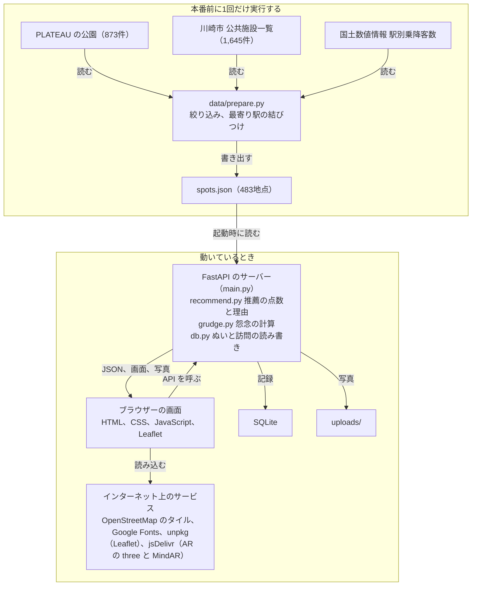

# 技術と機能のまとめ

発表と質疑で機能と技術を説明するためのまとめです。発表はスライドを使わず、動作デモとこのリポジトリで行います。数値と Issue の状態は2026年11月5日時点のものです。

全体の決まりは [design.md](design.md)、API の形は [api.md](api.md)、データの詳しい扱いは [data/README.md](../data/README.md) にあります。

## 30秒の説明

「ぬい憑き」は置いたままのぬいぐるみを連れて街へ出かけるぬい活アプリです。最後に連れ出した日から、ぬいに宿った怨念の強さが決まります。オープンデータから出かける先を理由つきで推薦し、訪れた場所でぬいと写真を残すと怨念が鎮まります。推薦された場所で記録すると、より多く鎮まります。

外出時に連れて行けるぬいの数には限りがあり、つい一番の推しの最新のぬいを選んでしまいます。そこで、置かれたままのぬいに怨念を宿らせ、そのぬいを選んで出かける理由を作りました。

技術の見どころは推薦です。川崎市のオープンデータから作った483地点に、現在地からの距離とデータの値でルールベースの点数を付けます。点数の内訳から推薦理由の文を作るので、なぜその場所なのかを画面で説明できます。

## 説明で間違えやすい点

- AR はぬいに付ける印刷した名札を目印にします。ぬいの顔には反応しません。
- AR のカメラは HTTPS か localhost でしか使えません。デモは PC のカメラと localhost で動かす想定です。
- 中間発表の時点では、AR は開発中と説明します。
- 怨念の強さで変わるセリフは、AR のページにだけ出ます。
- GeoPandas は使っていません。`data/prepare.py` が使うのは pandas と NumPy です。
- デモ用のデータの写真は、ふわまるだけ本物で、ほかは仮のイラストです。

## 全体の構成



本番中に重い前処理はしません。サーバーは1つのコマンドで起動し、API に加えて画面のファイルと写真も配ります。地図のタイル、フォント、Leaflet、AR のライブラリはインターネットから読むので、会場でも接続が必要です。

## 技術スタック

| 部分 | 使うもの | 役割 |
|---|---|---|
| データの前処理 | Python、pandas、NumPy | オープンデータから `spots.json` を作ります。NumPy はあとから足すデータの距離の計算に使います。 |
| 推薦 | Python（標準ライブラリだけ） | 点数と推薦理由の文を作ります。 |
| API | FastAPI、uvicorn、python-multipart | 5つの API を提供します。python-multipart は写真つきのフォームを受け取るために使います。 |
| データベース | SQLite（Python の sqlite3） | ぬいと訪問の記録を、`backend/nuitsuki.db` の1ファイルに保存します。 |
| 画面 | HTML、CSS、JavaScript（ES Modules） | ビルドなしで動きます。URL の `#` を見て画面を切り替えます。 |
| 地図 | Leaflet 1.9.4、OpenStreetMap のタイル | 地図、番号つきのピン、現在地の印を描きます。 |
| 文字 | Zen Maru Gothic、Noto Serif JP（Google Fonts） | 画面の丸ゴシックと、朱印の「鎮」「記」に使います。 |
| AR | MindAR 1.2.5、Three.js 0.160.0 | ぬいに付けた名札を追跡し、演出を重ねます。AR のページを開いたときだけ読み込みます。 |
| テスト | pytest、httpx | 前処理、推薦、`GET /recommend`、画面のファイルの配信の17件のテストがあります。 |

手元で動かしたバージョンは Python 3.14.4、FastAPI 0.162.0、uvicorn 0.54.0、pandas 3.1.0、pytest 9.2.0 です。

React などのフレームワークと npm は、チームの決まりで使っていません（[design.md](design.md)）。推薦に機械学習は使っていません。

## 機能ごとの説明

### 推薦地点のデータ

川崎市の公園438件と文化施設45件、合わせて483地点を推薦の候補にしています。

- 公園は PLATEAU の873件から、面積が1,000㎡未満の公園と霊園を外しています。小さな児童公園が推薦の上位を埋めてしまうためです。
- 施設は公共施設一覧の1,645件から、博物館・美術館、記念館・資料館、ホール、音楽ホール、市民館・会館、図書館の6種類に絞っています。移転して座標の場所にない川崎市市民ミュージアムは外しました。
- 各地点にいちばん近い駅を結びつけ、駅までの距離と1日の乗降客数を持たせています。

結果は `backend/data/spots.json` に書き出して git に入れてあるので、前処理をしなくても API は動きます。

ファイル: `data/prepare.py`、`backend/data/spots.json`、`data/README.md`

### 地点の推薦

現在地から3km以内の地点に点数を付け、高い順に5件返します。計算は次のとおりで、各要素は0〜1の値です。

```
点数 = 近さ × 0.45 + 大きさ × 0.35 + 駅の近さ × 0.2

近さ     = 1 − 現在地からの距離 ÷ 3km
大きさ   = 公園は面積の対数（1,000㎡で0、100万㎡で1）、施設は種類ごとの値
駅の近さ = 1 − 最寄り駅までの距離 ÷ 2km
```

施設には面積がないので、博物館・美術館は0.9、記念館・資料館と音楽ホールは0.7、ホールは0.6、市民館・会館と図書館は0.3としています。駅の近さを入れたのは、ぬいを連れて電車で行きやすい場所を選ぶためです。

川崎駅から実際に出した結果です。表の値は重みを掛けたあとの点数です。小数第3位で丸めたので、足した値と点数が0.01ずれる行があります。

| 地点 | 距離 | 近さ | 大きさ | 駅 | 点数 |
|---|---:|---:|---:|---:|---:|
| アートガーデンかわさき | 171m | 0.42 | 0.32 | 0.18 | 0.92 |
| ミューザ川崎シンフォニーホール | 196m | 0.42 | 0.25 | 0.18 | 0.85 |
| ラゾーナ川崎プラザソル | 228m | 0.42 | 0.21 | 0.18 | 0.80 |
| 富士見公園 | 1,285m | 0.26 | 0.24 | 0.14 | 0.64 |
| さいわい緑道 | 842m | 0.32 | 0.16 | 0.12 | 0.60 |

富士見公園はさいわい緑道より遠いものの、広さで上回って4位に入っています。

点数の順に並べたあと、2つの決まりで選び直します。

- 50mより近い地点は同じ建物とみなし、点数の高い方だけを残します。
- 1つのカテゴリから返すのは3件までとし、公園と施設が両方出るようにします。ほかのカテゴリが足りないときは超えます。

推薦理由の文は点数を押し上げた要素の順に事実を並べて作ります。武蔵小杉駅の近くで多摩川緑地を出すと、「広さ72.1haの運動公園で、半径3km以内の公園で一番広い。現在地から約1.3km。多摩川駅から徒歩7分」のように広さが先に来ます。

ファイル: `backend/app/recommend.py`（API は `GET /recommend`）

### 地図と推薦カード

地図を画面いっぱいに出し、推薦地点を番号つきのピンと下のカードで見せます。PC の幅では、カードは左のパネルに縦に並びます。

- カードを横に送ると対応するピンが朱色に変わり、ピンを押すとそのカードが出ます。
- 地図を押すと、その場所を現在地にして推薦を取り直します。会場で GPS がずれても、歩いているようにデモできます。
- 最初の現在地は川崎駅です。位置情報は右上のボタンを押したときだけ取ります。会場が川崎市の外だと推薦地点が出ないためです。
- いちばん怨念の強いぬいを地図の上に浮かべて、連れ出す相手を思い出せるようにしています。

画面の作りは Google マップのシートや Airbnb の地図、ポケモン GO の相棒、スタンプラリーのアプリなどを参考にしました。

ファイル: `frontend/js/map.js`

### 地点の詳細

カードの「詳しく見る」で、地点の情報を下から出るシートに出します。「経路を見る」は Google マップを開きます。

| 地点 | 出す情報 |
|---|---|
| 施設（45件） | 説明（33件）、住所、開いている時間、休館日、電話、公式サイト、設備 |
| 公園（438件） | 広さ、開園した年。元のデータに住所がないので、住所は出しません |
| どちらも | 推薦したわけ、最寄り駅、駅の1日の乗降客数 |

`GET /recommend` が返す `details` と `attrs` をそのまま使うので、詳細を開くときに API は呼びません。値がない項目は表示しません。

ファイル: `frontend/js/spot-detail.js`、`data/prepare.py`

### 怨念の計算と段階

```
放置の点     = min(100, 放置日数 × 2)
基本の除霊   = 推薦地点なら 50、それ以外なら 10
連続減衰後   = max(10, 基本の除霊 − 10 × 同じ場所に続けて記録した回数)
距離係数     = 100m 以内なら 1、2km 以上なら 0、その間は直線で減る
除霊         = 連続減衰後 × 距離係数
怨念         = max(0, 放置の点 − 除霊の合計)
```

同じ場所に続けて記録すると除霊量は 50 → 40 → 30 → 20 → 10 → 10 のように減ります。推薦地点から離れた場所で記録すると、距離係数の分だけ除霊量が減り、2km 以上離れていると除霊できません。推薦地点以外の記録には距離の減衰はありません。

デモ用のデータでは次の値になります。

| ぬい | 放置日数 | 放置の点 | 記録 | 怨念 |
|---|---:|---:|---|---:|
| ふわまる | 60日 | 100 | なし | 100 |
| もちもち | 55日 | 100 | 推薦地点1件、それ以外1件 | 40 |
| こんぺいとう | 30日 | 60 | 推薦地点1件 | 10 |

段階は、0が「鎮まった」、1〜39が「弱い」、40〜69が「中くらい」、70〜100が「強い」です。

怨念はデータベースに保存せず、API が返すたびに計算します。今日の日付で値が変わるためです。画面では計算せず、API の値をそのまま表示します。段階に合わせて、写真の縁の色、札、写真がないときの顔の絵が変わります。

訪問を記録しても「最後に連れ出した日」は変えません。そのため、怨念が0になっても日が経てばまた増えます。ただし放置の点の上限は100なので、除霊の合計が100以上になると0のままです。

ファイル: `backend/app/grudge.py`、`frontend/js/ui.js`

### 訪問の記録と朱印

ぬいを顔のボタンから選び、写真を添えて記録します。怨念の強いぬいから順に並び、いちばん強いぬいを初めから選んでいます。ぬいを選ぶと、`GET /visits/preview` で「この記録の除霊量」が出ます。記録すると朱印が押され、怨念の数字とゲージが下がります。結果画面には除霊量と、その内訳（基本の値、同じ場所の連続減衰、距離減衰、怨念が足りなかった場合の上限）が出ます。

| 記録した場所 | 朱印 | 基本の鎮まる量 | 送る値 |
|---|---|---:|---|
| 推薦地点 | 朱色の「鎮」 | 50 | `spot_id` |
| それ以外 | 墨色の「記」 | 10 | `spot_name`（画面で入れた名前） |

推薦地点では、同じ場所に続けて記録すると鎮まる量が10ずつ減り、最低10になります。また、記録した位置が推薦地点から離れていると、その距離に応じて鎮まる量が減ります。2km以上離れていると鎮まりません。推薦地点のカードから記録するときも、送る位置は現在地です。地点まで歩いてから記録すると、多く鎮まります。

`POST /visits` は次の順に動きます。

1. ぬいと地点を確かめます。`spot_id` があれば `spots.json` から地点の名前を取り、推薦地点での記録として扱います。
2. 記録する前の怨念を計算します。
3. 写真を `backend/uploads/` にランダムな名前で保存し、記録をデータベースに入れます。
4. 記録したあとの怨念を計算し、`grudge_before`、`grudge_after`、除霊量の内訳 `calm` を返します。

`GET /visits/preview` は同じ計算を保存せずに返します。記録前の画面はこれで除霊量を見せ、記録後の画面は `POST /visits` の `calm` を使います。画面はこの値で演出を出します。位置は画面が送った値をそのまま使うので、実際にその場にいるかどうかは確かめません。デモのための割り切りです。

ファイル: `frontend/js/visit.js`、`backend/app/main.py`、`backend/app/db.py`

### AR の憑依

記録の結果画面と、ぬいの一覧の「いちばん怨んでいるぬい」のカードにある「憑依を見る」で開く別のページです。怨念が0のときのボタンは「鎮まった様子を見る」です。

ぬいに付けた印刷の名札をカメラで追跡します。カメラ映像から切り取ったぬいを揺らし、オーラ、人魂、吹き出しのセリフを重ねます。見せ方とセリフは怨念の段階で変わります。

名札は4cm角で、全長14cmのぬいに付ける想定です。ぬいの顔を目印にする方法も試しましたが、実機では名札のほうが精度がよかったので、名札を使っています。

ファイル: `frontend/ar/`（詳しくは [frontend/ar/README.md](../frontend/ar/README.md)）

### ぬいの登録、一覧、思い出

- 登録では名前、最後に連れ出した日、写真（任意）を入れます。写真がなければ、怨念の段階に合わせた顔の絵を出します。
- 一覧ではいちばん怨念の強いぬいを上に大きく出し、すべてのぬいをタイルで並べます。開かなくても、縁の色と札で段階が分かります。
- 思い出の画面では思い出の数、朱印の数、最後に連れ出した日をまとめて出し、記録を朱印つきの写真で並べます。写真を押すと大きく見られます。

ファイル: `frontend/js/register.js`、`frontend/js/nuis.js`、`frontend/js/ui.js`

### 地図を速く出す工夫

地図のライブラリを比べ、そのうえで読み込みの順番を変えて、地図が出るまでの時間をほぼ半分にしました。遅さの主な原因はフォントで、51件で約680KBあり、タイルと回線を取り合っていました。

- タイルは推薦地点に地図を寄せてから読みます。寄せる前のズームのタイルを読まなくなります。
- 地図の画面で使う JavaScript を、`modulepreload` で最初にまとめて読みます。
- フォントはタイルを読み終えてから読みます。タイルが遅いときも5秒で読み始めます。

そのあと、スマホの幅で解像度が2倍以上の画面では、地図がぼやけないよう1段細かいタイルを出すようにしました。タイルが増えるので、スマホの遅い回線では時間が改善前に近くなっています。PC の幅では通常のタイルのままです。

| 実際のアプリ | 改善前 | 順番の改善後 | 細かいタイルを入れた今 |
|---|---:|---:|---:|
| 地図が出るまで（20Mbps） | 3.9秒 | 2.1秒 | 2.3秒 |
| 地図が出るまで（1.6Mbps） | 8.5秒 | 4.3秒 | 8.1秒 |
| タイルの要求 | 22件 | 10件 | 32件 |
| タイルの通信量（20Mbps） | 826KB | 372KB | 1,058KB |

スマホの画面の大きさと遅い CPU（4倍遅くする設定）を再現し、3回ずつ開いた中央値です。測定はパソコンの Chrome で行い、実機では測っていません。

ファイル: `frontend/js/map.js`、`frontend/js/main.js`、`frontend/index.html`

### 新しいデータの受け皿

中間発表で配られるデータを推薦に足せるように、受け皿を作ってあります。データはまだ配られていないので、試験用のデータで確かめた段階です。

1. ファイルを `data/raw/extra/` に置きます。CSV と GeoJSON の点、線、面を読めます。
2. `data/prepare.py` の `EXTRA_SOURCES` に1行足します。地点から決まった距離の中にある数（`count`）か、いちばん近いものまでの距離（`nearest`）を、各地点の `attrs` に入れます。
3. `backend/app/recommend.py` の `EXTRA_RULES` に、重み、点数が1になる値、推薦理由に足す文を書きます。
4. `python data/prepare.py` を実行し、API を起動し直します。

ファイル: `data/prepare.py`、`backend/app/recommend.py`

## API の一覧

| メソッドとパス | 内容 | 使う画面 |
|---|---|---|
| `GET /nuis` | ぬいの一覧。怨念の強さと訪問の数を含む | 地図、記録、一覧、思い出 |
| `POST /nuis` | ぬいの登録（写真は任意） | 登録 |
| `GET /recommend?lat=&lng=` | 推薦地点の上位5件。理由と詳細を含む | 地図 |
| `POST /visits` | 訪問の記録。記録の前後の怨念と除霊量の内訳を返す | 記録 |
| `GET /visits/preview` | 記録前の除霊量を試算する。保存しない | 記録 |
| `GET /nuis/{id}/visits` | そのぬいの思い出（新しい順） | 思い出 |

写真を送る2つの POST は `multipart/form-data` で受け取ります。項目の詳しい形は [api.md](api.md) にあります。

## 使っているデータ

| データ | 提供元 | 使い道 | ライセンス |
|---|---|---|---|
| [3D都市モデル（PLATEAU）川崎市 2022年度の関連データセット](https://www.geospatial.jp/ckan/dataset/plateau-14130-kawasaki-shi-2022) | 国土交通省 | 公園の名前、種類、面積、開園した年、位置 | PLATEAU サイトポリシー |
| [公共施設一覧](https://www.city.kawasaki.jp/170/page/0000116229.html) | 川崎市 | 施設の名前、種類、位置、住所、時間、説明など | CC BY 4.0 |
| [駅別乗降客数](https://nlftp.mlit.go.jp/ksj/gml/datalist/KsjTmplt-S12-2024.html) | 国土交通省（国土数値情報） | 駅の位置と1日の乗降客数（2024年度） | CC BY 4.0 |

データの出典は地図の画面のシートの下に、地図のタイルの出典（OpenStreetMap）は地図の上に出しています。

## デモの進め方

`backend` で次を実行し、`http://localhost:8000/` を開きます。怨念は今日の日付で変わるので、`seed.py` はデモの直前に実行してください。写真を見せるときは、選ぶ画像を用意しておきます。AR を見せるときは、[frontend/ar/README.md](../frontend/ar/README.md) の手順で名札を印刷し、ぬいに付けておきます。

```bash
pip install -r requirements.txt
python scripts/seed.py
uvicorn app.main:app --port 8000
```

1. 地図を見せます。川崎駅の近くの推薦地点が5件出て、いちばん怨んでいるふわまる（怨念100）が地図の上に出ています。
2. カードを横に送り、ピンの色が変わるのを見せます。推薦理由の行を読み、なぜその場所なのかを説明します。
3. ミューザ川崎シンフォニーホールの「詳しく見る」を押し、住所、時間、設備を見せます。
4. 詳細の「ここで記録する」を押します。ふわまるが選ばれた状態で、記録前に「除霊量 50」と内訳が出ているのを見せます。写真を選び、「記録する」を押します。朱印「鎮」が押され、怨念が100から50に下がります。結果画面にも「除霊量 50」と内訳が出ます。
5. 「憑依を見る」を押し、「はじめる」を押して、名札を付けたぬいをカメラに映します。
6. 「やめる」を押し、開始画面の左上の戻るボタンを押すと、そのぬいの思い出の画面が開きます。写真を押して大きく見せます。
7. 地図に戻り、「いまの場所で記録」を押します。こんぺいとうを選び、地点の名前を入れて記録します。朱印は「記」で、鎮まる量は10です。怨念は10から0になり、消えたと表示されます。推薦地点との差を説明します。
8. 地図を動かして別の場所を押し、現在地に合わせて推薦が変わるのを見せます。
9. 「登録」で新しいぬいを追加し、一覧に出るのを見せます。

## 聞かれそうなこと

### 推薦に AI は使っていますか

使っていません。点数のルールはすべて `recommend.py` に書いてあり、同じ入力なら同じ結果になります。点数の内訳から理由の文を作れます。前処理と推薦を分けているので、新しいデータも足しやすくしています。

### 地図はなぜ Leaflet ですか

同じ条件で比べて、いちばん速かったためです。初回の表示は、20Mbps で Leaflet が1.3秒、MapLibre が無駄を削っても4.3秒、1.6Mbps で3.3秒と7.8秒でした。ピンが5本だけの地図では、本体が約5倍ある MapLibre の重さを取り返せません。見た目は MapLibre のほうがくっきりしています。

### 本当にその場所に行ったか確かめていますか

確かめていません。画面から送られた地点をそのまま信じる割り切りです。現在地も地図を押して自由に変えられます。

### ログインはありますか

ありません。利用者は1人とみなしています。このまま公開すると、誰でも登録や記録ができます。

### 写真はどこに保存されますか

サーバーの `backend/uploads/` です。git には入れていません。

### 川崎市以外でも使えますか

今は川崎市だけです。`prepare.py` は川崎市のファイルを読むように書いているので、ほかの地域はデータを用意して作り直す必要があります。

### テストはありますか

`pytest` で17件あり、前処理、推薦、`GET /recommend`、画面のファイルの配信を確かめています。怨念の計算と、ぬいと訪問の API には自動テストがなく、手で動かして確かめました。

## まだ入っていないもの

| 項目 | 今の状態 | Issue |
|---|---|---|
| 怨念で変わるセリフ | AR のページにだけ出ます。ほかの画面には出ません。 | #13（未完了） |
| 鎮まったときの演出 | 朱印、数字とゲージの変化、顔の変化は入っています。 | #13（未完了） |
| 中間発表のデータ | 受け皿だけ作ってあり、データは本番で配られます。 | #11（未完了） |
| 実機での確認 | スマホの実機で確かめたのは地図タイルの見え方です。ほかの動作と速さは、パソコンの Chrome でスマホの幅を再現して確かめました。 | なし |
| 本物の写真 | ふわまる以外のデモ用のデータは仮のイラストです。 | なし |

Issue #7（ぬいと訪問の API、怨念の計算）は開いたままですが、API は実装済みで動いています。Issue #12（AR の憑依演出）も開いたままですが、AR は main に入っています。
