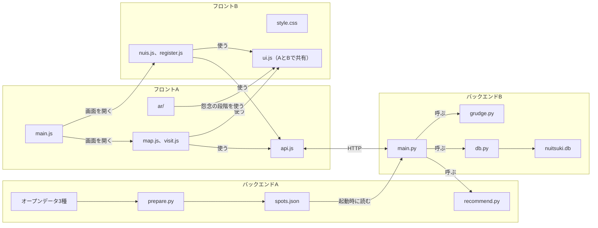
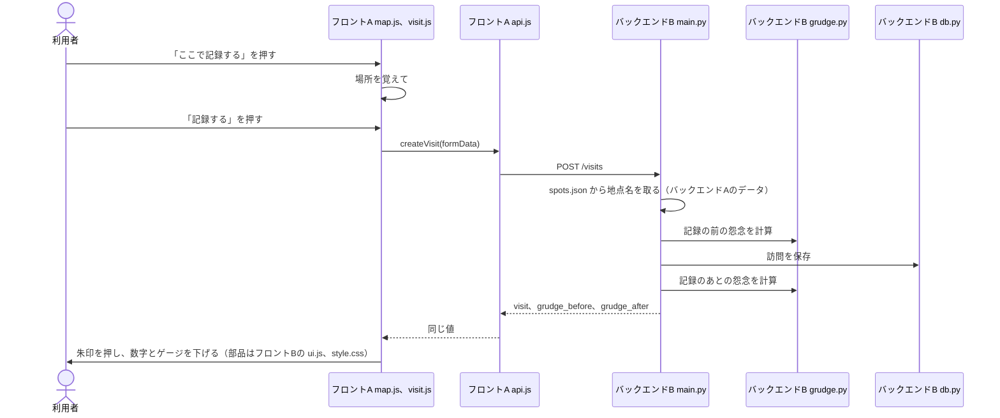

# 担当別のコード説明書

バックエンドA、バックエンドB、フロントA、フロントBの各担当が、受け持つ機能のコードを読んで説明し、直せるようになるための文書です。

内容は2026年11月6日時点のブランチ `tkg28/ar-from-nuis`（PR #29）に合わせています。「手を動かして確かめる」に書いた結果は、一時データベースで実際に動かして取った値です。

| 担当 | 受け持つ機能 | 説明書 |
|---|---|---|
| バックエンドA | 推薦地点のデータ作り、推薦の点数と理由 | [backend-a.md](backend-a.md) |
| バックエンドB | API、データベース、怨念の計算、デモ用のデータ | [backend-b.md](backend-b.md) |
| フロントA | 画面の骨組み、API の呼び出し、地図、訪問の記録 | [frontend-a.md](frontend-a.md) |
| フロントA（AR） | 憑依の演出、ぬいを動かす仕組み、名札 | [frontend-a-ar.md](frontend-a-ar.md) |
| フロントB | ぬいの一覧、思い出、登録、共通の部品、見た目 | [frontend-b.md](frontend-b.md) |

担当と関係なく全ファイルを見渡すときは [code-guide.md](../code-guide.md) を読んでください。用語の意味はその12章の用語集にあります。

## 4つの担当のつながり

本番で動くプログラムは Python のサーバー1つです。バックエンドAの `prepare.py` だけは本番前に実行します。



## 1回の操作で各担当のコードが動く順番

地図で富士見公園を選んで記録するときの流れです。



推薦地点の一覧を出すときは `map.js`、`api.js`、`main.py`、バックエンドAの `recommend.py` の順に動きます。

## 担当のあいだの受け渡し

| 渡す側 | 受ける側 | 渡すもの | 形を決めている文書 |
|---|---|---|---|
| バックエンドA | バックエンドB | `spots.json` と `recommend()` | [api.md](../api.md) の「spots.json の形」 |
| バックエンドB | フロントA、B | 5つの API | [api.md](../api.md) |
| フロントA | フロントB | `api.js` の関数、`main.js` からの画面の呼び出し | [frontend-main.md](../tasks/frontend-main.md) |
| フロントA、B | 全画面と AR | `ui.js` の部品と怨念の段階 | [design.md](../design.md) の「怨念の段階」 |

## 全員が知っておく決まり

- 怨念の数値はサーバーの `grudge.py` だけが計算します。画面は受け取った値を表示します。
- 怨念の段階（強い、中くらいなど）は画面の `ui.js` が決めます。計算と段階で担当が分かれている点に注意してください。
- API の項目名と形を変えるときは、コードより先に [api.md](../api.md) を直し、全員に伝えます。
- 推薦理由（`reason`）は「。」で区切った文です。画面はこの記号で分けて1行ずつ表示します。
- 画面の幅 900px を境に形が変わります。この値は `style.css`、`map.js`、`ar/main.js` の3か所にあります。
- 人の担当のファイルを書き換えたいときは、先に本人に伝えます。

## 動かし方

`backend` で次を実行し、`http://localhost:8000/` を開きます。`seed.py` は手元のデータベースを空にしてから、デモ用のデータを入れ直します。

```bash
pip install -r requirements.txt
python scripts/seed.py
uvicorn app.main:app --reload --port 8000
```

テストは `backend` で次を実行します。

```bash
pip install -r requirements-dev.txt
python -m pytest tests
```
