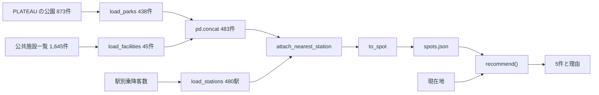

# バックエンドA：データと推薦

オープンデータから推薦地点の一覧を作り、現在地に合わせて地点を選ぶ担当の説明書です。全体のつながりは [README.md](README.md) にあります。

## 目次

1. [この担当の役目](#1-この担当の役目)
2. [担当のファイル](#2-担当のファイル)
3. [spots.json を作る処理](#3-spotsjson-を作る処理)
4. [推薦の処理](#4-推薦の処理)
5. [あとから足すデータ](#5-あとから足すデータ)
6. [ほかの担当とのつなぎ目](#6-ほかの担当とのつなぎ目)
7. [テスト](#7-テスト)
8. [手を動かして確かめる](#8-手を動かして確かめる)
9. [変えるときの手順](#9-変えるときの手順)
10. [最初の指示書との違いと次に触れそうな所](#10-最初の指示書との違いと次に触れそうな所)
11. [説明できるかの確認](#11-説明できるかの確認)

## 1. この担当の役目

この担当のコードは、動く時期が違う2つのプログラムに分かれています。

| プログラム | 動く時期 | 入力 | 出力 |
|---|---|---|---|
| `data/prepare.py` | 本番前に1回 | オープンデータ3種 | `backend/data/spots.json`（483件） |
| `backend/app/recommend.py` | 推薦を頼まれるたび | `spots.json` の中身と現在地 | 点数の高い5件と理由 |

2つをつなぐのは `spots.json` だけです。`prepare.py` は pandas を使うので時間がかかりますが、本番中は動きません。`recommend.py` は Python の標準の `math` だけを使います。



## 2. 担当のファイル

| ファイル | 内容 |
|---|---|
| [data/prepare.py](../../data/prepare.py) | オープンデータから `spots.json` を作る |
| [data/README.md](../../data/README.md) | データの出典、列、推薦のルール、足すデータの手順 |
| [data/requirements.txt](../../data/requirements.txt) | 前処理に必要なもの（pandas、NumPy） |
| [backend/data/spots.json](../../backend/data/spots.json) | 前処理の結果。git に入っている |
| [backend/app/recommend.py](../../backend/app/recommend.py) | 点数、選び方、推薦理由 |
| [backend/tests/test_recommend.py](../../backend/tests/test_recommend.py) | 前処理と推薦のテスト |

`data/raw/` には元のデータを置きます。git には入りません。

## 3. spots.json を作る処理

リポジトリの直下で `python data/prepare.py` と実行します。`main()` の順に読むと全体が分かります。

```python
def main() -> None:
    spots = pd.concat([load_parks(), load_facilities()], ignore_index=True)
    spots = attach_nearest_station(spots, load_stations())
```

公園と施設を1つの表につなげ、各行に一番近い駅を足し、1行ずつ辞書に直して JSON に書き出します。

### ファイルの先頭の定数

| 定数 | 内容 |
|---|---|
| `SOURCES` | 3つの元データのファイル名とダウンロード先 |
| `PARK_GEOJSON`、`STATION_GEOJSON` | zip の中のどのファイルを読むか |
| `PARK_TYPES` | 公園種別のコードと名前の対応 |
| `MIN_PARK_AREA_M2` | これより狭い公園を外す（1,000㎡） |
| `FACILITY_TYPES` | 推薦地点にする施設の POI コードと種類 |
| `AMENITY_COLUMNS` | 公共施設一覧の設備の列と、画面に出す名前 |
| `STATION_BOUNDS` | 川崎市の周りの緯度と経度の範囲 |
| `STATION_PASSENGERS_COLUMN` | 2024年度の乗降客数の列（`S12_061`） |
| `EXTRA_DIR`、`EXTRA_SOURCES` | 中間発表で配られるデータの置き場所と指定 |

### raw_path：元のデータを用意する

`data/raw/` にファイルがなければダウンロードし、場所を返します。一度置けば、ネットワークなしで前処理を動かせます。

### load_parks：公園を読む

```python
    keep = (parks["area_m2"] >= MIN_PARK_AREA_M2) & ~parks["name"].str.contains("霊園")
    return parks[keep]
```

- zip を開いたまま GeoJSON を読み、地物を1件ずつ辞書にします。
- `f"park_{i:04d}"` で ID を付けます。元のデータに ID がないので、絞り込む前のファイルの並び順を使います。
- 上の2行で 1,000㎡ 未満（434件）と霊園（1件）を外し、873件から438件にします。

ID が並び順なので、元のファイルの順が変わると ID も変わります。デモ用のデータ（`seed.py`）とモックは `park_0798`（富士見公園）を直接書いているので、影響を受けます。

### load_facilities：施設を読む

```python
    df = pd.read_csv(raw_path("facility"), encoding="cp932", dtype=str)
    df = df[df["POIコード"].isin(FACILITY_TYPES) & df["緯度"].notna() & df["経度"].notna()]
```

- `encoding="cp932"` はファイルが Shift_JIS だからです。
- `dtype=str` で全部の列を文字列として読みます。電話番号の先頭の0などが数値への変換で消えません。
- `FACILITY_TYPES` の6種類で緯度と経度があるものに絞り、備考に「移転」とある施設（川崎市市民ミュージアム）を外します。1,645件から45件になります。

住所や時間を整える小さな関数が4つあります。

| 関数 | 内容 | 例 |
|---|---|---|
| `_text` | 前後の空白を除く。空なら `None` | |
| `_year` | 年として読める値だけ整数にする | `"2002"` は 2002、`"平成"` は `None` |
| `_hours` | 開始と終了の時間をつなぐ | `9:00:00` と `21:30:00` は `9:00〜21:30` |
| `_amenities` | 設備の列のうち、値が「有」「可」で始まるか「有」で終わるものの名前を集める | |

### load_stations：駅を読む

全国の駅が路線ごとの線（LineString）で入っています。

```python
        lat = sum(pt[1] for pt in points) / len(points)
        lng = sum(pt[0] for pt in points) / len(points)
```

線の点の平均を駅の位置とします。GeoJSON の座標は `[経度, 緯度]` の順なので、`pt[1]` が緯度です。`STATION_BOUNDS` で川崎市の周りに絞り、最後に駅名でまとめます。

```python
    return df.groupby("name", as_index=False).agg(
        lat=("lat", "mean"), lng=("lng", "mean"), passengers=("passengers", "sum")
    )
```

同じ駅が路線ごとに複数行あるので、位置は平均を取り、乗降客数は合計します。結果は480駅で、川崎駅は 388,782人です。

### attach_nearest_station：一番近い駅を足す

```python
        best = min(station_list, key=lambda s: distance_m(spot.lat, spot.lng, s["lat"], s["lng"]))
```

地点ごとに480駅すべてとの距離を求め、一番近い駅を選びます。`distance_m` は下の「推薦の処理」で説明する式と同じものです。`prepare.py` と `recommend.py` を別々に動かせるよう、同じ関数を両方に置いています。

### to_spot と _plain：JSON の形にする

1行を [api.md](../api.md) の「spots.json の形」の辞書にします。`attrs` は推薦に使う値、`details` は画面に出すだけの値です。

公園と施設を `pd.concat` でつなぐと、公園にない列（`address` など）や施設にない列（`opened_year`）は欠損値（`NaN`）になります。`NaN` は JSON に書けないので、`_plain` が `None` に直します。同じ理由で `opened_year` は小数になるので、整数に戻しています。

```python
            "opened_year": None if pd.isna(row.get("opened_year")) else int(row["opened_year"]),
```

### できあがるデータ

| 項目 | 件数 |
|---|---|
| 公園・緑地 | 438（街区公園340、都市緑地40、近隣公園31、緑道11、地区公園6、総合公園4、特殊公園3、都市林2、運動公園1） |
| 文化・生涯学習 | 45（市民館・会館20、図書館12、博物館・美術館4、記念館・資料館4、ホール3、音楽ホール2） |

今の `data/raw/` で `prepare.py` を一時フォルダーに書き出すと、中身は git の `spots.json` と同じになりました。

## 4. 推薦の処理

外から呼ばれるのは `recommend(spots, lat, lng, limit=5)` です。点数を付ける、同じ建物を除く、カテゴリの偏りを抑える、理由を書く、の順に進みます。

### 点数の式

```python
WEIGHT_NEAR = 0.45  # 現在地からの近さ
WEIGHT_SIZE = 0.35  # 地点の大きさ（施設は種類）
WEIGHT_STATION = 0.2  # 駅からの近さ
```

3つの要素を0〜1にそろえ、重みを掛けて足します。

| 要素 | 計算 | 0になるとき | 1になるとき |
|---|---|---|---|
| 近さ | `1 - 距離 / 3000` | 3km（これより遠い地点は推薦しない） | 距離0 |
| 大きさ（公園） | `(log10(面積) - 3) / 3` | 1,000㎡ | 100万㎡ |
| 大きさ（施設） | `FACILITY_SCORES` の値 | | |
| 駅の近さ | `1 - 駅までの距離 / 2000` | 2km 以上 | 距離0 |

面積に対数を使うのは、広さの差が大きいためです。1万㎡ は 0.33、10万㎡ は 0.67 になり、広さが10倍になるごとに同じ幅だけ点が増えます。

施設には面積がないので、種類ごとの値を人が決めています。

```python
FACILITY_SCORES = {
    "博物館・美術館": 0.9,
    "記念館・資料館": 0.7,
    "音楽ホール": 0.7,
    "ホール": 0.6,
    "市民館・会館": 0.3,
    "図書館": 0.3,
}
```

`attrs.station_passengers`（駅の乗降客数）は点数に使っていません。`spot-detail.js` が地点の詳細に表示するだけです。

### 計算の例

川崎駅（35.5314, 139.6968）を現在地にしたときの実際の値です。

| 要素 | 富士見公園 | ミューザ川崎シンフォニーホール |
|---|---|---|
| 現在地からの距離 | 1,285m | 196m |
| 近さ × 0.45 | 0.5715 × 0.45 = 0.2572 | 0.9345 × 0.45 = 0.4205 |
| 大きさ × 0.35 | 面積 116,584㎡、0.6889 × 0.35 = 0.2411 | 音楽ホール、0.7 × 0.35 = 0.2450 |
| 駅 × 0.2 | 港町駅まで602m、0.699 × 0.2 = 0.1398 | 川崎駅まで196m、0.902 × 0.2 = 0.1804 |
| 合計 | 0.6381、表示は 0.64 | 0.8459、表示は 0.85 |

### 関数ごとの説明

| 関数 | 内容 |
|---|---|
| `distance_m` | 緯度と経度から2点の距離を求める（ハーバサイン公式）。地球を半径 6,371km の球とみなす |
| `size_score` | 大きさの点を返す。面積があれば対数の式、なければ施設の値 |
| `extra_score` | 足したデータの値を0〜1にする |
| `score_parts` | 重みを掛けた内訳と距離を返す。3km 以上なら `None` |
| `score_spot` | 内訳の合計を重みの合計で割る |
| `distance_text` | 距離を「約200m」「約1.3km」の文にする |
| `make_reason` | 推薦理由の文を作る |
| `park_ranks` | 現在地から3km以内の公園の広さの順位を返す |
| `check_extra_rules` | `EXTRA_RULES` の書き間違いを起動時に知らせる |
| `recommend` | 全体を動かす |

`score_spot` が合計を重みの合計で割るのは、`EXTRA_RULES` で重みが増えても点数を0〜1に保つためです。

### 選び方の順番

川崎駅での実際の動きを追います。483件のうち、3km以内の地点は96件です。点数の順に並べると、先頭は次のようになります。

| 点数 | 地点 | カテゴリ | 結果 |
|---:|---|---|---|
| 0.92 | アートガーデンかわさき | 施設 | 採用 |
| 0.92 | アートガーデンかわさき特別展示室 | 施設 | 同じ建物なので除外 |
| 0.85 | ミューザ川崎シンフォニーホール | 施設 | 採用 |
| 0.80 | ラゾーナ川崎プラザソル | 施設 | 採用 |
| 0.79 | 東海道かわさき宿交流館 | 施設 | 施設が3件に達したので見送り |
| 0.71 | 川崎市立川崎図書館 | 施設 | 同じ建物なので除外 |
| 0.64 | 川崎能楽堂 | 施設 | 見送り |
| 0.64 | 富士見公園 | 公園 | 採用 |
| 0.60 | さいわい緑道 | 公園 | 採用 |

コードは3段階です。

```python
    scored.sort(key=lambda item: (-item[0], item[1]["id"]))
```

1段階目は並べ替えです。点数を `round(score, 2)` で丸めてから、点数の高い順、同じなら ID の順に並べます。乱数がないので、同じ入力なら必ず同じ結果になります。

```python
        if all(distance_m(spot["lat"], spot["lng"], s["lat"], s["lng"]) >= SAME_PLACE_M for _, s in distinct):
            distinct.append(item)
        if len(distinct) >= limit * 4:
            break
```

2段階目は同じ建物の除外です。すでに残した地点から50m未満なら飛ばします。20件（`limit * 4`）集まったら打ち切ります。

```python
    for item in distinct:
        category = item[1]["category"]
        if counts.get(category, 0) < MAX_PER_CATEGORY:
            picked.append(item)
            counts[category] = counts.get(category, 0) + 1
    picked += [item for item in distinct if item not in picked]
    picked = sorted(picked[:limit], key=lambda item: (-item[0], item[1]["id"]))
```

3段階目はカテゴリの調整です。各カテゴリ3件までを先に選び、見送った地点を後ろにつなげます。公園か施設の片方が足りず5件に届かないときは、この後ろの分で埋まります。最後の行で点数の順に戻します。

### 推薦理由

`make_reason` は要素ごとの文を作り、点数への寄与が大きい順に並べます。

```python
    order = sorted(phrases, key=lambda key: -parts.get(key, 0.0))
    return "。".join(phrases[key] for key in order)
```

そのため、同じ公園でも決め手によって書き出しが変わります。

| 地点 | 現在地 | 理由 |
|---|---|---|
| 富士見公園 | 川崎駅 | 現在地から約1.3km。広さ11.7haの総合公園で、半径3km以内の公園で一番広い。港町駅から徒歩8分 |
| 多摩川緑地 | 武蔵小杉 | 広さ72.1haの運動公園で、半径3km以内の公園で一番広い。現在地から約1.3km。多摩川駅から徒歩7分 |
| 川崎市立中原図書館 | 武蔵小杉 | 現在地から約60mと近い。武蔵小杉駅から徒歩3分。図書館 |

理由を組み立てる決まりは次のとおりです。

- 近さの点が `NEAR_GOOD`（0.6）以上、つまり1.2km以内なら「と近い」を付けます。
- `park_rank` が1〜3なら「半径3km以内の公園で一番広い」のように順位を書きます。
- 徒歩の分数は直線距離を80mで割り、切り上げます。実際の道のりではないので目安です。
- データから分かる事実だけを書きます。混雑や撮りやすさは書きません。

## 5. あとから足すデータ

中間発表で配られるデータを少ないコードで足すための仕組みです。今は `EXTRA_SOURCES` も `EXTRA_RULES` も空なので動いていません。

手順は2か所に1つずつ足すだけです。

1. `data/prepare.py` の `EXTRA_SOURCES` が各地点の `attrs` に値を足します。
2. `backend/app/recommend.py` の `EXTRA_RULES` がその値を点数と理由に使います。

### prepare.py の側

| 関数 | 内容 |
|---|---|
| `load_shapes` | CSV か GeoJSON を読み、線分の配列にする |
| `_read_csv_points` | CSV の緯度と経度の列を読む。文字コードは UTF-8 のあとに Shift_JIS を試す |
| `_geometry_parts` | GeoJSON の形を点、線、面の縁に分ける |
| `distances_to_shapes` | 1つの地点から各地物までの距離を NumPy で一度に求める |
| `attach_extra` | `mode` に合わせて値を列に足す |

点は長さ0の線分、面は縁の線分として扱います。形を1種類にそろえることで、距離の計算を1つの式で済ませています。

`distances_to_shapes` の計算は3段階です。

```python
    kx = 111320 * math.cos(math.radians(lat))
    ky = 110540
```

まず、地点を原点とする平面に直します。緯度と経度の差にこの係数を掛けるとメートルになります。川崎市くらいの広さなら誤差は小さいです。

```python
    t = np.clip(t, 0.0, 1.0)
    d = np.hypot(ax + t * dx, ay + t * dy)
    result = np.full(shapes["count"], np.inf)
    np.minimum.at(result, shapes["feature"], d)
```

次に、原点から各線分までの最短距離を求めます。`t` は線分の上で一番近い点の位置で、0が片方の端、1がもう片方の端です。線分の外に出ないよう、0〜1に収めます。`np.minimum.at` で地物ごとの最小値を取ります。

```python
    crosses = shapes["ring"] & ((ay > 0) != (by > 0))
```

最後に、面の中にあるかを調べます。原点から右へ伸ばした線が面の縁と奇数回交われば中にあるので、距離を0にします。

`attach_extra` の `mode` は2種類です。

| `mode` | 列に入る値 | 例：3地点のデータを川崎駅と武蔵小杉で調べた結果 |
|---|---|---|
| `count` | `radius_m` 以内の地物の数 | 500m 以内で、川崎駅は2、武蔵小杉は0 |
| `nearest` | 一番近い地物までの距離（m） | 川崎駅は0、武蔵小杉は5,949 |

### recommend.py の側

```python
EXTRA_RULES: dict[str, dict] = {}
```

| 項目 | 内容 |
|---|---|
| `weight` | 重み |
| `full` | 点数が1になる値。負の値にすると、値が小さいほど点が高くなる（距離に使う） |
| `reason` | 理由に足す文。`{value}` に値が入る |

### 足すときに注意すること

試しに `{"weight": 0.2, "full": 5, "reason": "半径500m以内に催しの会場が{value}か所"}` を足すと、次の結果になりました。この例ではさいわい緑道だけに値3を入れています。

| 地点 | 点数 | 理由 |
|---|---|---|
| アートガーデンかわさき | 0.77 | 現在地から約170mと近い。博物館・美術館。川崎駅から徒歩3分。半径500m以内に催しの会場が0か所 |
| さいわい緑道 | 0.60 | 現在地から約840mと近い。広さ2.2haの緑道。半径500m以内に催しの会場が3か所。川崎駅から徒歩11分 |

ここから次の3点が分かります。

- **値が0でも理由に文が出ます。** `make_reason` は値が `None` でなければ文を足すので、「0か所」と出ます。`count` のデータを足すときは、0のときに文を出さないよう `make_reason` を直すか、文の書き方を考える必要があります。
- **足したデータがない地点は点が下がります。** 重みの合計が増えるので、値が0の地点の点数は全体に下がります。
- **`reason` に「。」を入れないでください。** 画面が「。」で区切って1行ずつ表示します。

そのほか、次の点も確かめてください。

- CSV の列名が「緯度」「経度」でなければ、`lat_col` と `lng_col` を指定します。
- GeoJSON は UTF-8 で読みます。座標は緯度と経度（WGS84）である前提です。別の座標系のデータは正しく計算できません。
- 座標がなく、市区町村名や駅名で結びつくデータは、`prepare.py` に読み込みの関数を足す必要があります。

## 6. ほかの担当とのつなぎ目

| 相手 | 使われ方 | 変えるときに起きること |
|---|---|---|
| バックエンドB | `main.py` が `recommend(SPOTS, lat, lng, limit=5)` を呼ぶ | 関数の名前や引数を変えると API が動かなくなる |
| バックエンドB | `main.py` が起動時に `spots.json` を読み、`spot_id` から地点名を引く | `spots.json` を作り直したらサーバーの再起動が要る |
| バックエンドB | `seed.py` が `park_0798` と `facility_141305000015` を使う | ID が変わると思い出の記録が地点と合わなくなる |
| フロントA | `map.js` と `visit.js` が `reason` を `reasonList` で「。」ごとに分ける | 文の区切りを変えると表示が崩れる |
| フロントA | `spot-detail.js` が `attrs` と `details` を読む | 項目名を変えると詳細が出なくなる |
| フロントA | `map.js` の案内の文に「3km 以内」と直接書いてある | `MAX_DISTANCE_M` を変えたら文も直す |

`recommend.py` が読み込みで `ImportError` を起こすと、`main.py` は `try` で受け止め、仮の推薦（`_fallback_recommend`）に切り替えます。エラーで止まらず、`score` が全部 0.5 になるので、推薦がおかしいときはここも疑ってください。文法の誤りや `check_extra_rules` のエラーでは起動時に止まります。

## 7. テスト

`backend` で `python -m pytest tests` を実行します。このうち16件がこの担当のものです。

| テスト | 確かめていること |
|---|---|
| `test_spots_json` | 483件で、カテゴリが2種類で、市民ミュージアムがない |
| `test_spots_json_details` | `details` の項目と、ミューザや富士見公園の値 |
| `test_prepare_details_helpers` | `_hours`、`_year`、`_amenities` |
| `test_recommend_returns_details` | 結果に `category` と `details` が入る |
| `test_recommend_changes_with_location` | 現在地で結果が変わり、同じ入力なら同じ結果で、点数が0〜1 |
| `test_recommend_skips_same_building` | 結果の地点どうしが50m以上離れている |
| `test_recommend_mixes_categories` | 1カテゴリ3件まで |
| `test_facility_reason_uses_type` | ミューザの理由の全文 |
| `test_reason_puts_main_factor_first` | 多摩川緑地の理由が広さから始まる |
| `test_attrs_change_result` | `attrs` の値を変えると結果が変わる |
| `test_extra_rules` | 足した値が点数と理由に入り、点数が0〜1のまま |
| `test_check_extra_rules` | `weight` や `full` の書き間違いを検出する |
| `test_prepare_extra_points` | CSV の点の数え方 |
| `test_prepare_extra_shapes` | 面の中、線までの距離、座標のない地物 |
| `test_recommend_api` | `GET /recommend` の形と順番 |
| `test_recommend_api_far_away_returns_empty` | 川崎市から遠いと空の一覧 |

重みを変えると `test_facility_reason_uses_type` や `test_reason_puts_main_factor_first` が失敗することがあります。理由の文が変わるからです。意図した変化ならテストの期待値を直します。地点を増やすと `test_spots_json` の 483 も直します。

## 8. 手を動かして確かめる

`backend` で `python` を起動し、次を順に打ちます。`>>>` は打たないでください。

### 推薦の結果を見る

```pycon
>>> import json
>>> from app import recommend as rec
>>> spots = json.load(open("data/spots.json", encoding="utf-8"))
>>> here = (35.5314, 139.6968)
>>> [(r["score"], r["name"]) for r in rec.recommend(spots, *here)]
[(0.92, 'アートガーデンかわさき'), (0.85, 'ミューザ川崎シンフォニーホール'), (0.8, 'ラゾーナ川崎プラザソル'), (0.64, '富士見公園'), (0.6, 'さいわい緑道')]
```

### 点数の内訳を見る

```pycon
>>> fujimi = next(s for s in spots if s["name"] == "富士見公園")
>>> {k: round(v, 3) for k, v in rec.score_parts(fujimi, *here)["parts"].items()}
{'near': 0.257, 'size': 0.241, 'station': 0.14}
>>> rec.make_reason(fujimi, *here, 1)
'現在地から約1.3km。広さ11.7haの総合公園で、半径3km以内の公園で一番広い。港町駅から徒歩8分'
```

### 川崎市の外を試す

```pycon
>>> rec.recommend(spots, 43.06, 141.35)
[]
```

### 重みを変えてみる

大きさを重く見ると、東海道かわさき宿交流館が上位に入ります。

```pycon
>>> rec.WEIGHT_NEAR, rec.WEIGHT_SIZE, rec.WEIGHT_STATION = 0.2, 0.6, 0.2
>>> [(r["score"], r["name"]) for r in rec.recommend(spots, *here)]
[(0.91, 'アートガーデンかわさき'), (0.79, 'ミューザ川崎シンフォニーホール'), (0.76, '東海道かわさき宿交流館'), (0.67, '富士見公園'), (0.53, 'さいわい緑道')]
>>> rec.WEIGHT_NEAR, rec.WEIGHT_SIZE, rec.WEIGHT_STATION = 0.45, 0.35, 0.2
```

### 選び直しを外してみる

カテゴリの上限を外すと5件とも施設になり、同じ建物の除外を外すと特別展示室が入ります。2つの処理があるわけを確かめられます。

```pycon
>>> rec.MAX_PER_CATEGORY = 99
>>> [r["name"] for r in rec.recommend(spots, *here)]
['アートガーデンかわさき', 'ミューザ川崎シンフォニーホール', 'ラゾーナ川崎プラザソル', '東海道かわさき宿交流館', '川崎能楽堂']
>>> rec.MAX_PER_CATEGORY = 3
>>> rec.SAME_PLACE_M = 0
>>> [r["name"] for r in rec.recommend(spots, *here)]
['アートガーデンかわさき', 'アートガーデンかわさき特別展示室（川崎浮世絵ギャラリー）', 'ミューザ川崎シンフォニーホール', '富士見公園', 'さいわい緑道']
>>> rec.SAME_PLACE_M = 50
```

ここまでの変更はファイルを書き換えないので、`python` を閉じれば消えます。

## 9. 変えるときの手順

| やりたいこと | 直す場所 | あとですること |
|---|---|---|
| 重みを変える | `recommend.py` の `WEIGHT_NEAR` など | サーバーの再起動、テスト、`data/README.md` の表 |
| 推薦の範囲を変える | `recommend.py` の `MAX_DISTANCE_M` | `map.js` の「3km 以内」の文、`data/README.md` |
| 施設の点を変える | `recommend.py` の `FACILITY_SCORES` | サーバーの再起動、テスト |
| 施設の種類を増やす | `prepare.py` の `FACILITY_TYPES`、`recommend.py` の `FACILITY_SCORES` | `prepare.py` の実行、サーバーの再起動、`test_spots_json` の件数 |
| 外す公園を変える | `prepare.py` の `MIN_PARK_AREA_M2` か `load_parks` | 同上 |
| 配られたデータを足す | `EXTRA_SOURCES` と `EXTRA_RULES` | 同上。[data/README.md](../../data/README.md) の「あとから足すデータ」 |

## 10. 最初の指示書との違いと次に触れそうな所

[docs/tasks/backend-data.md](../tasks/backend-data.md) には `recommend()` の返す項目が `id`、`name`、`lat`、`lng`、`score`、`reason` と書かれています。今は地点の詳細を出すために `category`、`attrs`、`details` も返しています。最新の形は [api.md](../api.md) です。

次に触れそうな所は次のとおりです。

- 中間発表のデータの取り込み。[5章](#5-あとから足すデータ)の注意を先に確かめてください。
- 「0か所」の文を出さないようにする `make_reason` の修正。
- 距離は直線距離なので、川や線路をまたぐ地点も近いと判定します。今はこの割り切りのまま動いています。

## 11. 説明できるかの確認

<details>
<summary>なぜ前処理と推薦を分けているのですか</summary>

重い処理を本番中に動かさないためです。前処理の結果を `spots.json` に置くので、本番はファイルを読むだけで済みます。データを足すときも、推薦の式を大きく変えずに済みます。
</details>

<details>
<summary>同じ現在地なら毎回同じ結果になりますか</summary>

なります。乱数を使わず、点数が同じなら ID の順に並べているからです。テストの `test_recommend_changes_with_location` でも確かめています。
</details>

<details>
<summary>AI を使っていますか</summary>

使っていません。人が決めた式で点数を付けるルールベースです。理由の文も決まった文の型に値を差し込んで作ります。
</details>

<details>
<summary>川崎駅で川崎図書館が出ないのはなぜですか</summary>

アートガーデンかわさきと同じビルにあり、50m未満なので同じ建物として除いているからです。点数の高いアートガーデンかわさきだけを残します。
</details>

<details>
<summary>乗降客数は点数に入っていますか</summary>

入っていません。駅の近さの点は駅までの距離だけで決まります。乗降客数は地点の詳細に表示するだけです。
</details>

<details>
<summary>spots.json を作り直したのに結果が変わりません。なぜですか</summary>

`main.py` が起動時にしか読まないからです。サーバーを再起動します。
</details>
