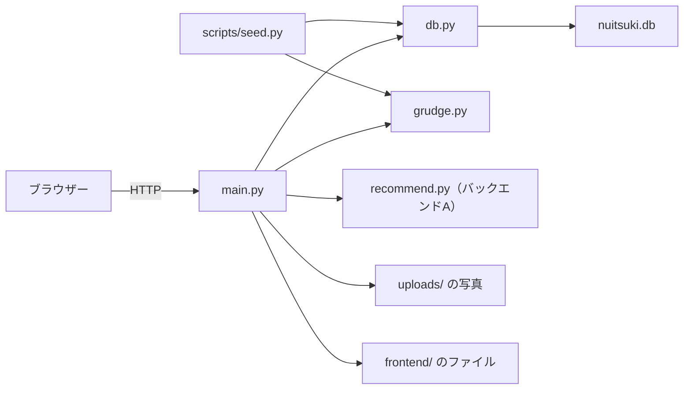

# バックエンドB：API と怨念の計算

画面とデータをつなぐ API、データベース、怨念の計算、デモ用のデータを受け持つ担当の説明書です。全体のつながりは [README.md](README.md) にあります。

## 目次

1. [この担当の役目](#1-この担当の役目)
2. [担当のファイル](#2-担当のファイル)
3. [サーバーが起動するまで](#3-サーバーが起動するまで)
4. [5つの API](#4-5つの-api)
5. [補助の関数](#5-補助の関数)
6. [画面と写真の配信](#6-画面と写真の配信)
7. [データベース](#7-データベース)
8. [怨念の計算](#8-怨念の計算)
9. [デモ用のデータ](#9-デモ用のデータ)
10. [ほかの担当とのつなぎ目](#10-ほかの担当とのつなぎ目)
11. [テスト](#11-テスト)
12. [手を動かして確かめる](#12-手を動かして確かめる)
13. [変えるときの手順](#13-変えるときの手順)
14. [最初の指示書との違いと次に触れそうな所](#14-最初の指示書との違いと次に触れそうな所)
15. [説明できるかの確認](#15-説明できるかの確認)

## 1. この担当の役目

ブラウザーから届く依頼を受け、次の4つを行います。

- ぬいと訪問をデータベースに読み書きする
- 怨念を計算する
- バックエンドAの `recommend()` を呼ぶ
- 画面のファイルと写真を配る

`backend` で `uvicorn app.main:app --port 8000` と打つと動きます。`app.main:app` は「`app/main.py` の中の変数 `app`」という意味です。



## 2. 担当のファイル

| ファイル | 内容 |
|---|---|
| [backend/app/main.py](../../backend/app/main.py) | API の入口。写真と画面も配る |
| [backend/app/db.py](../../backend/app/db.py) | SQLite の読み書き。SQL はここにしか書かない |
| [backend/app/grudge.py](../../backend/app/grudge.py) | 怨念の計算 |
| [backend/app/\_\_init\_\_.py](../../backend/app/__init__.py) | `app` を Python のパッケージにする |
| [backend/scripts/seed.py](../../backend/scripts/seed.py) | デモ用のデータを入れる |
| `backend/scripts/demo_photos/` | デモ用の画像。ふわまるは写真で、ほかは仮のイラスト |
| [backend/requirements.txt](../../backend/requirements.txt) | FastAPI、uvicorn、python-multipart |
| [backend/requirements-dev.txt](../../backend/requirements-dev.txt) | テスト用に pytest、httpx、pandas を足す |
| [backend/tests/test_frontend_files.py](../../backend/tests/test_frontend_files.py) | 画面のファイルの配信のテスト |

`backend/nuitsuki.db`（データベース）と `backend/uploads/`（写真）は動かすと作られます。git には入りません。

python-multipart は、FastAPI が `Form` や `File` を受け取るために必要です。

## 3. サーバーが起動するまで

`main.py` を上から読むと、次の順に進みます。

1. `recommend` を読み込みます。失敗したら仮の処理に切り替えます。
2. `app = FastAPI(...)` でアプリを作ります。
3. CORS の設定を足します。
4. 関数に付けた `@app.get` などで API を登録します。
5. 最後に写真と画面の配信を登録します。
6. uvicorn が `lifespan` の起動の処理を動かします。

`lifespan` は起動時と終了時に動く処理を書く場所です。`yield` より前が起動時です。

```python
@asynccontextmanager
async def lifespan(app: FastAPI):
    global SPOTS, SPOTS_BY_ID
    db.init_db()
    SPOTS = load_spots()
    SPOTS_BY_ID = {
        spot["id"]: spot for spot in SPOTS if isinstance(spot, dict) and "id" in spot
    }
    yield
```

- `db.init_db()` が表と `uploads/` を用意します。
- `SPOTS` は `spots.json` の全地点です。推薦に使います。
- `SPOTS_BY_ID` は ID から地点を引く辞書です。`POST /visits` で使います。

`spots.json` は起動時にしか読みません。作り直したら再起動が必要です。`load_spots` はファイルがないときや読めないときに空の一覧を返すので、サーバーは止まりません。そのときは推薦が0件になります。

### 仮の推薦の処理

```python
try:
    # バックエンドA が作る推薦の処理。まだない間は仮の処理を使う。
    from .recommend import recommend as recommend_spots
except ImportError:
    recommend_spots = None
```

開発の初めに `recommend.py` がなくても動くように書いたものです。`_fallback_reason` と `_fallback_recommend` がその仮の処理で、今は使われていません。ただし `recommend.py` で `ImportError` が起きると、エラーで止まらずに仮の処理に切り替わります。全地点の `score` が 0.5 なら、これを疑ってください。

## 4. 5つの API

FastAPI は関数の引数の書き方を見て、値の受け取りと確かめを自動で行います。

| 書き方 | 意味 |
|---|---|
| `lat: float`（`Form` なし） | URL の `?lat=` から受け取る。数値に変換する |
| `name: str = Form(...)` | フォームの必須の項目。`...` が必須の印 |
| `spot_id: str \| None = Form(None)` | フォームの任意の項目 |
| `last_outing_date: date = Form(...)` | `2026-11-06` の形の文字列を日付に変換する |
| `photo: UploadFile \| None = File(None)` | 任意のファイル |
| `nui_id` がパスの `{nui_id}` と同じ名前 | URL の一部から受け取る |

足りない値や変換できない値があると、関数を動かす前に FastAPI が 422 を返します。

| API | 関数 |
|---|---|
| `GET /nuis` | `get_nuis` |
| `POST /nuis` | `create_nui` |
| `GET /recommend` | `get_recommend` |
| `POST /visits` | `create_visit` |
| `GET /nuis/{nui_id}/visits` | `get_nui_visits` |

### GET /nuis

```python
    return [_nui_to_dict(nui) for nui in db.list_nuis()]
```

全部のぬいを登録の順に返します。怨念と訪問の数は `_nui_to_dict` がここで計算します。

### POST /nuis

```python
    name = name.strip()
    if not name:
        raise HTTPException(status_code=422, detail="name is required")

    photo_url = _save_photo(photo, "nui")
    nui = db.create_nui(name, last_outing_date.isoformat(), photo_url)
    return _nui_to_dict(nui)
```

名前の前後の空白を除き、空なら断ります。`status_code=201` を指定しているので、成功すると 201 を返します。

### GET /recommend

```python
    if not SPOTS:
        return []
    if recommend_spots is not None:
        return recommend_spots(SPOTS, lat, lng, limit=5)
    return _fallback_recommend(lat, lng, limit=5)
```

点数の計算はバックエンドAの担当で、ここは呼ぶだけです。

### POST /visits

このアプリで一番大事な API です。順に読みます。

```python
    nui = db.get_nui(nui_id)
    if nui is None:
        raise HTTPException(status_code=404, detail="nui not found")

    spot_id = (spot_id or "").strip() or None
    spot_name = (spot_name or "").strip() or None
```

ぬいがいるかを確かめ、地点の値を整えます。空文字は `None` にそろえます。

```python
    recommended = False
    if spot_id is not None:
        spot = SPOTS_BY_ID.get(spot_id)
        if spot is None:
            raise HTTPException(status_code=404, detail="spot not found")
        spot_name = spot["name"]
        recommended = True
    elif not spot_name:
        raise HTTPException(
            status_code=422,
            detail="spot_name is required when spot_id is not given",
        )
```

推薦地点かどうかはサーバーが `spot_id` だけで決めます。画面から `recommended` は受け取りません。`spot_id` と `spot_name` を両方送ると、`spot_name` は `spots.json` の名前で上書きされます。

```python
    grudge_before = _grudge_of(nui)
    photo_url = _save_photo(photo, "visit")
```

ここまでの確かめを通ってから写真を保存するので、断った依頼の写真は残りません。

```python
    visit = db.create_visit(
        nui_id=nui_id,
        spot_id=spot_id,
        spot_name=spot_name,
        lat=lat,
        lng=lng,
        photo_url=photo_url,
        recommended=recommended,
    )
    grudge_after = _grudge_of(nui)
```

怨念は保存の前と後で計算します。引き算で「後」を求めないのは、0で止まる処理を `calc_grudge` だけに持たせるためです。怨念がすでに0なら前後とも0になり、画面は「これ以上は鎮まりません」と出します。

### GET /nuis/{nui_id}/visits

そのぬいがいなければ 404、いれば訪問を新しい順に返します。

### 実際の応答

実際に送った結果です。

| 送った内容 | 状態コード | 返った値 |
|---|---:|---|
| `POST /nuis`、名前「 てすと 」 | 201 | `"name": "てすと"`、`photo_url` は null |
| `POST /nuis`、名前が空白だけ | 422 | `{"detail": "name is required"}` |
| `POST /nuis`、名前なし | 422 | `detail` が一覧の形（`Field required`） |
| `POST /nuis`、日付が `2026/11/01` | 422 | `detail` が一覧の形（`invalid date separator`） |
| `POST /visits`、`spot_id=park_0798` | 201 | 地点名は富士見公園、`recommended` は true、怨念 100 → 70 |
| `POST /visits`、`spot_name=カフェ` | 201 | `spot_id` は null、`recommended` は false、怨念 70 → 60 |
| `POST /visits`、地点の指定なし | 422 | `spot_name is required when spot_id is not given` |
| `POST /visits`、`spot_id=nope` | 404 | `spot not found` |
| `POST /visits`、`nui_id=99` | 404 | `nui not found` |
| `GET /nuis/99/visits` | 404 | `nui not found` |
| `GET /recommend`、`lat` なし | 422 | `detail` が一覧の形（`Field required`） |
| `GET /recommend`、札幌の座標 | 200 | `[]` |

`detail` の形は2種類あります。自分で `HTTPException` を出すと文字列になり、FastAPI の自動の確かめで断ると一覧になります。画面の `api.js` は `String(body.detail)` で文字にするので、一覧の場合は `[object Object]` と表示されます。今は画面の側で入力を確かめているので、ふつうの操作では出ません。

## 5. 補助の関数

### _save_photo

```python
    if photo is None or not photo.filename:
        return None

    suffix = Path(photo.filename).suffix.lower()
    if not suffix[1:].isalnum() or len(suffix) > 10:
        suffix = ".jpg"

    filename = f"{prefix}_{uuid.uuid4().hex}{suffix}"
```

- 写真がなければ `None` を返します。`photo_url` は null になります。
- 送られたファイル名は拡張子だけを使います。ファイル名に記号や `../` があっても保存先に影響しません。
- `uuid4` で重ならない名前を作ります。`a b.PNG` は `nui_84afb805...png` のようになります。
- `shutil.copyfileobj` で `uploads/` に書き出し、`/uploads/...` の URL を返します。

中身が画像かどうかと大きさは確かめていません。公開するなら直す必要があります。

### _grudge_of と _nui_to_dict

データベースの行を API の形にし、怨念を計算します。

```python
    visits = [dict(row) for row in db.list_visits_for_grudge(nui["id"])]
```

`dict(row)` に直すのは、`grudge.py` の `visit.get(...)` を使えるようにするためです。`sqlite3.Row` には `get` がありません。

`_grudge_of` と `_nui_to_dict` には、怨念を計算する同じ呼び出しがあります。

### _visit_to_dict

```python
        "recommended": bool(visit["recommended"]),
```

SQLite には真偽値の型がないので、0と1で保存しています。API では `true` と `false` にして返します。

## 6. 画面と写真の配信

```python
# 写真と画面を配る。API のルートを先に登録してから、最後に / へ置く。
db.UPLOAD_DIR.mkdir(parents=True, exist_ok=True)
app.mount("/uploads", StaticFiles(directory=str(db.UPLOAD_DIR)), name="uploads")
```

`app.mount("/", ...)` を最後に置くのは、`/` がすべてのパスに当てはまるからです。先に置くと API に届かなくなります。FastAPI が作る `/docs` は mount より先に登録されているので開けます。

`html=True` により、`/` で `index.html` を、`/ar/` で `ar/index.html` を返します。存在しないパスは 404 です。`frontend/` がないときだけ、`frontend_not_ready` がその旨を返します。

```python
class FrontendFiles(StaticFiles):
    async def get_response(self, path: str, scope):
        response = await super().get_response(path, scope)
        response.headers["Cache-Control"] = "no-cache"
        return response
```

上のコードは説明のために docstring を省いています。`no-cache` は「使う前にサーバーに確かめる」という指定です。指定がないとブラウザーが古い JS を使い回すことがあり、古い JS と新しい JS が混ざると import のエラーで画面全体が止まります。変わっていなければ 304 が返り、本体は送り直しません。写真は変わらないので、`/uploads` には付けていません。

### CORS

CORS は別のアドレスの画面から API を呼ぶための許可です。本番は画面と API が同じアドレスなので要りません。`localhost:5500` の許可は仮の JSON で画面を作っていたときのものです。

## 7. データベース

SQLite は1ファイルで動くデータベースです。別のサーバーは要りません。

### 表

| 表 | 列 |
|---|---|
| `nuis` | `id`、`name`、`photo_url`、`last_outing_date` |
| `visits` | `id`、`nui_id`、`spot_id`、`spot_name`、`lat`、`lng`、`photo_url`、`recommended`、`created_at` |

`grudge` と `visit_count` の列はありません。怨念は今日の日付で変わる値なので、保存すると古くなるためです。

`spot_name` は推薦地点でも保存します。そのため、あとで `spots.json` から地点が消えても、思い出の名前は出せます。日付と日時は文字列で保存します。`2026-11-06T14:02:16` の形なら、文字列の順と時間の順が同じになるので `ORDER BY created_at DESC` で並べられます。

### connect

```python
@contextmanager
def connect() -> Iterator[sqlite3.Connection]:
    """1回の処理ごとに接続を開き、終わったら閉じる。"""
    conn = sqlite3.connect(DB_PATH)
    conn.row_factory = sqlite3.Row
    conn.execute("PRAGMA foreign_keys = ON")
    try:
        yield conn
        conn.commit()
    except Exception:
        conn.rollback()
        raise
    finally:
        conn.close()
```

`with connect() as conn:` の形で使います。

| 行 | 意味 |
|---|---|
| `conn.row_factory = sqlite3.Row` | `nui["name"]` のように列の名前で値を取れるようにする |
| `PRAGMA foreign_keys = ON` | `visits.nui_id` が `nuis` にあることを確かめる。接続ごとに必要 |
| `yield conn` | `with` の中の処理をここで動かす |
| `conn.commit()` | 成功したら保存する |
| `conn.rollback()` | エラーなら取り消す |
| `conn.close()` | どちらの場合も閉じる |

FastAPI は `def` で書いた API を別々のスレッドで動かします。SQLite の接続はスレッドをまたいで使えないので、処理ごとに開き直しています。

### 関数

| 関数 | 内容 |
|---|---|
| `init_db` | 表と `uploads/` を用意する。`CREATE TABLE IF NOT EXISTS` なので何度呼んでもよい |
| `reset_db` | 全データを消し、`sqlite_sequence` を消して番号を1に戻す |
| `list_nuis` | 全部のぬいを `id` の順に返す |
| `get_nui` | 1体を返す。なければ `None` |
| `create_nui` | ぬいを入れ、入れた行を返す |
| `list_visits` | そのぬいの訪問を新しい順に返す |
| `list_visits_for_grudge` | 怨念の計算用に訪問を返す。順番は問わない |
| `create_visit` | 訪問を入れ、入れた行を返す。`created_at` がなければ今の時刻 |

SQL の値は `?` で渡します。文字列をつなげて SQL を作らないので、入力された文字が SQL として解釈されません。

```python
        return conn.execute(
            "SELECT * FROM nuis WHERE id = ?", (cur.lastrowid,)
        ).fetchone()
```

`cur.lastrowid` は直前に入れた行の番号です。`(cur.lastrowid,)` の末尾のカンマは、要素が1つのタプルを作るために必要です。

## 8. 怨念の計算

```python
def calc_grudge(last_outing_date: date, visits: list[dict], today: date) -> int:
```

```python
    days = max(0, (today - last_outing_date).days)
    grudge = min(100, days * GRUDGE_PER_DAY)

    for visit in visits:
        if _is_recommended(visit):
            grudge -= CALM_RECOMMENDED
        else:
            grudge -= CALM_OTHER

    return max(0, grudge)
```

順番に意味があります。

1. 放置日数に2を掛け、先に100で頭打ちにします。放置の点は50日で上限に届きます。
2. 訪問の数だけ引きます。推薦地点は30、それ以外は10です。
3. 最後に0より下がらないようにします。

実際に計算した結果です。

| 条件 | 怨念 | 計算 |
|---|---:|---|
| 放置60日、記録なし | 100 | min(100, 120) |
| 放置45日、推薦1件、それ以外1件 | 50 | 90 − 30 − 10 |
| 放置20日、推薦1件 | 10 | 40 − 30 |
| 放置10日、推薦1件 | 0 | 20 − 30 は0で止まる |
| 放置100日、推薦4件 | 0 | 100 − 120 は0で止まる |
| 未来の日付 | 0 | 日数を0とする |

### 知っておきたい動き

- 訪問しても「最後に連れ出した日」は変わりません。そのため、放置の点が100に届くまでは、鎮めたあとも1日に2ずつ増えます。
- 鎮めた点が100以上になると、そのぬいはずっと0です。
- `today` を引数で受けるのは、日付を変えて確かめやすくするためです。API は `date.today()` を渡します。サーバーの時計の日付です。

段階の分け方（強い、中くらいなど）は画面の `ui.js` が決めます。この担当のコードにはありません。

## 9. デモ用のデータ

`backend` で `python scripts/seed.py` を実行すると、データベースを空にしてから次のデータを入れます。**手元のデータはすべて消えます。**

| 番号 | ぬい | 放置日数 | 訪問 | 怨念 |
|---:|---|---:|---|---:|
| 1 | もちもち | 45日 | 推薦地点1件（富士見公園）、それ以外1件（近所のカフェ） | 50 |
| 2 | ふわまる | 60日 | なし | 100 |
| 3 | こんぺいとう | 20日 | 推薦地点1件（ミューザ川崎） | 10 |

```python
BACKEND_DIR = Path(__file__).resolve().parent.parent
if str(BACKEND_DIR) not in sys.path:
    sys.path.insert(0, str(BACKEND_DIR))
```

`python scripts/seed.py` で動かすと、Python は `scripts/` を探す場所にします。`from app import db` が通るよう、`backend/` を足しています。

```python
        last_outing_date = (today - timedelta(days=days_ago)).isoformat()
```

日付は「今日から何日前」で作ります。**実行した日の値で固定されるので、次の日になると値が変わります。** 実行の翌日に計算すると、もちもちは52、ふわまるは100、こんぺいとうは12でした。発表の直前に実行してください。

`demo_photo` は `demo_photos/` の SVG を `uploads/` に写します。`reset_db` はデータベースだけを消すので、`uploads/` にある写真は残り続けます。

サーバーは DB の中身を覚えていません。動かしたまま `seed.py` を実行できます。開いている画面は再読み込みしてください。

## 10. ほかの担当とのつなぎ目

| 相手 | つなぎ目 | 注意 |
|---|---|---|
| フロントA、B | 5つの API の形 | 変えるときは先に [api.md](../api.md) を直して伝える |
| フロントA | `api.js` がエラーの `detail` を読む | `detail` の文は画面にそのまま出る |
| フロントA | `POST /visits` の `grudge_before`、`grudge_after` | 結果の演出が使う |
| フロントB | `GET /nuis` を順番のまま使う | タイルは登録の順に並ぶ |
| フロントA、B | `frontend/` を配るパス | `frontend/ar/` も同じサーバーから配る |
| バックエンドA | `recommend()` と `spots.json` | `seed.py` の地点の ID は `spots.json` の値 |

## 11. テスト

`backend` で `python -m pytest tests` を実行します。この担当の直接のテストは1件です。

| テスト | 確かめていること |
|---|---|
| `test_browser_must_check_frontend_files_before_reuse` | `/` に `no-cache` が付き、変わっていなければ 304 を返す |

**次のものには自動テストがありません。** 変えたら手で確かめてください。

- 怨念の計算（`grudge.py`）
- `GET /nuis`、`POST /nuis`、`POST /visits`、`GET /nuis/{id}/visits`

`test_recommend.py` の `client` を見ると、一時データベースで API を試す書き方が分かります。

```python
@pytest.fixture
def client(tmp_path, monkeypatch):
    monkeypatch.setattr(db, "DB_PATH", tmp_path / "test.db")
    with TestClient(main.app) as c:
        yield c
```

`with TestClient(...)` と書くと `lifespan` が動きます。`test_frontend_files.py` は `with` を使わないので `lifespan` は動きません。配信のテストには要らないからです。

## 12. 手を動かして確かめる

### 怨念の計算を試す

`backend` で `python` を起動し、次を順に打ちます。`>>>` は打たないでください。データベースには触りません。

```pycon
>>> from datetime import date, timedelta
>>> from app.grudge import calc_grudge
>>> today = date(2026, 11, 7)
>>> days_ago = lambda n: today - timedelta(days=n)
>>> calc_grudge(days_ago(60), [], today)
100
>>> calc_grudge(days_ago(45), [{"recommended": 1}, {"recommended": 0}], today)
50
>>> calc_grudge(days_ago(10), [{"recommended": 1}], today)
0
>>> calc_grudge(days_ago(60), [{"spot_id": "park_0798"}], today)
70
```

最後の例は、`recommended` がないときに `spot_id` で判断する `_is_recommended` の動きです。

### API を画面から試す

サーバーを動かして `http://localhost:8000/docs` を開くと、FastAPI が作った画面で API を試せます。「Try it out」を押し、値を入れて「Execute」を押します。

1. `GET /nuis` で一覧を見ます。
2. `POST /visits` で `nui_id` に 2、`spot_id` に `park_0798`、`lat` に 35.5、`lng` に 139.7 を入れます。怨念が 100 から 70 になります。
3. `spot_id` を `nope` にして送ると 404 になります。

記録が残るので、終わったら `python scripts/seed.py` で戻します。手元のデータを残したいときは、先に `backend/nuitsuki.db` を別の場所に写してください。

### データベースの中を見る

```pycon
>>> import sqlite3
>>> conn = sqlite3.connect(":memory:")
>>> conn.execute("SELECT 1 + 1").fetchone()
(2,)
```

`":memory:"` を `"nuitsuki.db"` に変えると、手元のデータベースを読めます。`conn.execute("SELECT id, name FROM nuis").fetchall()` のように試してください。

## 13. 変えるときの手順

| やりたいこと | 直す場所 | あとですること |
|---|---|---|
| 怨念の増え方、鎮まる量を変える | `grudge.py` の先頭の定数 | サーバーの再起動、`docs/design.md` と `docs/overview.md` の数字 |
| デモの初期値を変える | `seed.py` の `nui_specs`、`visit_specs` | `seed.py` の実行。発表の台本も確かめる |
| API の項目を足す | 先に `docs/api.md`、次に `_nui_to_dict` か `_visit_to_dict` | 全員に伝える |
| 列を足す | `db.py` の `SCHEMA` と INSERT 文 | `backend/nuitsuki.db` を消して `seed.py` を実行 |
| API を増やす | `main.py` の `app.mount("/", ...)` より上 | `docs/api.md`、`api.js` |

`CREATE TABLE IF NOT EXISTS` は今ある表を変えません。列を足したのに反映されないときは、データベースが古いままです。

## 14. 最初の指示書との違いと次に触れそうな所

[docs/tasks/backend-api.md](../tasks/backend-api.md) の must はすべて実装済みです。指示書より増えたものは `FrontendFiles` の `no-cache` と、`seed.py` の写真です。

次に触れそうな所は次のとおりです。

- `_fallback_reason`、`_fallback_recommend`、`try: from .recommend` の整理。今は使っていません。
- `_grudge_of` と `_nui_to_dict` の重なりの整理。
- 怨念の計算と API の自動テスト。`client` の書き方で足せます。
- 「最後に連れ出した日」を訪問で更新するかどうか。[design.md](../design.md) では could の扱いです。

## 15. 説明できるかの確認

<details>
<summary>怨念をなぜ保存しないのですか</summary>

今日の日付で変わる値だからです。保存すると日が変わったときに古くなります。「最後に連れ出した日」と訪問の記録から、返すたびに計算します。
</details>

<details>
<summary>訪問を記録すると「最後に連れ出した日」は変わりますか</summary>

変わりません。下げるのは訪問の記録の数です。
</details>

<details>
<summary>推薦地点での記録は誰が判定しますか</summary>

サーバーです。`spot_id` が `spots.json` にあれば推薦地点での記録にします。ただし、本当にその場所にいるかは確かめません。[design.md](../design.md) の割り切りです。
</details>

<details>
<summary>app.mount("/", ...) を先頭に移すとどうなりますか</summary>

すべてのパスが画面のファイルの配信に吸い込まれ、API に届かなくなります。
</details>

<details>
<summary>接続を処理ごとに開くのはなぜですか</summary>

FastAPI が `def` の API を別々のスレッドで動かし、SQLite の接続はスレッドをまたいで使えないからです。
</details>

<details>
<summary>発表の日に怨念の数字が想定と違います。なぜですか</summary>

リハーサルの記録が残っているか、`seed.py` を前の日に実行したかです。発表の直前に `python scripts/seed.py` を実行します。
</details>
