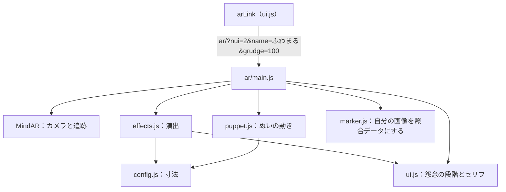

# フロントA：AR

ぬいに付けた名札をカメラで追跡し、憑依の演出を重ねるページの説明書です。[design.md](../design.md) の分担ではフロントAの受け持ちです。動かし方と注意は [frontend/ar/README.md](../../frontend/ar/README.md) にもあります。

## 確かめた範囲

この説明書を書くときに確かめたのは、開始画面の表示と URL の値の受け取りまでです。**カメラと印刷した名札での動作は、この説明書のために確かめていません。** カメラに関わる記述はコードを読んだ内容です。

## 目次

1. [このページの役目](#1-このページの役目)
2. [担当のファイル](#2-担当のファイル)
3. [起動の流れ](#3-起動の流れ)
4. [座標と寸法](#4-座標と寸法)
5. [憑依の演出](#5-憑依の演出)
6. [ぬいを動かす仕組み](#6-ぬいを動かす仕組み)
7. [名札](#7-名札)
8. [ほかの担当とのつなぎ目](#8-ほかの担当とのつなぎ目)
9. [手を動かして確かめる](#9-手を動かして確かめる)
10. [変えるときの手順](#10-変えるときの手順)
11. [動かないときの調べ方](#11-動かないときの調べ方)
12. [説明できるかの確認](#12-説明できるかの確認)

## 1. このページの役目

AR はアプリとは別のページです。`index.html` の中の画面ではないので、Three.js と MindAR はこのページを開いたときだけ読みます。地図の画面は遅くなりません。

3つの処理を組み合わせています。

| 処理 | 担当 | 内容 |
|---|---|---|
| 名札の追跡 | MindAR | カメラ映像の中の名札の位置と向きを計算する |
| 憑依の演出 | `effects.js` | オーラ、人魂、吹き出しを 3D で重ねる |
| ぬいの動き | `puppet.js` | カメラ映像からぬいを切り取って変形させる |



## 2. 担当のファイル

| ファイル | 行数 | 内容 |
|---|---:|---|
| [frontend/ar/index.html](../../frontend/ar/index.html) | 61 | ページ。ライブラリの読み込み先を決める |
| [frontend/ar/main.js](../../frontend/ar/main.js) | 209 | カメラと MindAR を起動し、全体を動かす |
| [frontend/ar/config.js](../../frontend/ar/config.js) | 38 | ぬいと名札の寸法 |
| [frontend/ar/effects.js](../../frontend/ar/effects.js) | 185 | オーラ、人魂、吹き出し |
| [frontend/ar/puppet.js](../../frontend/ar/puppet.js) | 229 | カメラ映像のぬいを切り取って動かす |
| [frontend/ar/marker.js](../../frontend/ar/marker.js) | 123 | 名札の模様を描く、照合データを作る |
| [frontend/ar/marker.html](../../frontend/ar/marker.html) | 64 | 名札の印刷ページ |
| `frontend/ar/marker.mind` | - | 名札の照合データ（バイナリ） |
| [frontend/ar/style.css](../../frontend/ar/style.css) | 150 | 開始画面、やめるボタン、状態の文の形。色、文字、ボタンは `css/style.css` を使う |
| [frontend/ar/README.md](../../frontend/ar/README.md) | 57 | 動かし方と注意 |

### ライブラリの読み込み

npm がないので、`index.html` の `importmap` で「`three` と書いたらこの URL」と決めています。

```html
          "three": "https://cdn.jsdelivr.net/npm/three@0.160.0/build/three.module.js",
```

バージョンを固定しています。`main.js` は MindAR の内部の値（`mindar.controller.trackingStates`）を読むので、MindAR を上げると動かなくなる可能性があります。インターネットがないと AR は動きません。

## 3. 起動の流れ

### ページを開いたとき

`main.js` の上の部分はページを開くと順に動きます。

1. `getUserMedia` を包み、カメラの解像度の希望を足します。
2. URL から `grudge`、`name`、`nui` を読みます。
3. セリフ、ぬいの顔、名前、怨念、戻り先を開始画面に入れます。`nui` があれば、ぬいの一覧から写真を探して顔と入れ替えます。取れないときは顔のままです。
4. HTTPS か localhost でなければ「はじめる」を押せなくします。

```js
const grudge = params.has('grudge') ? clampGrudge(params.get('grudge')) : 100;
```

`grudge` がなければ100として扱います。

カメラの解像度は MindAR を起動する前に指定しています。

```js
  media.getUserMedia = (constraints) => getUserMedia({ ...constraints, video: { ...constraints.video, ...CAMERA } });
```

MindAR は解像度を指定しないので、何もしないと 640×480 になることが多く、名札が小さく映って認識しにくくなります。そこで、MindAR が呼ぶ関数を差し替えて希望を足しています。PC は 1080p、スマホは 720p です。

### 「はじめる」を押したとき

`start()` の流れです。

1. 自分の画像を選んでいれば `compileTarget` で照合データを作ります。なければ `marker.mind` を使います。
2. `MindARThree` を作ります。
3. `mindar.addAnchor(0)` で、名札に付いた 3D の入れ物を受け取ります。入れた物は名札と一緒に動きます。
4. `nuiBody` を作り、`TAG_TILT_DEG` の分だけ傾け、演出を入れます。
5. `onTargetFound` と `onTargetLost` を登録します。
6. `await mindar.start()` でカメラを起動します。
7. カメラ映像が要るので、起動のあとに `createPuppet` で動くぬいを作ります。
8. `renderer.setAnimationLoop` で毎フレームの更新を始めます。

```js
    renderer.setAnimationLoop(() => {
      const delta = clock.getDelta();
      // 見失っているあいだは位置が古いので、映像を切り取って動かす処理だけ止める
      puppet.setTracking(mindar.controller.trackingStates[0]?.isTracking ?? true);
      parts.forEach((p) => p.update(clock.elapsedTime, delta, camera));
      renderer.render(scene, camera);
    });
```

`delta` は前のフレームからの秒数です。`parts` は演出と動くぬいの配列で、どちらも `object`、`setActive`、`update` を持ちます。`main.js` はこの共通の形だけを使います。

### 認識の設定

```js
const TRACKING = { warmupTolerance: 1, missTolerance: 30 };
```

`warmupTolerance: 1` は見つけたらすぐ出す設定です。`missTolerance: 30` は30フレーム見失ってから消す設定です。動かすと一瞬見失うことが多いので、演出が途切れないようにしています。

### その他の関数

| 関数 | 内容 |
|---|---|
| `setStatus` | 画面の下の文を出す、消す |
| `compileTarget` | 画像から照合データを作る。同じ画像は `compiled` の結果を使い回す |
| `showDebugInfo` | `?debug=1` のとき、カメラの解像度と1秒の処理の回数を出す |
| `stop` | 描画を止め、カメラを止め、開始画面に戻す |

`start` の `catch` はカメラを許可しないときなどに原因の文を出します。

## 4. 座標と寸法

座標の単位は名札の幅です。**名札の幅が1で、原点は名札の中心です。** `config.js` がぬいの寸法をこの単位に直します。

| 定数 | URL の値 | 既定値 | 内容 |
|---|---|---:|---|
| `MARKER_CM` | `markerCm` | 4 | 名札の幅（cm） |
| `NUI_CM` | `nuiCm` | 14 | ぬいの全長（cm） |
| `TAG_HEIGHT_RATIO` | `tagRatio` | 0.36 | 名札の中心がぬいの下から何割の高さか |
| `TAG_TILT_DEG` | `tilt` | 0 | 名札の傾き（度） |
| `HIDE_TAG` | `hideTag` | 1 | 画面の中で名札を消すか |

```js
export const NUI_HEIGHT = NUI_CM / MARKER_CM;
// ぬいの体の中心（マーカーの中心から見た高さ）
export const NUI_CENTER_Y = (0.5 - TAG_HEIGHT_RATIO) * NUI_HEIGHT;
```

既定値で計算すると、`NUI_HEIGHT` は 14 ÷ 4 = 3.5 です。ぬいは名札3.5個分の高さです。`NUI_CENTER_Y` は (0.5 − 0.36) × 3.5 = 0.49 で、体の中心は名札の中心より 0.49 上にあります。

`PARTS` はぬいの部位の位置です。こちらは**ぬいの高さを1、体の中心を0とした値**で、単位が違います。

| 項目 | 値 | 内容 |
|---|---:|---|
| `outline` | 0.44、0.54 | 輪郭の楕円の半径（横、縦） |
| `neckY` | 0.05 | 首の高さ。ここから上を頭として傾ける |
| `armY` | -0.08 | 腕の高さ |
| `armInnerX` | 0.2 | 肩の横の位置 |
| `armOuterX` | 0.42 | 腕の先の横の位置 |
| `armSwing` | 0.35 | 腕の振りの大きさ |

これらの値は録画に映ったぬいから測ったものです。別のぬいでは合わないことがあります。

## 5. 憑依の演出

`effects.js` は怨念の段階で見せ方を変えます。段階は `ui.js` の `grudgeStage` が決めます。

```js
const LOOKS = {
  strong: { aura: 'rgba(225, 40, 70, 1)', wisp: 'rgba(255, 130, 90, 1)', wisps: 3, shake: 1, deform: 1 },
  medium: { aura: 'rgba(160, 60, 255, 1)', wisp: 'rgba(110, 200, 255, 1)', wisps: 3, shake: 0.6, deform: 0.75 },
  weak: { aura: 'rgba(90, 140, 255, 1)', wisp: 'rgba(110, 200, 255, 1)', wisps: 2, shake: 0.25, deform: 0.5 },
  calm: { aura: 'rgba(255, 225, 140, 1)', wisp: 'rgba(255, 225, 140, 1)', wisps: 0, shake: 0, deform: 0.3 },
};
```

| 項目 | 内容 |
|---|---|
| `aura` | オーラの輪の色 |
| `wisp` | 人魂の色 |
| `wisps` | 人魂の数 |
| `shake` | 震えの強さ |
| `deform` | ぬいの動きの大きさ（`puppet.js` に渡す） |

| 関数 | 内容 |
|---|---|
| `hauntLook` | 怨念から `LOOKS` の1行を選ぶ |
| `glowTexture` | 人魂の光の画像を canvas に描く |
| `ringTexture` | オーラの輪の画像を描く。真ん中を透明にして、ぬいが白く飛ばないようにする |
| `keepOnScreen` | 吹き出しが画面の外へ出そうなら内側へ寄せる |
| `createBubble` | 吹き出しを canvas に描く。長いセリフは文字を小さくする |
| `createHauntEffect` | 全部を組み立て、`object`、`setActive`、`update` を返す |

`createHauntEffect` の入れ物は2段です。

```js
  const root = new THREE.Group();
  root.position.set(0, NUI_CENTER_Y, 0.05);
  const body = new THREE.Group();
  body.scale.setScalar(EFFECT_SCALE);
```

`root` をぬいの体の中心に置き、`body` を揺らします。部品は高さ1.5のぬいを想定した寸法なので、`EFFECT_SCALE`（3.5 ÷ 1.5 = 約2.33）で拡大します。

`update` は毎フレーム動きます。

```js
      strength += (target - strength) * Math.min(1, delta * 3);
```

`strength` は見え方の強さで、`target`（0か1）に少しずつ近づきます。名札を見つけるとふわっと出て、見失うとふわっと消えます。

`keepOnScreen` は吹き出しの位置を画面の座標に直し、中心が画面の端に近づきすぎたら、はみ出す分だけ内側へ戻します。ぬいが画面いっぱいに映ったときのためです。

## 6. ぬいを動かす仕組み

一番難しいファイルです。本物のぬいは動かせないので、画面の上で動いて見せています。

### 考え方

1. ぬいの位置に、細かく分割した板を置きます。
2. 板の各点について、**変形する前に**この点が画面のどこに映るかを計算し、その位置のカメラ映像を板に貼ります。何も変形させなければ、板は本物のぬいとぴったり重なります。
3. 板を変形させると、貼った映像も一緒に動きます。
4. 動くと本物のぬいがはみ出して見えるので、その下にまわりの色で塗った板を敷きます。

これを GPU で動くプログラム（シェーダー）で書いています。頂点シェーダーが板の形を変え、フラグメントシェーダーが色を決めます。JS からシェーダーへ渡す値を uniform と呼びます。

### 形を変える：頂点シェーダー

```glsl
    vLocal = position;
    // ぬいの高さを 1、体の中心を 0 とした座標
    vec2 q = (position.xy - uCenter) / uNuiHeight;
    float k = uStrength * uDeform;
```

`vLocal` に変形する前の位置を残します。`q` は `PARTS` と同じ単位の座標です。`k` が動きの大きさで、怨念が弱いと `uDeform` が小さくなります。

変形は腕、頭、体全体の順です。

```glsl
    // 頭: 首から上をゆっくり傾ける
    float headWeight = smoothstep(uNeckY - 0.05, uNeckY + 0.12, q.y);
    q = mix(q, rotateAround(q, vec2(0.0, uNeckY), sin(uTime * 2.3) * 0.16 * k), headWeight);
```

- `smoothstep` はある範囲で0から1へなめらかに変わる値を返します。ここでは「どのくらい頭に含まれるか」です。
- `rotateAround` は支点のまわりに回します。
- `mix` は2つの位置を割合で混ぜます。頭は回した位置、体はもとの位置になり、首のあたりは中間になるので、境目が割れません。
- `sin(uTime * 2.3)` で時間とともに左右に揺れます。

腕も同じ考えで、肩を支点に振ります。`sign(q.x)` で左右を分け、`armWeight` で腕の範囲だけを動かします。体全体は足もとを支点に揺らし、`abs(sin(uTime * 4.0))` で跳ねさせます。

### 映像を貼る：フラグメントシェーダー

```glsl
  vec2 videoUv(vec3 local) {
    vec4 clip = uProjectOriginal * vec4(local, 1.0);
    vec2 ndc = clip.xy / clip.w;
    vec2 px = vec2((ndc.x * 0.5 + 0.5) * uContainer.x, (0.5 - ndc.y * 0.5) * uContainer.y);
    vec2 uv = (px - uVideoRect.xy) / uVideoRect.zw;
    return vec2(uv.x, 1.0 - uv.y);
  }
```

これが仕組みの中心です。変形する前の位置から、カメラ映像の中の位置を求めます。

| 行 | 内容 |
|---|---|
| `clip` | 板の上の点を、カメラから見た位置に変換する |
| `ndc` | 画面の中心を0、端を±1とした座標にする |
| `px` | 画面のピクセルの位置にする。画面の y は下向きなので符号を変える |
| `uv` | カメラ映像の中の割合（0〜1）にする |
| 最後の行 | 映像の上下を合わせる |

変形する前の位置で映像を取るので、板がどう動いても、貼る映像はぬいのままです。

3つの値を JS から渡しています。

```js
  puppet.onBeforeRender = (renderer, scene, camera) => {
    uniforms.uProjectOriginal.value.multiplyMatrices(camera.projectionMatrix, camera.matrixWorldInverse).multiply(puppet.matrixWorld);
```

| uniform | 内容 |
|---|---|
| `uProjectOriginal` | 板の座標から画面の座標への変換。描く直前のカメラと板の位置から求める |
| `uContainer` | 画面の大きさ |
| `uVideoRect` | 画面の中でカメラ映像が置かれている位置と大きさ。MindAR が CSS で配置するので `video.style` から読む |

### 3枚の板の重ね方

| 順 | 物 | 内容 |
|---:|---|---|
| 1 | `cover` | ぬいの楕円の中を、すぐ外側の映像で塗る |
| 2 | `puppet` | 切り取って動かすぬい |
| 2.5 | `tagCover` | 名札を、まわりの毛の色で塗る。`HIDE_TAG` のときだけ |
| 3 | 演出 | `effects.js` のオーラ、人魂、吹き出し |

`renderOrder` でこの順に描きます。

```js
    new THREE.ShaderMaterial({ ...common, fragmentShader: coverFragment, uniforms: { ...uniforms, uDeform: { value: 0 } } }),
```

`cover` だけ `uDeform` を0にしているので変形しません。ほかの uniform は同じ物を共有します。

`cover` は楕円の外側の点を21個（角度7通り × 距離3通り）混ぜて色を作ります。1点だけを引き伸ばすと放射状の筋が見えるからです。ぬいの輪郭は楕円で近似しているので、ぬいのまわりの床も少し一緒に動きます。模様の多い場所では筋が見えます。

### 見失ったとき

```js
      u.value += ((tracking ? target : 0) - u.value) * Math.min(1, delta * (tracking ? 3 : 8));
```

見失っている間は位置が古いので、ずれた映像を貼らないよう `uStrength` を速く0に近づけます。演出（`effects.js`）は `missTolerance` の間は残ります。

## 7. 名札

| 関数 | 内容 |
|---|---|
| `createRandom` | 種つきの乱数を作る |
| `drawMarker` | 枠、図形110個、中央のおばけを描く |
| `createMarkerImage` | 模様を画像にする |
| `compileMarker` | 画像から照合データを作る。MindAR の `Compiler` を必要なときに読む |
| `loadImage` | 画像の読み込みを待つ |

同じ種（`DEFAULT_SEED`）なら毎回同じ模様になるので、印刷した名札と照合データが一致します。追跡は角の多い模様のほうが安定するので、大きさと向きの違う図形を散らしています。文字を使わないのは、端末ごとに字形が変わるためです。

`marker.mind` は模様の特徴点をまとめたデータです。作るのに時間がかかるので、あらかじめ作って置いています。**模様を変えたら作り直してください。** `marker.html` の「照合データ（marker.mind）を作る」を押し、ダウンロードしたファイルで置き換えます。

`marker.html` は `MARKER_CM` に合わせて canvas の幅を決めるので、印刷すると4cm角になります。`?markerCm=` を変えて印刷すると大きさも変わります。

MindAR の認識には次の決まりがあります（[frontend/ar/README.md](../../frontend/ar/README.md)）。

- 名札が映像の中で 100px ほどより小さいと認識できません。
- 名札を探すのは映像の中央付近だけです（1080p で横の中央 53%、720p で 40%）。
- 追跡は1回の処理で名札の幅の8%ほどしか動きを追えません。

## 8. ほかの担当とのつなぎ目

| 相手 | つなぎ目 | 注意 |
|---|---|---|
| フロントA | `visit.js` の結果画面が `arLink` を使う | 記録のあとの怨念を渡す |
| フロントB | `nuis.js` の一番上のカードが `arLink` を使う | 一番怨念の強いぬいだけに付いている |
| フロントA、B | `grudgeStage`、`clampGrudge`、`grudgeGauge`、`nuiAvatar`、`stageChip` を `../js/ui.js` から読み、`../css/style.css` も読み込む | `ui.js` と `css/style.css` を変えると AR も変わる |
| バックエンドB | 同じサーバーが `frontend/ar/` を配る | 開始画面の写真を探すときだけ `GET /nuis` を呼ぶ。演出は API を呼ばずに動く |

AR のページは API を呼びません。怨念は URL の値です。セリフ（`grudgeStage().line`）を表示しているのは今のところ AR だけです。

## 9. 手を動かして確かめる

### 開始画面を確かめる

サーバーを動かして次の URL を開くと、カメラなしで確かめられます。

| URL | 見出し | 怨念の文 | セリフ | 戻り先 |
|---|---|---|---|---|
| `/ar/` | ぬい憑き | なし | ゆるさない… | `../#map` |
| `/ar/?grudge=0` | ぬい憑き | なし | また連れてってね | `../#map` |
| `/ar/?grudge=30&name=テスト` | テスト | 怨念 30 | …まあ、許してあげてもいい | `../#map` |
| `/ar/?grudge=50&name=テスト&nui=2` | テスト | 怨念 50 | 最近ずっと置いていくよね | `../#nui/2` |
| `/ar/?grudge=100&name=テスト&nui=2` | テスト | 怨念 100 | ゆるさない… | `../#nui/2` |

### カメラで確かめる

1. `/ar/marker.html` を開き、名札を別の端末の画面に出すか、印刷します。
2. `/ar/?grudge=100&debug=1` を開き、「はじめる」を押してカメラを許可します。
3. 名札を映すと、演出が出ます。左上にカメラの解像度と処理の回数が出ます。
4. `grudge` を 0、30、50 に変えて、色と動きの違いを比べます。
5. `?hideTag=0` で名札を消す処理を止めると、`tagCover` の働きが分かります。

スマホで試すには HTTPS が要ります。[frontend/ar/README.md](../../frontend/ar/README.md) を読んでください。

## 10. 変えるときの手順

| やりたいこと | 直す場所 |
|---|---|
| セリフ | `ui.js` の `grudgeStage` |
| 段階ごとの色、人魂の数、動きの大きさ | `effects.js` の `LOOKS` |
| 動きの速さ、振れ幅 | `puppet.js` の `vertexShader` の `sin(...)` と係数 |
| ぬいの大きさ、名札の位置 | まず URL の `?nuiCm=&tagRatio=` で試し、`config.js` の既定値を直す |
| 腕や首の位置 | `config.js` の `PARTS` |
| 認識の粘り | `main.js` の `TRACKING` |
| 名札の模様 | `marker.js` のあと、`marker.mind` を作り直す |

## 11. 動かないときの調べ方

| 症状 | 確かめること |
|---|---|
| 「はじめる」を押せない | HTTPS か localhost で開いているか |
| カメラが起動しない | ブラウザーのカメラの許可。インターネットの接続 |
| 名札に反応しない | 名札の大きさ。映像の中央にあるか。`?debug=1` の解像度 |
| 演出の位置がずれる | `?tagRatio=`、`?tilt=`、`?nuiCm=` を試す |
| ぬいの動きが出ない | `?debug=1` の処理の回数。少ないと追跡が途切れる |
| ぬいのまわりに筋が見える | 背景の模様が多い。無地の床や壁の前で試す |
| 画面に何も出ない | F12 の Console の赤いエラー |

## 12. 説明できるかの確認

<details>
<summary>ぬいは本当に動いているのですか</summary>

動いていません。カメラ映像のぬいの部分を板に貼り、板を変形させて動いて見せています。下にまわりの色の板を敷いて、本物のぬいを隠します。
</details>

<details>
<summary>なぜ名札を使うのですか</summary>

MindAR は画像を目印に位置を追跡します。ぬいの顔を目印にする方法も試しましたが、実機では印刷した名札のほうが精度がよかったので、名札を使っています。画面の中では `tagCover` で名札を消しています。
</details>

<details>
<summary>怨念の強さはどう演出に反映されますか</summary>

URL の `grudge` から段階を決め、`LOOKS` の色、人魂の数、震え、動きの大きさと、`grudgeStage` のセリフを変えます。
</details>

<details>
<summary>なぜ変形する前の位置で映像を取るのですか</summary>

変形した後の位置で取ると、その場所の映像（床など）が貼られ、ぬいが動いて見えないからです。変形する前の位置で取ると、ぬいの映像が板と一緒に動きます。
</details>

<details>
<summary>オフラインで動きますか</summary>

動きません。Three.js と MindAR を jsDelivr から読むからです。
</details>
