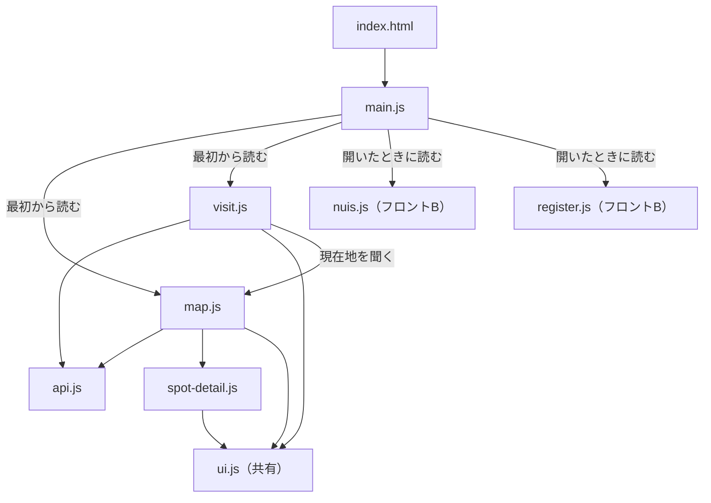
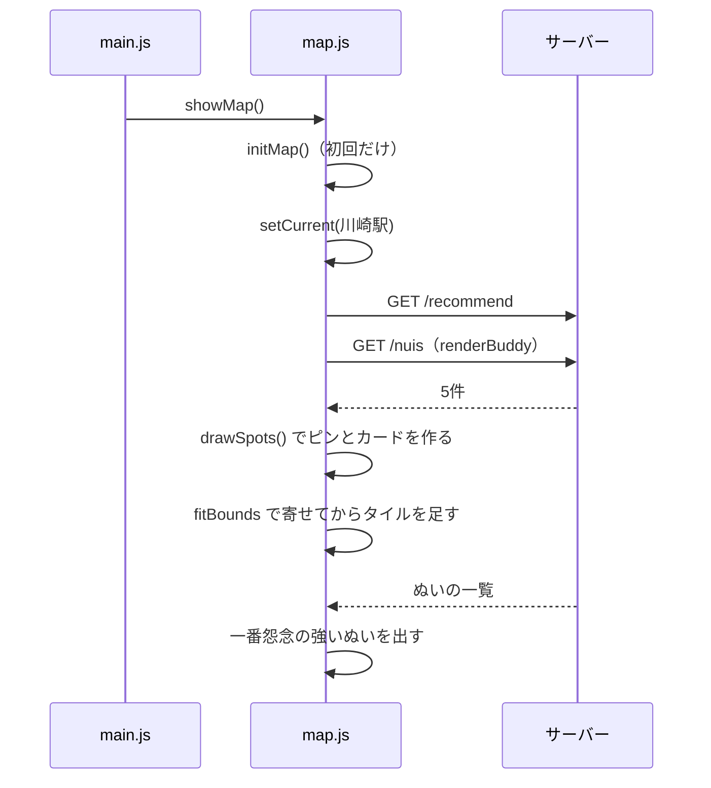

# フロントA：骨組みと地図と訪問の記録

画面全体の骨組みと、地図で地点を選んで訪問を記録する流れを受け持つ担当の説明書です。AR は [frontend-a-ar.md](frontend-a-ar.md) に分けました。全体のつながりは [README.md](README.md) にあります。

## 目次

1. [この担当の役目](#1-この担当の役目)
2. [担当のファイル](#2-担当のファイル)
3. [ページが開くまで](#3-ページが開くまで)
4. [画面の切り替え](#4-画面の切り替え)
5. [API の呼び出し](#5-api-の呼び出し)
6. [地図と推薦カード](#6-地図と推薦カード)
7. [地点の詳細](#7-地点の詳細)
8. [訪問の記録](#8-訪問の記録)
9. [ほかの担当とのつなぎ目](#9-ほかの担当とのつなぎ目)
10. [手を動かして確かめる](#10-手を動かして確かめる)
11. [変えるときの手順](#11-変えるときの手順)
12. [最初の指示書との違いと次に触れそうな所](#12-最初の指示書との違いと次に触れそうな所)
13. [説明できるかの確認](#13-説明できるかの確認)

## 1. この担当の役目

アプリは1ページだけで、画面の切り替えでページを読み直しません。この担当は次の4つを作っています。

- URL の `#` で画面を切り替える仕組み
- API を呼ぶ関数のまとまり
- 地図に推薦地点を出す画面
- 訪問を記録して怨念が下がる様子を見せる画面

ビルドはありません。保存して再読み込みするだけで反映されます。



## 2. 担当のファイル

| ファイル | 内容 |
|---|---|
| [frontend/index.html](../../frontend/index.html) | 骨組み。`#map` と `#visit` の中身、下のメニュー |
| [frontend/js/main.js](../../frontend/js/main.js) | 画面の切り替えとフォントの読み込み |
| [frontend/js/api.js](../../frontend/js/api.js) | API の呼び出し。仮の JSON との切り替え |
| [frontend/js/map.js](../../frontend/js/map.js) | 地図と推薦カード |
| [frontend/js/spot-detail.js](../../frontend/js/spot-detail.js) | 地点の詳細のシート |
| [frontend/js/visit.js](../../frontend/js/visit.js) | 訪問の記録と結果の演出 |
| `frontend/mock/` | API の代わりの JSON（`nuis.json`、`recommend.json`、`visits.json`） |
| `frontend/ar/` | AR。別の説明書 |

`frontend/js/ui.js` はフロントBと共有しています。説明は [frontend-b.md](frontend-b.md) にあります。

## 3. ページが開くまで

`index.html` の読み込みの順番に意味があります。

```html
<script src="https://unpkg.com/leaflet@1.9.4/dist/leaflet.js"></script>
<script type="module" src="js/main.js"></script>
```

- Leaflet はふつうの `<script>` なので、全部の JS から `L` という名前で使えます。npm もビルドもありません。
- `type="module"` の JS は `import` と `export` でファイルを分けられます。HTML を読み終えてから動きます。

```html
<link rel="modulepreload" href="js/map.js">
```

`modulepreload` は、`import` をたどる前に JS をまとめて読む指定です。地図の画面に要るファイルを並べ、往復の回数を減らしています。

`index.html` の最小のスタイルにある次の2行で、画面を切り替えます。

```css
.screen { display: none; }
.screen.is-active { display: block; }
```

全部の `<section class="screen">` は最初から HTML にあり、`is-active` が付いた1つだけが見えます。

## 4. 画面の切り替え

`main.js` は109行と短いので、全部読めます。

| `#` | 動く関数 | ファイル |
|---|---|---|
| `#map` | `showMap()` | `map.js` |
| `#visit` | `showVisit()` | `visit.js` |
| `#nuis` | `showNuis()` | `nuis.js` |
| `#nui/1` | `showNuiDetail(1)` | `nuis.js` |
| `#register` | `showRegister()` | `register.js` |

```js
async function render() {
  const { name, param } = parseHash(location.hash);
  showSection(name);

  // 地図のない画面から開いたときは、待たずにフォントを読む
  if (name !== 'map') loadFonts();

  if (name === 'map') showMap();
  else if (name === 'visit') showVisit();
  else await callLazyScreen(name, param);
}

window.addEventListener('hashchange', render);
```

`#` の部分が変わるとブラウザーは `hashchange` を出し、ページは読み直しません。リンクは `<a href="#nuis">` と書くだけで画面が切り替わります。JS から切り替えるときは `location.hash = '#visit'` と書きます。

| 関数 | 内容 |
|---|---|
| `parseHash` | `#nui/1` を `{ name: 'nui', param: 1 }` にする。知らない名前は `map` にする。数字だけの値は数値に直す |
| `showSection` | `is-active` を付け替え、下のメニューの選択を変え、`document.body.dataset.route` に画面の名前を入れ、先頭までスクロールする |
| `callLazyScreen` | `import()` でファイルを読み、画面の関数を呼ぶ |
| `loadFonts` | フォントの `<link>` を足す。1回だけ動く |
| `render` | 上の関数を順に呼ぶ |

### 読み込みを分けている理由

```js
const LAZY_SCREENS = {
  nuis: { module: './nuis.js', fn: 'showNuis' },
  nui: { module: './nuis.js', fn: 'showNuiDetail' },
  register: { module: './register.js', fn: 'showRegister' },
};
```

フロントBのファイルは `import()` で開いたときに読みます。分担して作っていたころ、ファイルがなくても画面全体が止まらないようにした名残です。読み込みに失敗すると `index.html` の `data-pending` の文（「ここはフロントB の担当です」）が出ます。Console の `[main]` の警告で原因を確かめてください。

### 記録の画面のメニュー

`document.body.dataset.route` は `<body data-route="visit">` のように HTML に入ります。`style.css` の次の行がこの値を見て、記録の画面で下のメニューを隠します。

```css
body[data-route="visit"] .navbar { display: none; }
```

### フォントを待たせる理由

フォントは合わせて約680KBあり、地図のタイルと回線を取り合います。そこで `map.js` がタイルを読み終えた合図（`nuituki:map-ready`）を出すか、5秒経ったときに読み始めます。測定は [overview.md](../overview.md) にあります。

## 5. API の呼び出し

ほかの JS は `fetch` を直接書かず、`api.js` の関数を使います。

| 関数 | API | 返す値 |
|---|---|---|
| `getNuis()` | `GET /nuis` | ぬいの配列 |
| `createNui(formData)` | `POST /nuis` | 登録したぬい |
| `getRecommend(lat, lng)` | `GET /recommend` | 推薦地点の配列 |
| `createVisit(formData)` | `POST /visits` | `{ visit, grudge_before, grudge_after }` |
| `getVisits(nuiId)` | `GET /nuis/{id}/visits` | 訪問の配列 |

中の補助の関数は3つです。

```js
async function getJson(url) {
  const res = await fetch(url);
  if (!res.ok) throw new Error(await errorMessage(res));
  return res.json();
}
```

- `getJson` と `postForm` は通信し、失敗なら例外を投げます。`fetch` は 404 や 422 でも例外を投げないので、`res.ok` を確かめる必要があります。
- `errorMessage` は FastAPI の `{ "detail": "..." }` を読んで文にします。各画面はこの例外を `catch` して表示します。
- `postForm` は `body` に `FormData` を渡します。ブラウザーが写真も含む `multipart/form-data` の形にします。`Content-Type` は自分で書きません。

### 仮の JSON で動かす

```js
export const USE_MOCK = false; // 仮の JSON で画面を作るときだけ true にする
```

`true` にすると、API の代わりに `frontend/mock/` の JSON を読みます。`mockVisit` と `createNui` は仮の値を返すだけで、記録は残りません。`mockUrl` は `import.meta.url`（このファイルの場所）から場所を求めるので、ページの URL が変わっても同じファイルを指します。

`API_BASE` は API のアドレスです。画面と同じサーバーなので空のままです。

## 6. 地図と推薦カード

`map.js` は一番大きな画面です。ピンとカードを同じ順で作り、連動させています。

### 状態を持つ変数

| 変数 | 内容 |
|---|---|
| `map` | Leaflet の地図。`null` のときだけ作る |
| `tiles` | 地図の絵（タイル）の層 |
| `spotLayer` | ピンの入れ物。まとめて消せる |
| `currentMarker` | 現在地の印 |
| `current` | 現在地の緯度と経度 |
| `markers` | ピンの配列。カードと同じ順 |
| `activeIndex` | 選んでいる地点の番号 |
| `ignoreScrollUntil` | スクロールで選び直さない時刻 |

### 開くときの流れ



```js
export function showMap() {
  if (!map) initMap();
  // 隠れている間に地図を作ると大きさがずれるので、表示のたびに直す
  map.invalidateSize();
  // 記録のあとで怨念が変わるので、表示のたびに取り直す
  renderBuddy();
}
```

### 関数ごとの説明

| 関数 | 内容 |
|---|---|
| `getCurrentLocation` | 現在地を返す。`visit.js` が使う |
| `showMap` | 画面を開くたびに呼ばれる |
| `initMap` | 地図、タイル、ボタンの動きを1回だけ用意する |
| `showTiles` | タイルを地図に足す。2回目からは何もしない |
| `toggleSheet` | 下のシートをたたむ、広げる |
| `locate` | ブラウザーの位置情報で現在地を取る。ボタンを押したときだけ動く |
| `setCurrent` | 現在地を変え、印を動かし、推薦を取り直す |
| `loadRecommend` | API を呼び、結果かエラーを出す |
| `showSkeleton` | 読み込み中のカードの形を出す。前の結果があれば残す |
| `emptyCard` | 文だけのカードを作る |
| `drawSpots` | ピンとカードを作り、地図を寄せる |
| `mapPadding` | シートなどに隠れる分の余白を計算する |
| `cardFor` | カード1枚を作る |
| `setActive` | ピンとカードに `is-active` を付ける |
| `onListScroll` | カードを横に送ったら、真ん中のカードを選ぶ |
| `renderBuddy` | 一番怨念の強いぬいをシートの上に出す |
| `buddyText` | そのぬいの文の部分を作る |
| `selectPlace` | 記録する場所を伝えて `#visit` に進む |
| `status` | 上の帯の文を変える |

### 現在地

```js
  map.on('click', (e) => {
    setCurrent(e.latlng.lat, e.latlng.lng, '押した場所を現在地にしました');
  });
```

地図を押した場所も、位置情報のボタンも、`setCurrent` を通ります。位置情報を自動で取らないのは、会場が川崎市の外だと推薦地点が出なくなるからです。

### タイルを読む順番

タイルは地図を小さな正方形に分けた画像で、OpenStreetMap から読みます。無駄な読み込みを減らすため、次の順に進みます。

1. `initMap` でタイルの層を作りますが、まだ地図に足しません。
2. 推薦地点が届くと、`fitBounds` で全地点が見える位置に寄せます。
3. `showTiles` でタイルを足します。寄せる前のズームのタイルを読まずに済みます。
4. API が遅いときは、`setTimeout(showTiles, TILE_WAIT_MS)` が3秒後にタイルを出します。

```js
    detectRetina: window.devicePixelRatio >= SHARP_TILE_MIN_RATIO && !WIDE.matches,
```

`detectRetina` は高解像度の画面で1段細かいタイルを出す指定です。地図がくっきりしますが、タイルの数は増えます。スマホの幅だけで有効にしています。[overview.md](../overview.md) の測定では、スマホの幅で 1.6Mbps のとき、地図が出るまで 8.1秒、タイルは32件です。

### ピンとカードの連動

```js
    marker.on('click', () => setActive(i, { scrollCard: true }));
```

| 操作 | 動き |
|---|---|
| ピンを押す | そのカードまで送る |
| カードの名前を押す | 地図を寄せて、詳細を開く |
| カードを横に送る | `onListScroll` が真ん中のカードを選び、地図を寄せる |
| PC の幅でスクロールする | カードが縦に並ぶので、選び直さない |

ピンを押してカードが動いている間にスクロールの処理が動くと、別の地点を選び直してしまいます。そこで `setActive` が `ignoreScrollUntil` を800ms先に設定します。`onListScroll` は120ms止まってから動きます。

### ピンは HTML、カードは DOM

```js
      html: `<span class="spot-pin-body"><span>${i + 1}</span></span>`,
```

ピンの番号は自分で作った数字なので HTML の文字列に入れています。地点の名前や理由は `textContent` で入れます。データの中の文字が HTML として解釈されないようにするためです。

### 一番怨念の強いぬい

```js
    const top = [...nuis].sort((a, b) => b.grudge - a.grudge)[0];
```

`[...nuis]` は配列の写しです。同じ値なら登録の順が先のぬいを選びます。読み込みに失敗すると、このぬいの表示だけを隠します。

## 7. 地点の詳細

`spot-detail.js` の `openSpotDetail(spot, onRecord)` が `<dialog>` を作って開きます。`GET /recommend` が `details` と `attrs` を返しているので、詳細を開くときに API は呼びません。

| 関数 | 内容 |
|---|---|
| `icon` | `ICONS` の SVG を文字列で返す |
| `infoRow` | アイコン、見出し、値の1行を作る |
| `link` | リンクを作る。外のサイトなら新しいタブで開く |
| `areaText` | 広さを「11.7ha」「4,310㎡」にする |
| `openSpotDetail` | 全体を組み立てて開く |

値がある項目だけを出します。公園には住所がなく、施設には広さがありません。富士見公園では「最寄り駅」「広さ」「開園した年」の3行になりました。

```js
  dialog.replaceChildren(body, actions);
  dialog.showModal();
```

`showModal()` を使うと、Esc キーで閉じる動きと、背景の操作を止める動きをブラウザーが受け持ちます。外側を押して閉じる動きは `e.target === dialog` で判定します。

「経路を見る」は Google マップの URL を開くだけで、経路の計算はしていません。「ここで記録する」は `map.js` から渡された `onRecord` を呼びます。詳細の側は記録の画面のことを知らなくて済みます。

## 8. 訪問の記録

### 場所の渡し方

`map.js` と `visit.js` はイベントで連絡します。

```js
function selectPlace(spot, lat, lng) {
  document.dispatchEvent(new CustomEvent('nuituki:place-selected', {
    detail: { spot, lat, lng },
  }));
  location.hash = '#visit';
}
```

```js
document.addEventListener('nuituki:place-selected', (e) => {
  place = e.detail;
});
```

`dispatchEvent` はその場で受け手を動かすので、`place` が入ってから画面が切り替わります。受け手を先に登録しておく必要があるので、`main.js` は `visit.js` を最初から読み込みます。

`spot` が `null` なら推薦地点の外での記録です。地図を通らず `#visit` を開いたときも、`showVisit` が今の現在地で同じ扱いにします。

### 関数ごとの説明

| 関数 | 内容 |
|---|---|
| `showVisit` | 画面を開くたびにフォームを初期化する |
| `renderPlace` | 推薦地点なら名前と理由、それ以外なら名前の入力欄を出す |
| `renderNuiOptions` | ぬいを怨念の強い順に並べ、一番強いぬいを選んでおく |
| `markSelected` | 選んだぬいに枠を付ける |
| `showPreview` | 選んだ写真を送る前に見せる |
| `submit` | 入力を確かめ、`FormData` を作って送る |
| `renderResult` | 朱印、数字、ゲージ、次のボタンを出す |
| `settle` | 数字とゲージを下げる |
| `showError`、`hideError` | エラーの文を出す、隠す |

### 送る処理

```js
  const formData = new FormData();
  formData.append('nui_id', checked.value);
  formData.append('lat', String(place.lat));
  formData.append('lng', String(place.lng));
  if (place.spot) {
    // 推薦地点のときは、地点の名前を API が spots.json から取る
    formData.append('spot_id', place.spot.id);
  } else {
    formData.append('spot_name', nameInput.value.trim());
  }
```

項目の名前は [api.md](../api.md) の `POST /visits` と同じです。推薦地点で写真なしのとき、実際の送信は `nui_id`、`lat`、`lng`、`spot_id` でした。送っている間はボタンを `disabled` にして、二重に送らないようにしています。

### 結果の演出

CSS と JS を組み合わせています。富士見公園でふわまるを記録したときの実際の表示です。

| 時間 | 動き | 担当 |
|---|---|---|
| 0ms | 数字 100、ゲージ 100%、記録の前の顔 | `renderResult` |
| 150ms〜 | 朱印が押される | `style.css` の `.seal.is-stamped` |
| 550ms〜1450ms | 数字とゲージが 70 まで下がる | `settle` |
| 終わり | ゲージの段階を直す。写真のないぬいは顔も変える | `settle` の `finish` |

```js
      const value = before - (before - after) * (1 - (1 - t) ** 3);
```

`t` は時間で0から1へ進みます。`1 - (1 - t) ** 3` は最初が速く、最後がゆっくりな動きです。`requestAnimationFrame` で画面の更新ごとに値を出します。

| 条件 | 見出し | 文 |
|---|---|---|
| `after >= before` | ○○と記録しました | これ以上は鎮まりません。 |
| `after === 0` | ○○の怨念が消えました | N 鎮まり、怨念がすっかり消えました。 |
| それ以外 | ○○の怨念が鎮まりました | N 鎮まりました。いまの怨念は「強い」です。 |

朱印は推薦地点なら朱色の「鎮」、それ以外は墨色の「記」です。`prefers-reduced-motion` の設定がある端末では、動かさずに結果を出します。

`renderResult` の最後で `place = null` にして、同じ場所で続けて記録しないようにしています。

## 9. ほかの担当とのつなぎ目

| 相手 | つなぎ目 | 注意 |
|---|---|---|
| バックエンドB | `api.js` と [api.md](../api.md) | 項目名を勝手に変えない |
| バックエンドA | `reason` を `reasonList` で「。」ごとに分ける。最初の行を濃くする | 文の順番は点数への寄与の順 |
| バックエンドA | 詳細が `attrs` と `details` を読む | 値がない項目は出さない |
| フロントB | `showNuis`、`showNuiDetail`、`showRegister` を呼ぶ | 関数の名前を変えると画面が出ない |
| フロントB | `style.css` のクラス | 地図と記録の章もフロントBのファイルにある |
| フロントB | `ui.js` の部品 | 引数を変えるときは両方を確かめる |
| AR | `arLink` が `ar/?nui=&name=&grudge=` を作る | [frontend-a-ar.md](frontend-a-ar.md) |

幅 900px は `map.js` の `WIDE`、`style.css` の `@media (min-width: 900px)`、`ar/main.js` の `WIDE_SCREEN` の3か所にあります。

## 10. 手を動かして確かめる

サーバーを動かして `http://localhost:8000/` を開き、F12 で開発者ツールを開きます。Console に次を打ちます。

### API を呼ぶ

```text
const api = await import('/js/api.js');
(await api.getRecommend(35.5763, 139.6595))[0].name
```

武蔵小杉の1位「川崎市コンベンションホール」が返ります。

### 画面を切り替える

Console で `location.hash = '#nui/2'` と打つと、ふわまるの思い出が開きます。次の値を確かめました。

| `#` | `document.body.dataset.route` | 下のメニューの選択 |
|---|---|---|
| `#nui/2` | `nui` | ぬい |
| `#nuis` | `nuis` | ぬい |
| `#register` | `register` | 登録 |
| `#visit` | `visit` | メニューが消える |
| `#xyz` | `map` | 地図 |

### 地図を押す

地図を押すと、カードが別の5件に変わります。スマホの幅で地図の右上あたりを押したときは、教育文化会館大師分館や大師公園が出ました。F12 の Network で `recommend?lat=...` の通信を見てください。

### 記録の通信を見る

1. Network を開いたまま、カードの「ここで記録する」を押します。
2. 「記録する」を押します。
3. `visits` の通信を選び、Payload で送った項目を、Response で `grudge_before` と `grudge_after` を見ます。

記録が残るので、終わったら `python scripts/seed.py` で戻します。手元のデータも消えます。

### 入力の確かめを試す

地図で「いまの場所で記録」を押し、名前を入れずに「記録する」を押すと、「地点の名前を入れてください。」と出ます。

### 仮の JSON で動かす

`api.js` の `USE_MOCK` を `true` にし、`frontend` で `python -m http.server 5500` を実行して `http://localhost:5500/` を開きます。サーバーなしで画面が動きます。ぬいの怨念は 60、96、0 になります。`mock/nuis.json` の値だからです。終わったら `false` に戻してください。

## 11. 変えるときの手順

| やりたいこと | 直す場所 |
|---|---|
| 最初の現在地とズーム | `map.js` の `DEFAULT_CENTER`、`DEFAULT_ZOOM` |
| カードの項目 | `map.js` の `cardFor` |
| 詳細の項目 | `spot-detail.js` の `openSpotDetail` |
| 結果の文 | `visit.js` の `renderResult` |
| 下がる動きの時間 | `visit.js` の `settle` の `DELAY`、`DURATION`。朱印の時間は `style.css` |
| 3km の案内の文 | `map.js` の `drawSpots`。`recommend.py` の `MAX_DISTANCE_M` と合わせる |
| 広い画面の境目 | `map.js`、`style.css`、`ar/main.js` の3か所 |

画面を足すときの手順です。

1. `index.html` に `<section id="名前" class="screen">` を足します。
2. `main.js` の `LAZY_SCREENS` に足します。
3. 新しい JS ファイルに、画面を描く関数を `export` で書きます。

API を足すときは、`docs/api.md` を直したあとに `api.js` に関数を足します。

## 12. 最初の指示書との違いと次に触れそうな所

[docs/tasks/frontend-main.md](../tasks/frontend-main.md) と今の実装には次の違いがあります。

| 指示書 | 今の実装 |
|---|---|
| ピンを押すと名前と理由が出る | ピンを押すと下のカードが選ばれる |
| `<input ... capture>` で撮る | `capture` はなく、写真を撮るか選ぶかを端末が聞く |
| 地図の下に出典を出す | シートの一番下に出す |
| 怨念の結果を文で出す | 朱印、数字、ゲージの演出にした |

次に触れそうな所は次のとおりです。

- `loadRecommend` は、続けて地図を押すと届いた順に結果を描きます。後から届いた古い結果が残る可能性があります。今は対策していません。
- `data-pending` の文と `callLazyScreen` の失敗の処理は分担して作っていたころの名残です。
- 中間発表のデータを足したあと、カードの理由が長くなったときの見え方を確かめる必要があります。

## 13. 説明できるかの確認

<details>
<summary>なぜ React を使っていないのですか</summary>

[design.md](../design.md) の方針で、ビルドの要らない素の HTML と JavaScript で作っています。Leaflet は CDN から読みます。
</details>

<details>
<summary>画面を切り替えるとデータはどうなりますか</summary>

`showNuis` などが開くたびに API から取り直します。`map.js` の地図は1回だけ作り、ぬいの表示だけ取り直します。
</details>

<details>
<summary>どうやって推薦地点を記録の画面に渡していますか</summary>

`selectPlace` が `nuituki:place-selected` というイベントを出し、`visit.js` が `place` に入れます。そのあとで `#visit` に変えます。
</details>

<details>
<summary>記録の画面を再読み込みするとどうなりますか</summary>

`place` が消えるので、現在地（最初は川崎駅）での推薦地点の外の記録になります。名前の入力欄が出ます。
</details>

<details>
<summary>会場が川崎市の外でもデモできますか</summary>

できます。最初の現在地は川崎駅で、地図を押して変えられます。位置情報はボタンを押したときだけ使います。ただし地図のタイルとフォントにはインターネットが必要です。
</details>

<details>
<summary>怨念は画面で計算していますか</summary>

していません。API の `grudge_before` と `grudge_after` を表示します。`api.js` の `mockVisit` の引き算は仮の JSON で動かすためだけのものです。
</details>
