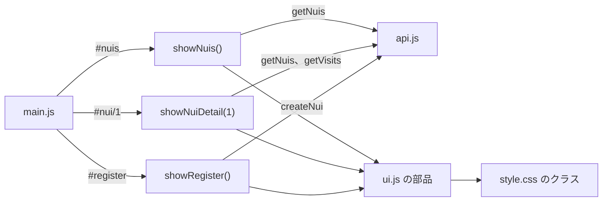

# フロントB：ぬいの画面と見た目

ぬいの一覧、思い出、登録の画面と、アプリ全体の見た目を受け持つ担当の説明書です。全体のつながりは [README.md](README.md) にあります。JavaScript に慣れていない人も読めるよう、基本の書き方から説明します。

## 目次

1. [この担当の役目](#1-この担当の役目)
2. [担当のファイル](#2-担当のファイル)
3. [先に知っておく書き方](#3-先に知っておく書き方)
4. [共通の部品](#4-共通の部品)
5. [ぬいの一覧](#5-ぬいの一覧)
6. [ぬいの思い出](#6-ぬいの思い出)
7. [ぬいの登録](#7-ぬいの登録)
8. [見た目](#8-見た目)
9. [ほかの担当とのつなぎ目](#9-ほかの担当とのつなぎ目)
10. [手を動かして確かめる](#10-手を動かして確かめる)
11. [変えるときの手順](#11-変えるときの手順)
12. [最初の指示書との違いと次に触れそうな所](#12-最初の指示書との違いと次に触れそうな所)
13. [説明できるかの確認](#13-説明できるかの確認)

## 1. この担当の役目

どの画面も次の順に動きます。

1. フロントAの `main.js` が URL の `#` を見て画面の関数を呼びます。
2. 画面の関数が `api.js` の関数で API からデータを取ります。
3. 取ったデータから HTML の要素を作り、画面に入れます。



怨念の計算はしません。API が返す `grudge` を表示します。

## 2. 担当のファイル

| ファイル | 内容 |
|---|---|
| [frontend/index.html](../../frontend/index.html) の `#nuis`、`#nui`、`#register` | 画面の枠。中身は JS が作る |
| [frontend/js/nuis.js](../../frontend/js/nuis.js) | ぬいの一覧と思い出 |
| [frontend/js/register.js](../../frontend/js/register.js) | ぬいの登録 |
| [frontend/js/ui.js](../../frontend/js/ui.js) | 共通の部品。フロントAと共有 |
| [frontend/css/style.css](../../frontend/css/style.css) | 全画面の見た目 |

`index.html` の枠には `<p data-pending>ここはフロントB の担当です…</p>` があります。分担して作っていたときの案内で、`hidePending` が隠します。

## 3. 先に知っておく書き方

### 要素を作って入れる

このアプリの画面はほとんどこの形で作っています。

```js
  const name = document.createElement('h3');
  name.className = 'nui-tile-name';
  name.textContent = nui.name; // textContent なら名前に記号があっても安全
```

| 書き方 | 意味 |
|---|---|
| `document.createElement('h3')` | `<h3>` を作る。まだ画面には出ない |
| `.className = '...'` | CSS のクラスを付ける |
| `.textContent = ...` | 文字を入れる。HTML として解釈しない |
| `.append(a, b)` | 中に入れる |
| `.replaceChildren(...)` | 中身を全部入れ替える。引数がなければ空にする |
| `.classList.toggle('x', 条件)` | 条件が真ならクラスを付け、偽なら外す |

`innerHTML` に利用者の入力を入れると、入力に書かれたタグが動いてしまいます。名前のように利用者が入れる文字は `textContent` で入れます。`innerHTML` を使っているのは、コードに書いた固定の SVG やフォームだけです。

### async と await

通信は時間がかかるので、結果を待つ書き方を使います。

```js
    const nuis = await getNuis();
```

`await` は結果が届くまで次の行に進みません。`await` を使う関数には `async` を付けます。

### try と catch

```text
try {
  // 失敗するかもしれない処理
} catch (error) {
  // 失敗したときの処理
}
```

`api.js` は API が失敗すると例外を投げます。画面は `catch` で受けて `error.message` を表示します。上は形を説明するための例です。

### 配列の書き方

| 書き方 | 意味 |
|---|---|
| `[...list]` | 配列の写しを作る。元の順番を変えないため |
| `.sort((a, b) => b.grudge - a.grudge)` | 大きい順に並べる |
| `.filter((v) => v.recommended)` | 条件に合うものだけ残す |
| `.find((n) => n.id === nuiId)` | 最初に合うものを返す |
| `Promise.all([x, y])` | 2つの通信を同時に待つ |
| `value ?? 0` | `value` が null か undefined なら0 |

## 4. 共通の部品

`ui.js` は複数の画面と AR で使います。データを受け取って要素を返すだけで、通信も計算もしません。

### 怨念の段階

```js
export function grudgeStage(grudge) {
  if (grudge <= 0) return { label: '鎮まった', key: 'calm', line: 'また連れてってね' }; // 0
  if (grudge <= 39) return { label: '弱い', key: 'weak', line: '…まあ、許してあげてもいい' }; // 1〜39
  if (grudge <= 69) return { label: '中くらい', key: 'medium', line: '最近ずっと置いていくよね' }; // 40〜69
  return { label: '強い', key: 'strong', line: 'ゆるさない…' }; // 70〜100
}
```

| 項目 | 使い道 |
|---|---|
| `label` | 札に出す文字 |
| `key` | CSS のクラス名。`is-calm`、`is-weak`、`is-medium`、`is-strong` |
| `line` | ぬいのセリフ。今のところ AR でしか表示していない |

JS は段階の名前だけを決め、色は CSS が決めます。色を変えるときは CSS だけ直せば済みます。

### 部品の一覧

| 関数 | 作るもの | 使う場所 |
|---|---|---|
| `clampGrudge(value)` | 0〜200の整数 | ほぼ全部 |
| `arLink(nui, grudge, className)` | AR のページへのリンク | 一覧、記録の結果 |
| `nuiFace(stageKey, className)` | 写真がないときの顔の SVG | `nuiAvatar`、空の案内、登録 |
| `nuiAvatar(nui, className)` | 丸い写真。写真がなければ顔 | ほぼ全部 |
| `stageChip(grudge)` | 「強い」などの札 | 一覧、思い出、地図 |
| `reasonList(reason, className)` | 推薦理由の箇条書き | 地図、詳細、記録 |
| `grudgeGauge(grudge, label, before)` | ゲージ | 一覧、思い出、地図、記録の結果 |
| `seal(text, recommended)` | 朱印 | 思い出、記録の結果 |
| `openPhoto(src, alt, caption)` | 写真を画面いっぱいに出す | 思い出 |

少し詳しく見ます。

- `clampGrudge(250)` は 200、`clampGrudge(-5)` は 0、`clampGrudge('abc')` は 0、`clampGrudge(49.6)` は 50 です。
- `FACES` は段階ごとの目と口の SVG です。強いほど目が据わり、額に線が出ます。
- `grudgeGauge` は `before` を渡すと、鎮まった分を斜線で残します（`.grudge-gauge-ghost`）。記録の結果画面で使います。
- `reasonList('a。b。', 'x')` は `<ul class="x"><li>a</li><li>b</li></ul>` を返します。
- `seal` の `recommended` が真なら朱色の `is-shu`、偽なら墨色の `is-sumi` です。

## 5. ぬいの一覧

`#nuis` を開くと `showNuis` が動きます。

```js
    const top = [...list].sort((a, b) => b.grudge - a.grudge)[0];
    container.appendChild(createHero(top));
```

一番怨念の強いぬいを上に大きく出します。

```js
    for (const nui of list) {
      grid.appendChild(createNuiTile(nui));
    }
    grid.appendChild(createAddTile());
```

タイルは API が返す順（登録の順）に全員分を並べ、最後に登録へのタイルを置きます。一番上のぬいはタイルにも出ます。

### 状態ごとの表示

| 状態 | 表示 |
|---|---|
| 読み込み中 | 読み込み中… |
| ぬいが0体 | 顔、「まだぬいが登録されていません。」、登録へのボタン |
| 失敗 | ぬいの一覧を読み込めませんでした：（理由） |
| 成功 | 一番上のカードとタイル |

### 関数ごとの説明

| 関数 | 内容 |
|---|---|
| `getContainer(section, className)` | 中身を入れる箱を用意する。あれば中身を空にする |
| `hidePending(section)` | 「フロントB の担当です」の案内を隠す |
| `createError(message)` | エラーの文を作る |
| `createEmpty(text, href, label)` | 顔、文、ボタンの案内を作る |
| `formatDate(value)` | `2026-11-01T15:20:00` を `2026/11/01` にする |
| `createHero(nui)` | 一番上のカードを作る |
| `createNuiTile(nui)` | ぬい1体のタイルを作る |
| `createAddTile()` | 登録へのタイルを作る |
| `showNuis()` | 一覧の画面を描く |

### 一番上のカード

```js
  hero.append(main, go, arLink(nui, grudge, 'button is-block'));
```

`createHero` は3つのリンクを持ちます。デモ用のデータではそれぞれ次の行き先でした。

| リンク | 行き先 |
|---|---|
| ぬいの写真と名前 | `#nui/2` |
| ふわまるを連れ出す場所を探す | `#map` |
| 憑依を見る | `ar/?nui=2&name=...&grudge=100` |

怨念が0なら、文は「どのぬいも鎮まっています」「連れ出す場所を探す」「鎮まった様子を見る」に変わります。

### クラスで段階を伝える

```js
  tile.className = `nui-tile is-${grudgeStage(grudge).key}`;
```

デモ用のデータのタイルは `nui-tile is-medium`（もちもち）、`nui-tile is-strong`（ふわまる）、`nui-tile is-weak`（こんぺいとう）になります。

## 6. ぬいの思い出

`#nui/1` を開くと、`main.js` が番号を渡して `showNuiDetail(1)` を呼びます。

```js
    const [nuis, visits] = await Promise.all([getNuis(), getVisits(nuiId)]);
    const nui = (Array.isArray(nuis) ? nuis : []).find((n) => n.id === nuiId);
```

ぬい1体を返す API はないので、一覧を取ってその中から探します。訪問と同時に取るので、待つ時間は短くて済みます。

| 関数 | 内容 |
|---|---|
| `createProfile(nui, visits)` | 写真、名前、怨念、ゲージ、数字、ボタン |
| `createMemory(visit)` | 訪問1件のカード |
| `showNuiDetail(id)` | 全体を描く |

### 数字の部分

```js
  const sealed = visits.filter((v) => v.recommended).length;
```

もちもちは「思い出 2件」「朱印 1個」「最後に連れ出した日 2026/09/22」のように出ます。朱印の数は推薦地点での記録の数です。

### 訪問のカード

| 条件 | 表示 |
|---|---|
| 推薦地点 | 朱色の「鎮」、`memory is-recommended`、「推薦された地点」 |
| それ以外 | 墨色の「記」、「推薦地点の外」 |
| 写真あり | 押すと `openPhoto` で大きく見られる |
| 写真なし | 「写真なし」の枠 |

### 番号がおかしいとき

| URL | 表示 |
|---|---|
| `#nui/abc` | ぬいの番号が正しくありません。一覧から選び直してください。 |
| `#nui/99`（API） | 思い出を読み込めませんでした：nui not found |
| `#nui/99`（仮の JSON） | このぬいは見つかりませんでした。 |

`#nui/99` で表示が違うのは、本物の API は `getVisits` が 404 で失敗して `catch` に入るからです。「見つかりませんでした」の分岐に進むのは仮の JSON のときです。

## 7. ぬいの登録

`showRegister` がフォームを1回だけ作ります。

```js
  let container = section.querySelector('.register-wrap');
  if (!container) {
```

一度作ったらそのまま使うので、別の画面に移って戻っても入力は残ります。

| 関数 | 内容 |
|---|---|
| `hidePending(section)` | 案内を隠す |
| `setError(form, message)` | エラーの文を出す。空文字なら消す |
| `showPreview(form)` | 選んだ写真を丸の中に出す |
| `submitForm(event, form)` | 送る処理 |
| `showRegister()` | 画面を用意する |

### フォームの名前と API

`FORM_HTML` の `name` は [api.md](../api.md) の `POST /nuis` と同じです。

```js
  const formData = new FormData(form);
```

`new FormData(form)` は `name` の付いた入力を全部集めます。そのため `name` を変えると API に届きません。

### 送る処理

`submitForm` は次の順に動きます。

1. `event.preventDefault()` でページの読み直しを止めます。
2. 名前と日付を確かめます。空なら「名前と「最後に連れ出した日」を入力してください。」と出して止めます。
3. 前後の空白を除いた名前を入れ直します。
4. 写真を選んでいなければ `photo` を消します。
5. ボタンを `disabled` にして、二重に送らないようにします。
6. `createNui` を呼びます。
7. 成功したらフォームを空にし、`location.hash = '#nuis'` で一覧へ移ります。
8. 失敗したら理由を出し、ボタンを戻します。

```js
  const photo = formData.get('photo');
  if (!(photo instanceof File) || photo.size === 0) {
    formData.delete('photo');
  }
```

写真を選ばなくても `FormData` には空のファイルが入るので、消しています。

### 今日より後を選べなくする

```js
    const today = new Date();
    today.setMinutes(today.getMinutes() - today.getTimezoneOffset());
    form.last_outing_date.max = today.toISOString().slice(0, 10);
```

`toISOString()` は世界標準時で日付を返すので、日本の朝9時前だと前の日になります。先に時差の分だけずらしてから文字にしています。

### 写真の仮の URL

```js
  if (previewUrl) URL.revokeObjectURL(previewUrl);
  previewUrl = file ? URL.createObjectURL(file) : null;
```

`createObjectURL` は端末のファイルを見せる仮の URL を作ります。使い終わったら `revokeObjectURL` で消して、メモリを空けます。

## 8. 見た目

`style.css` は1,184行です。コメントで章に分かれています。

| 章 | 内容 | 主に使う担当 |
|---|---|---|
| `:root` | 色、影、文字の変数 | 全部 |
| 画面の枠 | `.page`、`.top-bar`、`.error`、`.empty` | 全部 |
| ボタン | `.button` とその種類 | 全部 |
| ぬいの顔、写真、怨念 | `.avatar`、`.stage-chip`、`.grudge-gauge`、`.seal` | 全部 |
| 地図 | ピン、シート、カード、詳細 | フロントA |
| 訪問の記録 | 選択、写真の枠、結果 | フロントA |
| ぬいの一覧 | `.nui-hero`、`.nui-tile` | フロントB |
| ぬいの思い出 | `.profile`、`.stats`、`.memory`、`.photo-viewer` | フロントB |
| ぬいの登録 | `.avatar-pick` | フロントB |
| 下のメニュー | `.navbar` | 全部 |
| 広い画面 | `@media` | 全部 |

### 色の変数

```css
  --primary: #6A4BF0;
  --shu: #E0483A;
```

色は `:root` に変数として置き、`var(--primary)` で使います。色を変えるときはまずここを直します。

| 変数 | 使い道 |
|---|---|
| `--bg`、`--surface` | 背景とカードの地 |
| `--ink`、`--ink-soft`、`--ink-faint` | 文字の濃さ3段階 |
| `--primary` | 紫。主なボタンと選択 |
| `--shu` | 朱色。推薦地点と記録 |
| `--stage-*` | 段階の濃い色（ゲージ、縁） |
| `--tint-*` | 段階の薄い色（背景） |

### 段階の色の付け方

`ui.js` が `is-strong` などのクラスを付け、CSS が色を決めます。

```css
.avatar.is-strong { --ring: var(--stage-strong); background-color: var(--tint-strong); }
```

```css
  box-shadow: 0 0 0 3px var(--surface), 0 0 0 6px var(--ring, var(--line));
```

`.avatar` の縁は変数 `--ring` の色です。クラスごとに `--ring` だけを変えています。`var(--ring, var(--line))` の2つ目は、`--ring` がないときの色です。

### ボタン

```css
  box-shadow: inset 0 0 0 2px var(--line), 0 3px 0 var(--line);
```

下に影の段を付け、押すと `transform: translateY(2px)` で沈みます。

| クラス | 見た目 |
|---|---|
| `.button` | 白 |
| `.is-primary` | 紫 |
| `.is-shu` | 朱色。記録するボタン |
| `.is-small` | 小さい |
| `.is-block` | 横いっぱい |

### 朱印のアニメーション

```css
.seal.is-stamped { animation: stamp 0.5s cubic-bezier(0.2, 1.4, 0.4, 1) 0.15s both; }
```

大きく透明な状態から縮んで現れ、押した様子を見せます。`both` は始まる前と終わった後も最初と最後の状態を保つ指定です。`visit.js` の数字はこの朱印の終わるころに下がり始めます。

### 画面の幅

| 幅 | 変わるもの |
|---|---|
| 640px 以上 | ぬいと思い出のタイルが3列になる |
| 900px 以上 | シートが左のパネルになり、カードが縦に並び、メニューが右下に浮く |

900px は `map.js` の `WIDE` と同じ値にしてください。JS も同じ幅で動きを変えています。

### そのほかの決まり

| 書き方 | 意味 |
|---|---|
| `[hidden] { display: none !important; }` | `hidden` 属性を必ず効かせる。`img { display: block; }` のほうが強いため |
| `.hidden` | `index.html` にある、隠すためのクラス |
| `.visually-hidden` | 見えないが、読み上げやキーボードでは使える。写真の入力に使う |
| `:focus-visible` | キーボードで選んだ所に枠を出す |
| `env(safe-area-inset-bottom)` | スマホの下の余白を空ける |
| `prefers-reduced-motion` | 動きを減らす設定の端末ではアニメーションを止める |

## 9. ほかの担当とのつなぎ目

| 相手 | つなぎ目 | 注意 |
|---|---|---|
| フロントA | `main.js` が `showNuis`、`showNuiDetail`、`showRegister` を呼ぶ | 名前を変えると `data-pending` の文が出る |
| フロントA | `api.js` の関数 | `api.js` は書き換えず、相談する |
| フロントA | `map.js`、`visit.js` が `ui.js` と `style.css` を使う | 部品やクラスを変えたら地図と記録も確かめる |
| AR | `ar/` が `ui.js` の `grudgeStage`、`clampGrudge` を読む | AR の `style.css` は別のファイル |
| バックエンドB | API の項目名 | [api.md](../api.md) を見る |
| バックエンドB | `#nui/99` の 404 | `detail` の文がそのまま出る |

## 10. 手を動かして確かめる

サーバーを動かして `http://localhost:8000/` を開き、F12 で開発者ツールを開きます。Console に次を打ちます。

### 段階を確かめる

```text
const ui = await import('/js/ui.js');
[0, 1, 39, 40, 69, 70, 100].map((g) => ui.grudgeStage(g).label)
```

`['鎮まった', '弱い', '弱い', '中くらい', '中くらい', '強い', '強い']` が返ります。

### 部品を画面に足す

```text
document.querySelector('#nuis .page').append(ui.grudgeGauge(30, '試し', 80));
```

`#nuis` を開いた状態で打つと、一番下に斜線つきのゲージが出ます。もう一度その画面を開くと消えません。再読み込みしてください。

### 色を変える

```text
document.documentElement.style.setProperty('--primary', '#0A7');
```

紫のボタンが緑に変わります。再読み込みすると戻るので、色を試すのに使えます。

### 入力の確かめを試す

「登録」の画面で何も入れずに「登録する」を押すと、「名前と「最後に連れ出した日」を入力してください。」と出ます。日付の入力では今日より後を選べません。

### 通信を見る

F12 の Network を開き、「ぬい」の画面を開くと `nuis` の通信が出ます。Response で API の値を見てください。思い出を開くと `nuis` と `visits` の2つが出ます。

### 仮の JSON で動かす

[frontend-a.md](frontend-a.md) の手順で `USE_MOCK` を `true` にすると、サーバーなしで画面を作れます。

## 11. 変えるときの手順

| やりたいこと | 直す場所 | 確かめること |
|---|---|---|
| アプリの色 | `style.css` の `:root` | 地図と記録の画面も |
| 段階の色 | `style.css` の `--stage-*`、`--tint-*` | 札、ゲージ、縁 |
| 段階の境目 | `ui.js` の `grudgeStage` | `docs/design.md`、AR の見え方 |
| セリフ | `ui.js` の `grudgeStage` | AR の吹き出しに収まるか |
| タイルの項目 | `nuis.js` の `createNuiTile` | 広い画面でも |
| 思い出のカード | `nuis.js` の `createMemory` | 写真のない記録も |
| 登録の項目 | `register.js` の `FORM_HTML` | `docs/api.md` と `main.py` にも必要 |

見た目を変えたら、スマホの幅（375px）と PC の幅の両方で確かめます。F12 の左上のスマホのアイコンで幅を変えられます。

## 12. 最初の指示書との違いと次に触れそうな所

[docs/tasks/frontend-nui.md](../tasks/frontend-nui.md) と今の実装には次の違いがあります。

| 指示書 | 今の実装 |
|---|---|
| API はまだできていないので仮の JSON で作る | API は動いている。`USE_MOCK` は `false` |
| 暗めの色（紫や青）を基本にする | 明るい紫の地で、朱色を組み合わせている |
| カードを並べる | 一番怨念の強いぬいのカードとタイルに分けた |
| カードにセリフを出す（should） | 一覧と思い出には出ていない。AR だけ |

次に触れそうな所は次のとおりです。

- 一覧や思い出にセリフを出す。`grudgeStage(grudge).line` で取れます。
- `hidePending` と `index.html` の `data-pending` の整理。
- 一番上のカード以外のぬいからも AR を開けるようにする。今は一番怨念の強いぬいと記録の結果からだけ開けます。`arLink` を使えば足せます。

## 13. 説明できるかの確認

<details>
<summary>段階の色はどこで決まりますか</summary>

`ui.js` が `is-strong` などのクラスを決め、`style.css` がクラスごとの色を決めます。
</details>

<details>
<summary>ぬいの名前に HTML のタグを入れるとどうなりますか</summary>

文字としてそのまま表示されます。`textContent` で入れているからです。
</details>

<details>
<summary>写真を登録しないとどうなりますか</summary>

`photo_url` が null で返り、`nuiAvatar` が怨念の段階に合わせた顔の SVG を出します。
</details>

<details>
<summary>一覧の並びはどう決まりますか</summary>

タイルは登録の順です。一番上のカードだけ、怨念の一番強いぬいを選びます。
</details>

<details>
<summary>登録したのに一覧に出ません。何を確かめますか</summary>

F12 の Network で `POST /nuis` の状態コードを見ます。`USE_MOCK` が `true` だと記録が残らないので、それも確かめます。
</details>

<details>
<summary>怨念の数字はどこで計算していますか</summary>

サーバーの `grudge.py` です。画面は API の値を表示するだけです。
</details>
